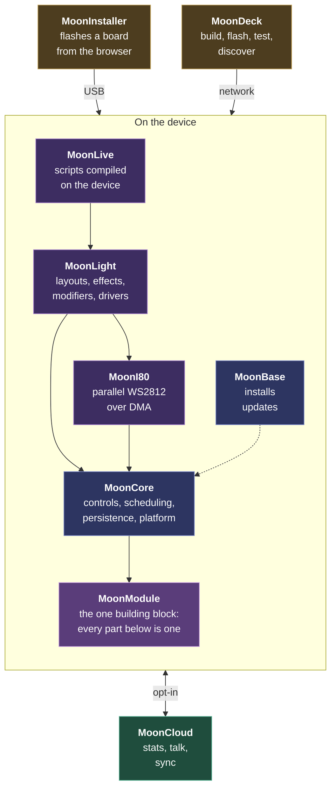

# MoonLight

Drive large LED installations and DMX fixtures. One source tree drives ESP32, Teensy, Raspberry Pi, macOS, Windows and Linux.


**Flash an ESP32 from your browser and see lights in under a minute:** open the [web installer](https://moonmodules.org/MoonLight/install/) in Chrome or Edge, plug in your device, and follow it. No toolchain, no recompile. The [Getting started guide](docs/gettingstarted.md) takes you from a blank board to a running light show.

No hardware handy? The [desktop build](https://github.com/MoonModules/MoonLight/releases/latest) runs the same UI and effect pipeline on macOS, Windows and Linux, driving fixtures over Art-Net, DDP or E1.31.

If you like MoonLight, give it a star, fork it, or open an issue. It helps the project get noticed.

## What you get

🎨 **Plug in, open a browser, see lights.** A live 3D preview of every effect, modifier and layout, controllable from the same tab. The interface renders any module from its declared controls.

🎛️ **A pipeline you build visually**: layouts, then layers of effects and modifiers, then drivers. Every change applies on the next frame, and settings persist across power cycles. Editing a pin map, a strand length or an output protocol on a running device needs no reboot.

🔵 **Large installations on a classic ESP32 too**, not only on an S3 or P4. Memory adapts to the size of the installation, degrading rather than crashing on tight devices.

🧊 **Native 3D throughout**: 2D and 1D are the cases where a dimension is size 1, so an effect never picks a mode.

💡 **DMX and addressable LEDs together**: RGB strips, RGBW pixels, par lights and moving heads through one pipeline.

🌐 **Industry protocols both ways**: send and receive [Art-Net](https://art-net.org.uk/), [E1.31/sACN](https://tsp.esta.org/tsp/documents/docs/ANSI_E1-31-2018.pdf) and [DDP](http://www.3waylabs.com/ddp/), interoperable with Falcon, Advatek, xLights, Resolume and LedFx.

🔌 **Parallel WS2812 output** over three ESP32 peripherals: RMT on every chip, the S3's LCD_CAM i80 bus, and the P4's Parlio engine, each with an on-device loopback test that bit-verifies the wire signal.

🎵 **Audio-reactive**: an I²S microphone drives a 16-band FFT spectrum and sound level.

🏠 **Home automation**: a device joins Homebridge and any MQTT hub for on/off, brightness and color. See [the MQTT module](https://moonmodules.org/MoonLight/moonmodules/core/system.html#mqtt).

📁 **On-device file manager**: browse and edit the device filesystem from the browser, with drag-drop upload and [firmware update over the LAN](https://moonmodules.org/MoonLight/moonmodules/core/system.html#firmware-update).

🛡️ **Robust to any input**: add, delete, replace or reconfigure any module in any order, at any grid size, and the device keeps running. Every crash found becomes a regression test.

Written against ESP-IDF directly with no third-party libraries, and with our own code rather than a fork: [why we write our own code](docs/explanation/why-we-write-our-own.md). How it is put together: [the architecture](docs/explanation/architecture/index.md).

## The parts

MoonLight is one system in nine named parts. Each has a page that owns its detail.



### MoonModule

The one building block, and the idea the rest of the system is built on. Every effect, modifier, layout, driver and service is a MoonModule: the same base class, the same lifecycle, and controls the module declares itself.

That uniformity pays three times over. The interface renders any module from its declared controls, so a new module needs no UI code. Persistence, live reconfiguration and the REST API work on a module they have never seen. And adding a capability is a new file rather than a new framework, which is why the catalog grows without the core growing with it.


Architecture: [MoonModule](docs/explanation/architecture/moonmodule.md) · Use it: [core modules](docs/moonmodules/core/) · [light modules](docs/moonmodules/light/)

### MoonCore

The domain-neutral runtime: the module base class, controls, scheduling, persistence, and the platform abstraction. It knows nothing about lights, which is what lets the light domain stay simple on top of it. Everything in the system is a **MoonModule** with the same lifecycle and declared controls, and that uniformity is why the interface renders any module with no per-module code.


Architecture: [MoonCore](docs/explanation/architecture/mooncore.md) · [MoonModule](docs/explanation/architecture/moonmodule.md) · Use it: [System](https://moonmodules.org/MoonLight/moonmodules/core/system.html) · [Control](https://moonmodules.org/MoonLight/moonmodules/core/system.html#control) · [Services](https://moonmodules.org/MoonLight/moonmodules/core/services.html)

### MoonLight

The light domain, and the bigger half of the code: light values, layouts, layers, mapping, blending, effects, modifiers and LED drivers. This is what you build a light show from, stacking a layout, then layers of effects and modifiers, then a driver.


Architecture: [MoonLight](docs/explanation/architecture/moonlight.md) · Use it: [Effects](https://moonmodules.org/MoonLight/moonmodules/light/effects.html) · [Layouts](https://moonmodules.org/MoonLight/moonmodules/light/layouts.html) · [Modifiers](https://moonmodules.org/MoonLight/moonmodules/light/modifiers.html) · [Drivers](https://moonmodules.org/MoonLight/moonmodules/light/drivers.html)

### MoonLive

Scripts compiled to native machine code on the device. Write an effect in the browser, and it runs at the speed of compiled code rather than an interpreter, on ESP32 and on the desktop alike.


Architecture: [MoonLive](docs/explanation/architecture/moonlive.md) · Use it: [MoonLiveEffect](https://moonmodules.org/MoonLight/moonmodules/light/moonlive.html) · [the script language](moonlive/README.md)

### MoonI80

Our own DMA driver for parallel WS2812 output, one of the backends [ParallelLedDriver](https://moonmodules.org/MoonLight/moonmodules/light/drivers.html#parallelled) selects. It adds a streaming ring and 74HCT595 expander support, which is what drives 12,288 lights from a single board.

Architecture: [MoonLight drivers](docs/explanation/architecture/moonlight.md#drivers) · Use it: [LED drivers](https://moonmodules.org/MoonLight/moonmodules/light/drivers.html#parallelled)

### MoonBase

A small maintenance image in the factory slot that installs updates into one large app slot, instead of spending half the flash on a second copy of the firmware. A power cut mid-update lands back in MoonBase rather than a half-written app.

Architecture: [MoonBase](docs/explanation/architecture/moonbase.md) · Use it: [System modules](https://moonmodules.org/MoonLight/moonmodules/core/system.html)

### MoonCloud

The opt-in server side, and the only server a device talks to. [Stats](docs/explanation/mooncloud.md#stats) reports what people run so development follows real use, [Talk](docs/explanation/mooncloud.md#talk) is a public message board between devices, and [Sync](docs/explanation/mooncloud.md#sync-planned) is planned.

Architecture: [MoonCloud](docs/explanation/architecture/mooncloud.md) · Use it: [MoonCloud](docs/explanation/mooncloud.md) · [privacy policy](docs/legal/privacy-policy.md)

### MoonInstaller

The browser installer: it picks your device, flashes the matching firmware, and hands the device your WiFi credentials over USB. No serial monitor, no recompile.


Architecture: [MoonInstaller](docs/explanation/architecture/mooninstaller.md) · Use it: [Web installer](https://moonmodules.org/MoonLight/install/) · [Getting started](docs/gettingstarted.md) · [source](mooninstaller/README.md)

### MoonDeck

The developer console: one page that builds, flashes, runs, tests and monitors across every target, and discovers devices on the network.


Architecture: [MoonDeck](docs/explanation/architecture/moondeck.md) · Use it: [MoonDeck](moondeck/MoonDeck.md) · [Build processes](docs/moonwalk.md#desktop-build-test)

## Performance

A full render pipeline (effect, modifier, Art-Net output) on real hardware, at 128x128:

| Device | Lights | FPS |
|---|---:|---:|
| Desktop | 16,384 | 9,708 |
| Olimex `esp32` | 16,384 | 11 |
| LOLIN S3 N16R8 | 16,384 | 6 |

Smaller grids run far faster: a classic ESP32 holds over 1,500 FPS at 16x16 and 81 FPS at 64x64. Pick an Ethernet device when frame rate matters, and an S3 when you need PSRAM headroom for large buffers.

Per-grid and per-device tables, free-heap figures, and why WiFi costs what it does: [performance.md](docs/reference/performance.md). The contracts CI enforces on every run live in [`test/scenarios/*.json`](test/scenarios/).

## Getting started

**ESP32**: open the [web installer](https://moonmodules.org/MoonLight/install/) in Chrome or Edge ([MoonInstaller](#mooninstaller)). It walks you through device, firmware, flashing and network setup.

**Desktop**: download your build from the [releases page](https://github.com/MoonModules/MoonLight/releases), then open `http://localhost:8080/`. Step by step with screenshots: [Install MoonLight](https://moonmodules.org/MoonLight/moonwalk.html#install), with your platform picked.

- **macOS arm64**: `.dmg`, drag to Applications. Ad-hoc signed, so right-click and Open the first time.
- **Windows x64**: `-setup.exe` installs for your user without an admin prompt. Unsigned, so SmartScreen asks once.
- **Linux x64 and arm64**: `.tar.gz`, or `.deb` on Debian, Ubuntu and Raspberry Pi OS. The arm64 build covers a Raspberry Pi, a NanoPi and most 64-bit boards.

**From source**: you need [uv](https://docs.astral.sh/uv/), CMake 3.20+ and a C++20 compiler, plus ESP-IDF v6.x for ESP32. Then launch [MoonDeck](#moondeck):

```sh
uv run moondeck/moondeck.py
```

Open `http://localhost:8420` to build, run, test, flash and discover devices. Full setup and every target: [the build processes](docs/moonwalk.md#build-setup).

## Documentation

| Document | What's in it |
|----------|--------------|
| [Getting started](docs/gettingstarted.md) | Blank board to running light show |
| [the architecture](docs/explanation/architecture/index.md) | How the system is put together |
| [MoonWalk](docs/moonwalk.md#build-setup) | Build and flash for every target, step by step |
| [moonmodules/](docs/moonmodules/) | One page per module: [core](docs/moonmodules/core/) and [light](docs/moonmodules/light/) |
| [performance.md](docs/reference/performance.md) | Timing and memory per platform |
| [testing.md](docs/reference/testing.md) | What the tests cover |
| [coding-standards.md](docs/contributing/coding-standards.md) | How code here is written |
| [documentation-standards.md](docs/contributing/documentation-standards.md) | How docs here are written |
| [CLAUDE.md](CLAUDE.md) | Rules, constraints, and the process |

## How we work

MoonLight is built by AI agents under tight human direction. Everything in this repository is authored by agents; the **product owner** writes none of it directly. What the product owner authors is the [process](CLAUDE.md), the [architecture](docs/explanation/architecture/index.md), and the [module specifications](docs/moonmodules/), then decides what to build, reviews every line, runs the hardware tests, and controls every commit and release. Agents write; the product owner thinks.

The roles, the principles and the full process: [CLAUDE.md](CLAUDE.md).

## History

This is the current iteration of years of LED and light-system development, and each prior project proved ideas this one builds on:

| Project | Description | Repo |
|---------|-------------|------|
| **WLED** | Open-source LED firmware (user and contributor since 2021) | [Aircoookie/WLED](https://github.com/Aircoookie/WLED) |
| **WLED-MoonModules** | WLED fork with advanced features | [MoonModules/WLED](https://github.com/MoonModules/WLED) |
| **StarLight** | Standalone LED firmware | [ewowi/StarLight](https://github.com/ewowi/StarLight) |
| **MoonLight** | Ground-up build: 60+ effects, memory-optimized mapping, 11 driver types | [ewowi/MoonLight](https://github.com/ewowi/MoonLight) |

We built and maintained these, so MoonLight rests on our own hands-on experience. Their lessons are distilled in [`docs/work/past/`](docs/work/past/index.md). We carry the ideas forward and write our own code, crediting by name whoever inspired a feature.

## Credits

The people, projects and published algorithms whose work shaped MoonLight, each with what it shaped and the modules that name it, are on the [Attributions](docs/reference/attributions.md) page.

## Contributing

MoonLight is a community project, shaped by the people who use it:

- **Ideas and requests**: an effect, a layout, a driver, a fixture you want supported? [Open an issue](https://github.com/MoonModules/MoonLight/issues).
- **Help build it**: pick something from the [issues](https://github.com/MoonModules/MoonLight/issues), or propose a module. The process is in [CLAUDE.md](CLAUDE.md).
- **Test on hardware**: run it on your panels and fixtures, and report what works.
- **Talk to us**: [Discord](https://discord.gg/TC8NSUSCdV), [Reddit](https://reddit.com/r/moonmodules), [YouTube](https://www.youtube.com/@MoonModulesLighting), [GitHub](https://github.com/MoonModules), or [leave a message](https://tally.so/r/68X5xO).

## License

See [LICENSE](LICENSE): GPL-3.0. MoonLight is provided as is, without warranty: like any software it has bugs, and you use it at your own risk.
