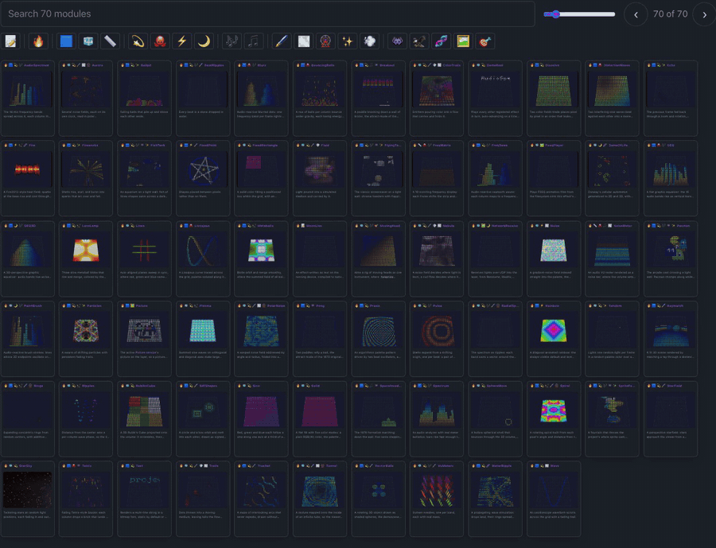

# MoonLight

Drive large LED installations and DMX fixtures. One source tree drives ESP32, Teensy, Raspberry Pi, macOS, Windows and Linux.

**Start on whatever device you have.** The [web installer](https://moonmodules.org/MoonLight/install/) flashes an ESP32 from Chrome or Edge in under a minute. A Teensy takes it too, the [desktop build](https://github.com/MoonModules/MoonLight/releases/latest) runs on Windows, Linux and macOS, and a container runs it anywhere. Every device runs the same interface and light pipeline, and several work together as one installation, driving LEDs and DMX fixtures over Art-Net, DDP and E1.31. [Install MoonLight](docs/moonwalk.md#install) covers each platform step by step, and [Show an effect on your lights](docs/moonwalk.md#first-light-show) takes it from there.

## Find your way

- **[Getting started](docs/getting-started.md)**: an ESP32 from the web installer, the desktop build, or the source with MoonDeck.
- **[How it works for you](docs/getting-started.md#how-it-works-for-you)**: live changes, help and MoonWalk on the device, the tests, privacy, and [how we build it](docs/getting-started.md#how-we-build-it).
- **[The documentation site](https://moonmodules.org/MoonLight/)**: every effect, modifier, layout and driver, the processes in [MoonWalk](docs/moonwalk.md), every test, and [the architecture](docs/explanation/architecture/index.md) with its parts.
- **[Performance](docs/reference/performance.md)**: frame rates per device and grid size.
- **[Where it comes from](docs/explanation/why-we-write-our-own.md#where-it-comes-from)** and **[who it learned from](docs/reference/attributions.md)**.

If you like MoonLight, give it a star, fork it, or open an issue. It helps the project get noticed.

## How we work

MoonLight is built by AI agents under tight human direction. The product owner authors the [process](CLAUDE.md), the [architecture](docs/explanation/architecture/index.md) and the [module specifications](https://moonmodules.org/MoonLight/moonmodules/light/effects.html). They decide what to build, review every line, test on hardware and control every commit and release. Agents write; the product owner thinks.

## Contributing

Ideas, code, hardware tests and conversation are all welcome: [how to take part](docs/contributing/index.md).

## License

See [LICENSE](LICENSE): GPL-3.0. MoonLight is provided as is, without warranty: like any software it has bugs, and you use it at your own risk.
