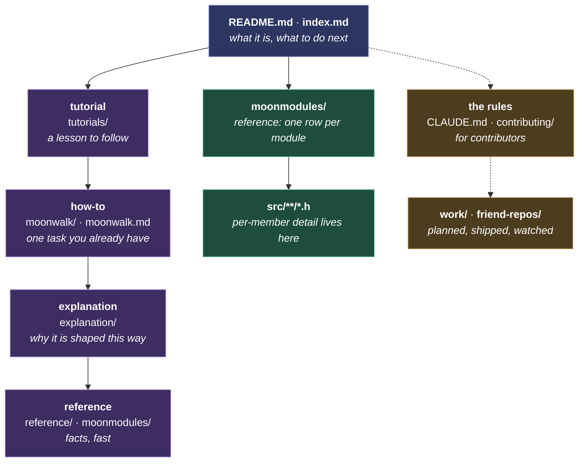
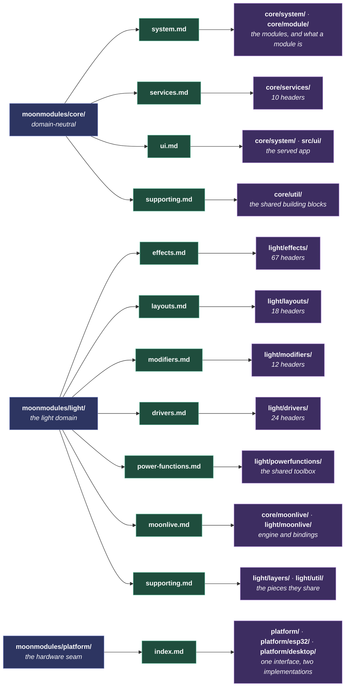

# Documentation standards

How the project writes prose: docs, comments, and the pages generated from them. For developers, the people who write those. Code rules are in [coding-standards.md](coding-standards.md). The two meet at `///` comments, which are code by location and documentation by purpose: their rules, syntax and content alike, are on this page.

Every rule has one home. Another document links here rather than restating, because two copies become two different rules. A [MoonWalk](../moonwalk.md) step that applies a rule links it: the author applies it at that step, and a reviewer checks the work against the same steps.

It starts with the four kinds of page and which one each of ours is. Then how a page is written, then the two pages every module has. It ends with comments: the smallest scale, and the one place code and prose meet.

## The hierarchy

A reader enters at the top and stops as soon as they have enough. A writer puts a fact at the shallowest level that fully owns it, and links to it from every level above. Purple is the four [Diátaxis](https://diataxis.fr/) types, green is written once in the source, and gold sits outside the grid.



Each level says what a thing is and links down for the rest. A fact stated above its home is a second copy that drifts.

### Zooming in on the green boxes

The green levels above are one domain, one summary page, one group of headers. A reader drills down: pick the domain, pick the page whose subject matches the question, follow a card's Source link into the header. A writer walks the same path in reverse, and a documentation sweep follows it page by page, which is how progress is tracked.



A page owns one subject, so a header belongs to the page whose subject it serves rather than to the folder it sits in. `MoonLiveEffect.h` is carded on `effects.md` beside the compiled effects. The pieces several pages share, such as `Layer`, `Buffer` and `MappingLUT`, are carded once on `supporting.md`.

The README is the strictest case. It is the page most often written as if it were the only one. It names a capability and links to the page that owns it, so a paragraph of detail there sits in the wrong place.

## What we document

Document a thing once, in the place closest to it, and link the rest. A fact the source states is never re-typed in prose, so the question "where does this belong?" has one answer, and so does "where do I find it?"

Every page serves one of four reader needs, and only one. This is [Diátaxis](https://diataxis.fr/), followed as written: the four come from two questions, whether the reader is **learning** or **working**, and whether they want to **do** something or **understand** it.

| | Doing | Understanding |
|---|---|---|
| **Learning** | **Tutorial**: a lesson to follow. `tutorials/`, and MoonTube's clips. | **Explanation**: why it is shaped this way. `explanation/`. |
| **Working** | **How-to**: one task you already have. A [MoonWalk](../moonwalk.md) process, `moonwalk/*.yaml`. | **Reference**: facts, fast. `reference/`, the catalog rows, the headers. |

**The folder is the type.** A page's path says which cell it sits in, and a how-to is a process in `moonwalk/` rather than a page. So `reference/installing-on-linux.md` holds facts by location, and its steps are the [Prepare a Linux board](../moonwalk.md#prepare-linux-board) process. The nav labels stay reader-facing ("Understanding MoonLight" over "Explanation"), because the type is a writer's tool.

The test for any page is the cell it sits in. A tutorial that stops to explain, or a reference that starts to teach, is two pages: move the other half to where it belongs.

Two kinds of page sit outside the grid on purpose. **The rules**, [coding-standards.md](coding-standards.md) and this page in `contributing/` and [CLAUDE.md](../../CLAUDE.md) at the repo root, are for contributors and bind every change. `legal/` sits outside it too. **Work not yet in the code** lives under `docs/work/`, and nothing there describes the system as it is. `future` is what does not exist, `present` is being built and moves to `past` at its PR, `past` is what shipped.

Two scales below a page. **A module** has one reference card and one header (see [Module pages](#module-pages)); **a line of code** carries its own reason in a comment (see [Comments](#comments)).

**The split that decides everything else.** A hand-written page says what the code cannot; the header is the code's own documentation. So a fact about behavior belongs in the `.h`, beside the code. A fact about intent, cost or sequence has no member to sit on, and is written.

**A shipped plan is a working document, not testimony.** It may be edited, trimmed, or deleted: whatever its PR already carries is duplication. Only a dated record stating what was true at a moment (release notes, an inventory quoted from another project) is kept unrewritten.

## Writing

- **A page is read start to finish by one reader**, a **user** or a **developer**. A user brings no coding and no hardware knowledge beyond plugging in a board; a developer brings C++, embedded and this codebase's shape. Where a page serves both, lead with the user and put the depth lower down.
- **The headings are the page's table of contents, and they read top to bottom.** A few lines say what the page is and one paragraph says how it is laid out. The sections then follow in the order a reader needs them. A title that makes sense only after reading the body is the order being wrong.
- **One tone of voice, everywhere: factual, no nonsense.** State what is true and what to do, addressing the reader as "you". Leave out enthusiasm, apology, and how we felt building it. Only the assumed knowledge changes between pages, never the voice.
- **No sentence whose job is tone.** Every sentence carries a fact the reader needs. Three shapes to cut: a second person used for effect rather than instruction, a flourish before any information arrives, and a rhetorical question the page then answers. Vale checks spelling, sentence length and weasel words, so this one is the writer's judgement and the reviewer's check.
- **Follow the [principles](../CLAUDE.md#principles).** Three bear on documentation directly:
    - **Minimalism**: every fact has one home; history lives in git.
        - **Present tense only.** "No X anymore" narrates a removal, which is history. Describe the path that exists. Vale flags the words that date a sentence ("today", "currently", "no longer", "not yet").
        - **Positive form only.** "Not", "never", "neither", "without", "un-" and "non-" are the alarm bells: a negation says everything a thing is not, which is no shape at all. A real constraint stays ("the DMA cannot read PSRAM at shift clock"); a bare absence goes.
    - **Textbook names**: the name the textbook, standard or design guide gives a thing, so a reader recognizes it without being taught our vocabulary. A bespoke choice carries its one-line reason where it appears.
    - **Continuous improvement**: a doc describing what the code no longer does is a defect. Fix it in the change that opened the file, not in a sweep.
- **A page links down to detail, it does not absorb it.** Each level says what a thing is and sends the reader to the level that owns the detail. A fact stated above its home is a second copy that drifts. The test: if removing a paragraph costs nothing but a link, it was never this page's to hold. The ladder is in [The hierarchy](#the-hierarchy).
- **A list holds one kind of thing, most important first.** The heading rule, one level down: what a reader reaches for most often leads. A list mixing categories is really two lists.
- **A rule states a test.** Something a reader can hold a page against and get a yes or no. How the rule came to be broken is history, and goes in the commit that fixed it.
- **Say it, then stop: about 30 words.** One or two sentences a reader can act on, and a reason only when the point is surprising or has been got wrong before. Past that a reader skims, and a skimmed statement is not followed.
- **Write for the reader who will follow it**, not the one arguing with it. A trap that only bites whoever maintains the tooling belongs in the tooling.
- **Ask, do not argue.** A request states what you want and why, then stops. Quoting the other side's code back to them and pre-empting every objection is pressure, and earns a reply shorter than the message. Ask the one question that decides the rest.
- **A sentence is one thought.** Past thirty words it is two, joined by a comma or a colon that a full stop should have been. Instructions in particular: one step, one sentence, and the reader's eyes never lose the line.
- **The text never refers to itself.** "This page", "this recipe", "as described above", "in the following section": each one is the author stepping in front of the content. Say the thing; the reader knows where they are.
- **A diagram beats the paragraph that describes it.** Draw a structure, a flow or a hierarchy as a [Mermaid](https://mermaid.js.org/) diagram: it renders on the site and on GitHub, and it diffs as text. A screenshot does the same where the point is what a reader sees. Both follow the example rule: they replace prose rather than decorate it.
- **One example, only where the prose alone would be misread.** A code block earns its place by preventing a wrong reading; a second example is the author enjoying the subject.
- **A link's text says what it reaches.** "See the hot path rule" tells the reader whether to follow it; "see here" does not, and a bare filename only if the filename is the point.
- **A module is linked by its catalog card**, which links its header in turn. A link to the code itself, a line or a symbol, goes to the header.
- **One parenthetical per sentence.** A second qualification means the sentence carries two ideas: split it, or drop the weaker one.
- **Mechanism lives with the mechanism.** How a generator or script works belongs in that script. A page says what the reader must do.
- **American English spelling, everywhere**: identifiers, wire keys, comments, docs, UI strings. A grep for one dialect silently misses the other, and a drifting wire key breaks a contract with no compile error. A proper noun keeps its own spelling.
- **No em-dashes in prose.** Use a comma, colon, parentheses, or a full stop. A literal one in a UI string or test fixture stays.
- **No hard line wraps in markdown.** Let the editor soft-wrap, so a one-word edit is a one-word diff.
- **Convert as you touch.** Spelling and em-dash fixes ride the change that opens the file; a repo-wide sweep is a change of its own, reviewed as one. `check_prose.py` checks added lines only, for the same reason.

### The words for hardware

One word per thing, so a reader never wonders whether two words mean two things.

| word | what it is | example |
|---|---|---|
| **device** | one unit running MoonLight: its board plus everything that makes it usable, such as an enclosure, power input, terminals and level shifters; it has a `deviceName` and a `deviceModel` | a QuinLED Dig-2-Go on a shelf, the StadBeest's legs (`MM-StadBeest`) |
| **deviceModel** | the product a device is one of, which the catalog describes and the installer sets up | `QuinLED Dig-Next-2`, `LightCrafter 16`, `MIDI bridge` |
| **board** | the bare PCB, as in on-board LED and on-board peripherals | the ESP32-S3 DevKit |
| **firmware** | the compiled binary for one chip | `esp32s3-n16r8` |
| **desk** | a hardware controller of faders, knobs and pads, which drives a device's control surface | the iCON QCon Pro G2 |
| **installation** | several devices acting as one piece | the StadBeest: legs, two eyes and a MIDI bridge |

A unit is a device even when it is one bare board: "the bridge device", "the device the desk drives".

## Module pages

### Two surfaces per module

1. **A catalog card**, for the end user. One card in its group's deck, drawn from the module's help: its picture, name and line on the face, its help and controls on the back.
2. **The header**, for the developer. Its `///` comments are the technical reference, read in the repo or on GitHub.

`docs/moonmodules/` mirrors `src/`: a `core/` and a `light/` subtree, one flat page per group. The tree is `<core|light>/<type>/Module`, flat within a type, and **library is a tag, not a folder level**. In code and assets it rides in `tags()` and in docs in the page name, so `effects.md` splits to `effects_<library>.md` only when a section outgrows it. A blended-lineage module then needs no file move, and a mis-filing is a one-line edit. The tests have their own registry, [`gen_tests.py`](../../moondeck/docs/gen_tests.py), because unit tests are macros and scenarios are JSON.

**Reference a module generically** outside its own home: say "a modifier", not `FooModifier`. A module's home is its `.h`, its catalog card, its registration, and its tests. Naming it elsewhere multiplies rename cost.

**No per-module detail page.** Cross-file rationale that no single `.h` owns goes in a prose section under its group's summary page. Rationale shared by sibling modules lives once on their base class.

### The card

A catalog page is generated from `docs/help/help.json` under its name. Its intro is the class comment of the base `gen_help`'s `CATALOGS` names, or the page's own markdown where it keeps one. A deck with a card per module follows, then each module's `@guide` as its details section. Under the deck the build writes each module as plain markdown, which search indexes and a reader without JavaScript reads, and the deck script replaces it. The header is the one place a module is described.

Every card leads with its `@card` picture: `.gif` on effects, modifiers and layouts, which show motion, `.png` elsewhere. A control's line says what it does and leaves out its default and its range, which the reset button and the slider show. It runs to 100 characters with its name, 80 on effects, modifiers and layouts, where the picture carries the rest.

The card rules are enforced by [`check_docgen.py`](../moondeck/check/check_docgen.py) on help.json, pinned by [`test_check_docgen.py`](../../test/python/test_check_docgen.py). A check that silently stopped matching would report a clean run, so each rule is tested firing as well as staying quiet.

**Prose is Vale's**, wherever it sits: a page, a `///` block, a comment. One checker for what text says, so a rule has one home and one vocabulary.

A header reaches Vale through a **View**, `.vale/styles/config/views/CComments.yml`, which runs a tree-sitter query over the file's syntax tree and hands back the comment nodes alone. Vale has no native parser for C, so without the View it skips a header and reports nothing, which reads exactly like a clean file.

## Comments

These rules cover every comment the project writes, in whatever language: a `///` in a header, a `//` beside a line of the web interface, a `#` in a MoonDeck script. The prose gate reads all three, by two different routes. A C-family file needs the `CComments` View, since Vale has no parser for C and skips the file without one. That View hands back the comment nodes alone, so an identifier is never read as prose. JavaScript and Python need no View: Vale reads those as plain text. Both routes report the same findings, measured by breaking a View on purpose and watching the count hold.

- **Comments say WHY.** Restating what the line does is noise, and usually a naming failure: see [prefer naming over commenting](coding-standards.md#writing-a-line-of-code).
- **One line, above the code it explains.** A second line is the author still talking. A file whose comments outnumber its code has stopped being a header.
- **Settle the `///` first, then the `//`.** The doc comment is what a reader sees on hover and in the app's help, so it is where the explanation belongs. A `//` block below one that repeats it is deleted rather than shortened, and most of them turn out to be exactly that. Working the other way round collapses a `//` into one careful line, then deletes it an hour later once the `///` above says the same thing.
- **Keep the constraint, cut the exposition.** A constraint cannot be recovered from the code: the latch is 300 us, the DMA cannot read PSRAM at shift clock. What was tried first, and why this pattern over another, goes in the commit message.
- **Removing a comment needs the same justification as removing code**: outdated, wrong, or it only restated the code. Never strip to hit a length target, and never delete a reason you cannot reconstruct.
- **Say each fact once.** A restatement for emphasis reads as new information and costs the reader a second pass to learn it is not.
- **A heading inside a comment means it is not a comment.** Needing signposts is the signal to cut. The one exception is `@technical`, whose `##` sections become the help's own headings; inside a lead comment a heading wants to be a page, or wants to not exist.
- **MoonLive scripts get three comments, one line each**: what the script is, what each `addControl` knob does, what each function it defines does. Lifecycle functions need none. A script is read in the device's own editor, where prose buries the effect.

### The comment budget

A card is read across a row; a member comment is read beside the thing it describes. So the budget is one line: cut first, and only a fact the code does not say goes after `@technical`.

**A header opens with `///`**, so a reader learns what the file is for before the first member. A header of free functions, constants or several peer types leads with a `///` block of its own, the file's first comment before any code. A header declaring one type leads with that type's comment, which is the file's documentation already. A provenance marker above the lead, an SPDX tag or an `// Author:` line, is machine-read or a credit rather than documentation, and passes through. So does a block of tags such as the test inventory's `/// @module`.

**A test hook is named `...ForTest`**, and that name marks it as outside the public API: it needs no `///`.

**A declaration's comment is its `///`.** A `//` above a declaration reaches neither the help, the docs nor the IDE hover. So a note on a declaration is its `///` line, and `//` lives inside a body, on the line it explains. A section banner grouping the members below stands apart, with a blank line after it, and a `// --8<--` snippet marker is machine-read.

**`@technical` is an appendix, and only a lead carries one**: the file's, or a class's. A member gets one line, so an `@technical` there is depth in the wrong place, and it belongs in the file lead's appendix or on the module's page. Relaxing that once put a four-line block on every function in a swept header and cost 230 lines to undo.

| | Limit |
|---|---|
| The file's `///` lead | 10 lines |
| Class `///` | 10 lines |
| An `@technical` `##` section | 10 lines, and the appendix only on a file or class lead |
| Any other `///` run | 1 line |
| One sentence in a comment | 30 words |
| A `//` run beside code | 1 line |
| One comment line | 250 characters, on the way down |
| One line of a file or class lead | 400 characters |
| A whole `///` run, lead or class comment | 2500 characters |
| A sentence in a comment | 1 line, never wrapped |
| A paragraph in a comment | 1 line, cut to fit the line cap |
| Every public member | carries one |

**A lead's line is wider, and a run is capped as a block.** A lead is the summary that opens a header or a class. One of its lines carries what the whole thing is for: what it is, which hardware it runs on, where the shared body lives. Held to the member cap the driver headers each lost about a third of that, and what went was content. The run budget is what stops a lead sprawling instead. It also closes the cheapest way to satisfy a line cap: splitting one long line into two shorter ones leaves the text identical and every per-line rule passing.

**The line cap is a ratchet, not a target.** It sits at 250 and comes down as the tree does, which is one constant in `check_docgen.py` and nothing else. 120 was tried first and fought the other rules. Several short sentences sharing a line is exactly the compactness asked for above, and it passes 120 easily, so the cap fired on 4727 lines already inside the word budget. What a character count catches that a word count cannot is the paragraph living on one line, and those run from 320 to 1057 characters.

**One rule set, both kinds of file.** An implementation file follows exactly the limits above. What differs is that its findings are warnings where a header's are errors, because a header's comments are the published page. Three of these were once scoped to headers alone, and each reason turned out to be false. A `.cpp` carries a file lead with its own `@technical` appendix, just as a header does. A `.cpp` declares classes, 238 of them here. And a header is read as source far more often than as a rendered page, so its line width reaches a reader exactly as an implementation file's does. Two columns of limits drift apart, and the deduction is what keeps them honest.

The first five cut and the last adds, deliberately: the result is a short line on everything rather than an essay on a few things. The word limit counts a SENTENCE rather than a line, because the no-wrap rule makes a line a paragraph. Three short sentences on one line are correct, and one rambling sentence is not. Thirty rather than twenty because, measured over the tree, a cap of 20 fired on the median sentence. Vale carries the same 30 as a suggestion, so one number means one thing in both tools.

**The appendix budget counts a SECTION, not the whole appendix.** A single total punishes a file for having several distinct topics. The cheapest way to satisfy one is to delete a section rather than tighten the prose. Ten lines per `##` section asks each one to be disciplined and lets a file carry as many as it genuinely has. That is what an implementation file needs: the platform backends each hold a handful of separately diagnosed findings, and one shared budget could only force them out of the tree. A fenced block does not count, the same exemption the no-wrap rule makes. A protocol listing is as long as the thing it describes, and counting its lines would ask an author to delete wire format to fit a prose budget.

**No hard wrap in a comment, for the reason markdown gives.** Let the editor soft-wrap, so a one-word edit is a one-word diff rather than a reflowed paragraph. The one-line budget already forbids this on a header's member or code comment. So the rule bites where a block is allowed to be multi-line. That is the class comment, the `@technical` appendix, and any multi-line run in an implementation file. A list item, a heading, a table row and a fenced block are structure rather than a wrapped sentence, and each is left alone. This one holds everywhere, because its reason is the diff rather than the page. A split sentence reflows every line it spans when a word changes, which costs a reviewer the same in either file. A paragraph goes the same way: the sentences of one topic are one paragraph, and a paragraph is one line. Markdown joins them anyway, and a reader takes separate lines as separate topics. Past the cap the paragraph is cut until it fits, never split into sentence lines or line-sized chunks.

**`//` carries the same one-line budget as `///` in a header, and that is what makes the `///` cap mean anything.** Without it the one-line rule moves text rather than removing it. A fifty-line member comment re-spelled as `//` satisfies every other rule and leaves the file exactly as long. One line is room to say why, and past that the text is cut first. The file's lead `//` block is exempt, being the sibling of the class comment.

**An implementation file is asked for no member docs.** This one is a detector limit rather than a rule difference. "Public" is read from the shape of a declaration, which cannot see an anonymous namespace or a function body. In a header that approximation holds, because a header's declarations mostly are the public API and each is documented. In a `.cpp` it matched the fields of file-local structs and plain locals, asking a variable named `got` for a doc comment, so the rule stops at the header. A field that needs explaining carries a trailing `//`, which is what those already did.

**Cut first, then home what survives.** Most of what overflows one line restates the code, the test name or the spec, and goes. A fact none of them says moves to an existing home first, the module's spec or page. Only without one does it go to an `@technical` appendix, with an `@xref` back from the line that raised it. `check_docgen` ratchets the appendix total, so a cleanup that moves rather than cuts fails the gate.

**A finding in a header is an error; one in an implementation file is a warning, with one rule in each direction.** No-hard-wrap blocks in both kinds of file: the tree is at zero findings, so there is nothing left to stage. The line-length cap warns in both, because it is new and its findings are lines nobody wrote wrongly. A staged rule joins the others as the tree meets it. A header's comments are the published page, so a defect there ships, while a `.cpp` publishes nothing and its comments are a note to the next reader. Both are counted and both are reported, because a warning nobody sees is a warning nobody fixes. The split stages the sweep rather than ranking the two kinds of comment, so it goes and everything blocks once the warning column reaches zero. That is how Vale's own config promotes a page to error as the sweep finishes it.

Enforced by [`check_docgen.py`](../moondeck/check/check_docgen.py) over every header and implementation file under `src/`, `test/`, `esp32/main/`, `moonbase/main/`, `moondeck/moonlive/` and `teensy/`, the vendored ones excepted.


### Writing a `///` the help reads

`gen_help` reads the `///` comments into the app's help and the catalog pages, so the shape below decides what a reader sees.

- **`///`, not `//`.** Only `///` is documentation. A `//` comment is a note to the source reader.
- **The class `///` sits directly above `class X`**, inside the namespace. Separated by includes or the namespace open, clang does not attach it and the help loses its description.
- **Put detail on the member it describes**, not in the class comment. Every public control and method gets its own `///` leading with one sentence.
- **A module's class comment is its help in the app.** `gen_help` reads it into `docs/help/help.json`. The first paragraph is the one line under the module's title and the rest of the lead its summary. Each control's member `///` is the control's line. A block tag, a line opening `@<tag>` and running to the next blank line, is the help field of that name. `@card` is the picture, its file then optionally its alt text. `@video` is a clip a catalog's intro shows, its file then its title. `@attribution` is what the module learned from or who wrote it first, shown apart from the summary. It names entries of [the attribution catalog](../reference/attributions.md), comma-separated, and the help links each one. A name the catalog lacks shows as written, and the generator lists it for adding. Code that is no module, such as a power function, a packet format or a script, carries its own `@attribution` line, which the catalog lists beside the modules. An origin a tag names, 💫 MoonLight, 🌙 MoonModules, 🐙 WLED or ⚡️ FastLED, is no attribution; a module written here credits what it learned from. So the lead is written for users, and how it works goes after `@technical`.
- **Another module or class is named with `@ref ClassName`.** `gen_help` writes it into the help as a link: to a module's catalog card, named as the app names the type, or else to the class's header on GitHub. The class name rather than the display name, since the compiler keeps it unique and a display rename leaves it standing.
- **A user guide goes after `@guide`**, before `@technical`. Its `##` sections are the module's general help beyond the summary: how it works and how to get a look from it. A control is never explained there. Its longer help is a `/// @guide` line on its member, which the app shows under the control. It adds only what the line cannot hold and never says the line again. `check_docgen` flags a module guide section titled with a control, and a control's guide that repeats its line. The section budget applies, and the guide does not count toward the appendix total.
- **Deep dives go after `@technical`** at the end of the class block. The budget above applies: this is not an unbounded appendix.
- **`@xref{slug|label}` points at a `##` heading of the same file's `@technical`**, read as text by the developer at the header. The slug is that heading's slug: lowercased, punctuation dropped, spaces to hyphens. `ParallelLedDriver.h` is the worked example, pointing its vocabulary sentence at its own appendix:

    ```cpp
    /// The encode is a fused correct and transpose, per row. Vocabulary: strand, lane, slot, row, under
    /// @xref{terminology|Technical → Terminology}.
    ///
    /// @technical
    ///
    /// ## Terminology
    ```

    A renamed heading leaves the slug pointing at nothing, so `check_docgen` verifies that every `@xref` names a heading in the same file. The reverse is counted. A `@technical` section that no `@xref` in its file reaches is a section nothing refers to. It is a warning whose count only falls, since a section no reader is sent to is the first to cut.

    **A section written to hold a comment's depth carries an `@xref` back from that comment.** Moving the reasoning out is what keeps the code readable; the slug is what keeps it findable. The reader at the line that raises the question gets a pointer to the answer.
- **Wrap any `<tag>` in backticks**, or the help renders it as a live element and swallows the text.
- **A weasel that CONTRASTS is information.** "bytes actually allocated" against requested, "the factor actually in use" against configured: the word carries the distinction the comment exists to draw. Vale flags the word rather than the use, which is why its Weasel rule is a suggestion.
- **A `"\u2014"` string literal is not prose.** The dash a control shows for an unset value is UI text: converting it changes what the device displays. Vale flags it, and it stays.
