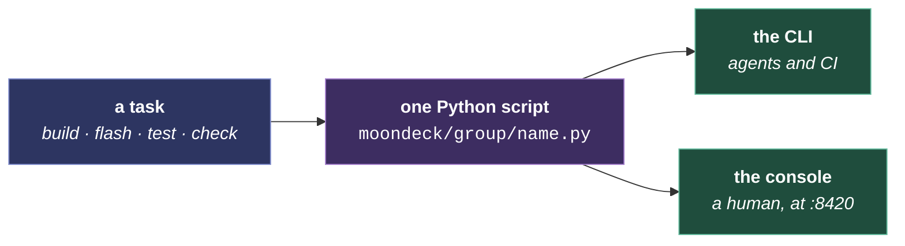

# MoonDeck

The developer console: one page that builds, flashes, runs, tests and monitors across every target, and discovers devices on the network. The per-script reference is [MoonDeck.md](../../moondeck/MoonDeck.md). What follows is why it is shaped this way.

The shape comes first, then how it pairs with MoonWalk, why the scripts are ours, and where the state lives.

## One script per task, two front ends

Every action the console offers is a thin wrapper around a script, so `uv run moondeck/build/build_desktop.py` and the button run the same code. That is the whole design: one implementation, two ways in, and no path where a human and an agent measure something differently.

<video src="../../assets/moontube/11-moondeck.webm" controls playsinline width="720" title="A tour of MoonDeck: why it exists, and what its tabs hold."></video>

**The script is the contract.** It picks the right per-host build directory, applies the flags the gate expects, and tees its output where the report reads it. Reaching past it to `cmake` or `idf.py` produces a number measured differently, or a stale binary the script would have rebuilt.

## Two menus, one kitchen

MoonDeck is the à la carte menu: every script on its page, in any order, for a reader who knows what they want. [MoonWalk](../../moonwalk.md), behind MoonDeck's 🗺️ button, is the set menu: the courses in order for one occasion, a first build or a commit. In MoonDeck it ticks off what was served, read from MoonDeck's run records. One kitchen cooks both, since a step names a script and MoonDeck runs it. So a script has one way to run, one log and one result, whichever menu ordered it.

The docs site shows the same set menu, but a web page cannot start a script on the reader's computer. Browsers also block a public site from calling a local address. So the site is the menu to read, for a contributor deciding what to run or running it from a terminal. The kitchen is MoonDeck, a server on the reader's own machine: the one place a script starts, logs and is timed.

## Why our own scripts

The ESP32 build is ESP-IDF-native. MoonLight tracks the IDF against a pinned commit for chips like the P4 and the S31, a control PlatformIO's packaged platforms do not offer. The hot-path drivers (LCD_CAM, parlio, GDMA) use the vendor APIs directly rather than through an Arduino core. The tooling also covers far more than compile, upload and monitor. It builds the desktop, runs unit tests and scenarios, checks specs and boundaries, measures, serves the web installer, provisions boards and drives bench runs. A wrapper toolchain would cover one of those and still need the scripts around it. One script per task with two front ends keeps people, agents and CI on the same path.

## State, and where it lives

Script definitions are committed in `moondeck/moondeck_config.json`. Runtime state, meaning the selected network, the known devices and the last-used serial port, lives in `moondeck/moondeck.json` and is gitignored: it describes one developer's bench rather than the project.

**Networks are the unit of bench state.** Each holds its own device list, serial port and WiFi credentials. The console selects the network whose subnet matches the host, so moving a laptop between networks usually needs no clicks.

**The device-model picker reads the installer's catalog.** The same `deviceModels.json` the web installer uses, so a device configured through either route ends up with the same module tree. Selecting a model pushes its full config: add the modules, then set their controls.

Logs and run counts under `build/moondeck-logs/` are derived state. Deleting `build/` resets them, and a missing file costs the count rather than the run.
