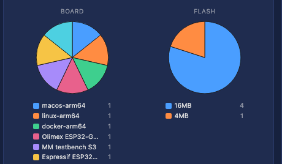
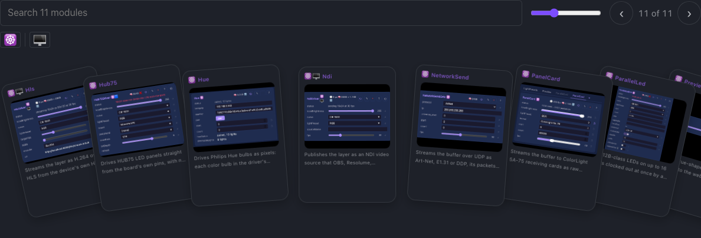
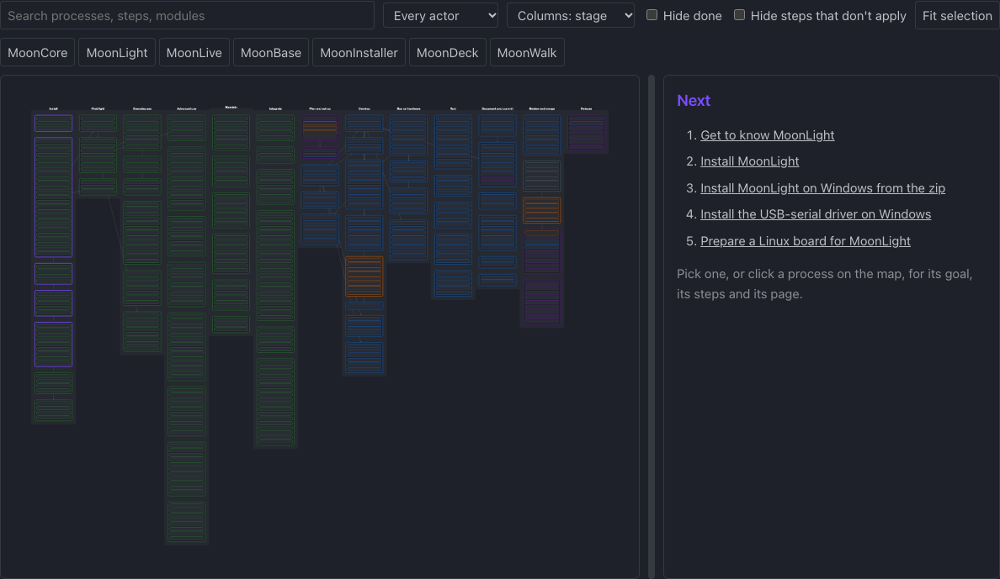
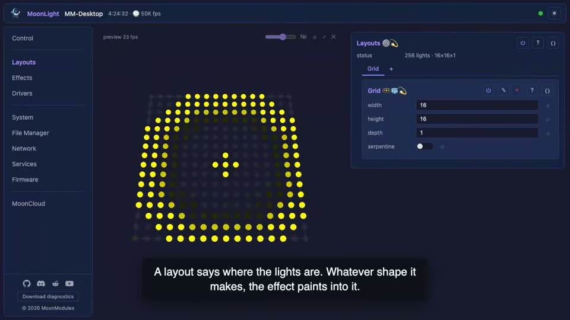
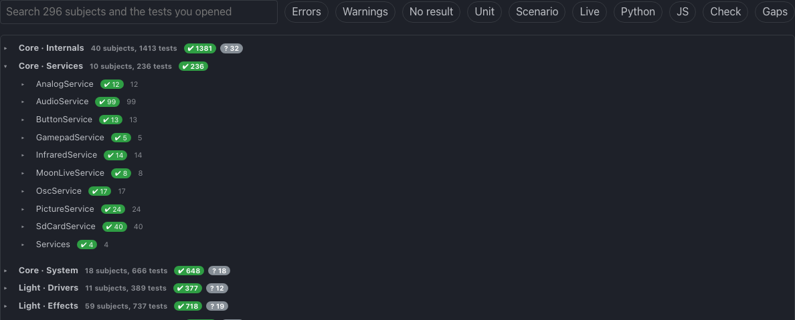
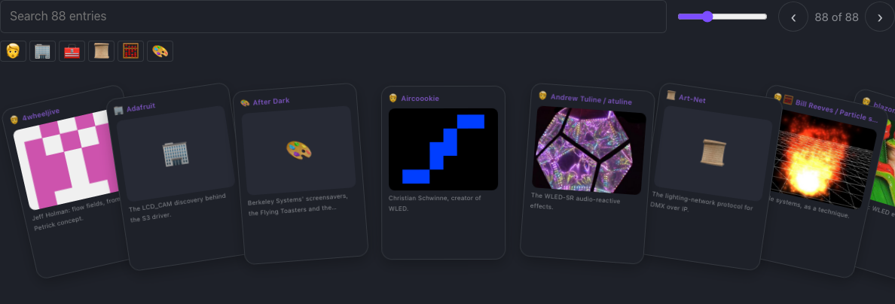
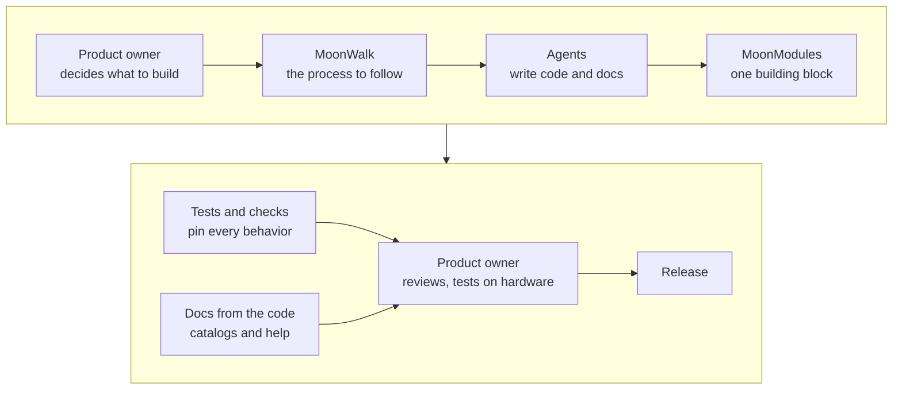

---
hide:
  - toc
---

# Getting started

This documentation follows the latest pre-release; a tagged release may lack what is described here.

## How it works for you

<div class="grid cards" markdown>

-   :material-devices: **Every device, one show**

    

    ESP32, Teensy, Windows, Linux, macOS and containers run the same interface, and several play together as one installation.

    [Install MoonLight](moonwalk.md#install)

-   :material-puzzle: **Everything works the same way**

    

    Every effect, layout, driver and service is a card with the same buttons and controls, so once you know one, you know them all.

    [The interface](moonmodules/core/ui.md)

-   :material-help-circle: **Help where you need it**

    

    Every control has a help line under it in the interface, the same text as the [Effects](moonmodules/light/effects.md), [Layouts](moonmodules/light/layouts.md), [Modifiers](moonmodules/light/modifiers.md) and [Drivers](moonmodules/light/drivers.md) pages, so the help always matches your firmware.

-   :material-map: **The steps are on the device**

    

    MoonWalk shows what to do next, from a first install to a multi-device show, and marks each step your device has already done.

    [MoonWalk](moonwalk.md)

-   :material-flash: **Every change is live**

    

    Every setting applies on the next frame, with no reboot. Add, remove or rearrange anything while the lights run, in any order and at any size: the device degrades rather than crashes.

    [How MoonLight works](explanation/how-moonlight-works.md)

-   :material-check-decagram: **Every behavior tested**

    

    Every behavior has a test, and every crash found becomes one. Where a scenario proves a control, the control's help links it.

    [Tests](reference/tests.md)

-   :material-shield-lock: **Private by default**

    

    MoonLight sends nothing to us unless you switch it on, and asks first. An update check or a download goes to GitHub, never to a server of ours.

    [Security](explanation/security.md) · [Privacy policy](legal/privacy-policy.md)

-   :material-hand-heart: **Credit where it is due**

    

    Every effect and idea we learned from someone is credited by name, with what they inspired.

    [Attributions](reference/attributions.md)

</div>

## Three ways in

Whichever you have at hand: a board, a laptop, or the source.

### An ESP32, from your browser

Open the [web installer](https://moonmodules.org/MoonLight/install/) in Chrome or Edge, plug in your device, and follow it. It picks your device, flashes the matching firmware and hands the device your WiFi credentials over USB, with no toolchain and no recompile.

[Install MoonLight](moonwalk.md#install) walks you from a blank board to a running device, and [Show an effect on your lights](moonwalk.md#first-light-show) from there to your first light show.

### A laptop: the desktop build

Download your build from the [releases page](https://github.com/MoonModules/MoonLight/releases/latest), then open `http://localhost:8080/`. It runs the same interface and effect pipeline on macOS, Windows and Linux, driving fixtures over Art-Net, DDP or E1.31. [Install MoonLight](moonwalk.md#install) goes through it for macOS, Windows, Linux and Docker, with screenshots.

### From source

You need [uv](https://docs.astral.sh/uv/), CMake 3.20+ and a C++20 compiler, plus ESP-IDF v6.x for ESP32. Then launch MoonDeck, the developer console:

```sh
uv run moondeck/moondeck.py
```

Open `http://localhost:8420` to build, run, test, flash and discover devices. Every target, step by step: [the build processes](moonwalk.md#build-setup).

## The introduction

Why MoonLight was rebuilt, who wrote it, and the principles it kept.

<video src="assets/moontube/00-intro.webm" controls playsinline width="720" title="The spoken introduction: why MoonLight was rebuilt, who wrote it, and what it kept."></video>

The whole series, all seventeen clips in one chaptered video, is on YouTube: [MoonLight v6.0.0, the full tour](https://youtu.be/F_YgmiUyWVQ).

## How we build it

For developers: every change travels the same road, from a decision to a release.



<div class="grid cards" markdown>

-   :material-scale-balance: **Six principles**

    Minimalism, textbook solutions, architecture first, guardrails, continuous improvement and robustness bind every change.

    [Principles & process](contributing/principles-and-process.md)

-   :material-sitemap: **One building block**

    Every module is a MoonModule with one lifecycle and the controls it declares, on a domain-neutral core, from one source tree for every platform.

    [The architecture](explanation/architecture/index.md)

-   :material-file-document-multiple: **Docs from the code**

    The catalog pages and the device's help are generated from the module headers.

    [Documentation standards](contributing/documentation-standards.md)

-   :material-robot: **Agents write, the product owner thinks**

    AI agents write the code and the docs; the product owner decides what to build, reviews every line, tests on hardware and controls every release.

    [Contributing](contributing/index.md)

-   :material-code-braces: **Our own code**

    No third-party libraries: we study others' work and write our own against our architecture.

    [Why we write our own code](explanation/why-we-write-our-own.md)

-   :material-console: **One console, every task**

    MoonDeck builds, flashes, tests and measures on every target, and every commit records flash, memory and frame rate.

    [From source](#from-source) · [Performance](reference/performance.md)

</div>
