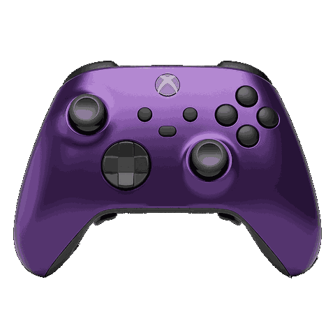
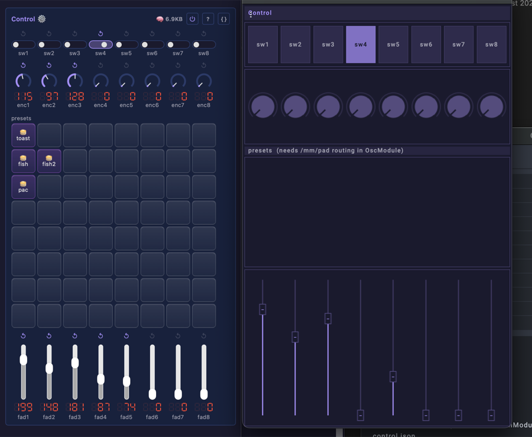

# Connecting a control surface

MoonLight's [Control](../moonmodules/core/system.md#control) card is a surface: eight switches, eight encoders, eight faders and a pad grid, each driving whatever you assign it. A control surface puts those controls under your hands. It can be a phone or tablet, a game controller, or a motorized mixing desk whose faders move when something else changes them.

> New here? Start with **[Install & first light](../gettingstarted.md)**. What follows assumes MoonLight is running and you can find it in a browser.


<video src="../assets/moontube/10-control.webm" controls playsinline title="The surface: the mapped controls, assigning your own, and OSC arriving from outside."></video>

---

## Pick a route

| What you have | Route | What it needs |
|---|---|---|
| A phone, a tablet or another app | [OSC](#a-phone-or-tablet-over-osc) | Open Stage Control, TouchOSC, Resolume, TouchDesigner or QLC+ on the same network |
| A MIDI desk (Mackie Control, such as the X-Touch or the QCon) or a gamepad | [The browser](#a-midi-desk-or-a-gamepad-through-the-browser) | The desk or pad plugged into the computer showing MoonLight's page |
| One desk for boards elsewhere in the rig | [The desktop app plus OSC](#one-desk-for-several-boards) | MoonLight running on the computer the desk is plugged into |
| A script or program of your own | [The REST API](../reference/integrating.md) | Set `Control`'s `fader1`, `switch2` or any other surface control, as every other route does |

Every route lands on the same surface, so a desk, a phone and the web UI stay in step: move a fader on one and the others follow.

---

## A MIDI desk or a gamepad, through the browser

1. In MoonLight add the service under **Services**: **Midi** for a desk, **Gamepad** for a controller.
2. Plug the desk or pad into the computer showing MoonLight's page, in Chrome, Edge or Firefox.
3. A desk: Chrome asks to use MIDI devices the first time; allow it. A pad: press any button, and the browser lists it.
4. Assign the surface's controls on the Control card, such as `fader2` to a game's paddle.

A Mackie desk in MC mode needs no setup: faders, knobs, SELECT buttons, touch sensors, motors and lights are mapped. An Akai APC40 mkII needs one choice: set the MIDI service's `profile` to Akai APC40 mkII, and its faders, knobs, activator buttons and clip pads are mapped, with their lights. A gamepad comes with default rows for its sticks and its A button.

 

The browser reads a desk with the Web MIDI API, which Chrome, Edge and Firefox offer on a secure origin only; Safari has no Web MIDI. The desktop app's page on `localhost` is a secure origin, so it works there, and the first time the browser asks permission to use MIDI devices.

### A board's own page needs marking as secure, once

A board's own page, such as `http://192.168.1.158`, is not a secure origin, so Chrome asks nothing and the desk or pad stays silent. Mark the address as secure once:

1. Open `chrome://flags/#unsafely-treat-insecure-origin-as-secure`.
2. Enter the board's address, such as `http://192.168.1.158`, set the flag to Enabled, and click Relaunch.
3. Reload the board's page: Chrome now asks to use MIDI devices.

### Making a gamepad appear

- A browser lists a pad only once one of its buttons is pressed with the page open, a rule against fingerprinting a visitor's hardware.
- Chrome, Firefox and every browser built on Chrome list a pad only on a secure origin: `localhost` on the desktop app, or a board's page marked as above.
- Safari lists a pad on any page, and so does every browser on an iPhone or iPad. A pad paired with a phone or tablet therefore plays on any board's page, with no computer involved.
- To check that the browser sees the pad, and which standard button or axis each control reports, open [hardwaretester.com/gamepad](https://hardwaretester.com/gamepad) in the same browser. If a button lights there, it reaches MoonLight too.

The inputs carry the names SDL's GameController API uses (`a`, `b`, `dpup`, `leftx`), so one set of rows works with any pad the browser reports in the standard mapping. A pad it does not recognize reports its own order, and `learn` binds it all the same.

A stick follows the surface's convention, up and right being more, and writes its position rescaled into the target's range once it moves past a small deadband. A pad's first stick positions are taken as rest, so plugging one in off-center moves nothing. A switch on the surface driving a button control, such as Space Invaders' `fire`, presses it on the way down only.

### What a desk does

A Mackie desk's faders move the surface's faders, its knobs turn the encoders, and each channel's SELECT button flips its switch. The desk follows the surface back: motors, SELECT lights and knob rings. A hand on a fader holds its motor still, and the browser sends only what changed, so a page opened later moves the motors to where the surface already is.

On an Akai APC40 mkII, track faders, track knobs and activator buttons 1 to 8 drive the surface's faders, encoders and switches. The 40 clip pads apply presets 1 to 40, the top-left pad being preset 1 as on the Control card. Activators light while their switch is on and knob rings fill like a meter. A pad is dark when empty, dim white when stored and green when applied. The faders have no motors. Chrome asks once to allow SysEx, which puts the desk in Alternate Ableton Live mode, where every light is the host's. Every message is in [the APC40 reference](../reference/hardware/control-surfaces.md#akai-apc40-mkii).

---

## A desk on the board's own USB port

With the MIDI service's `source` on USB, the desk plugs into the board instead of the computer, and the board is the USB host. Any page then works, without marking it as secure.

- It needs an S3 with 8 MB of flash or more.
- The port then carries no serial log and no USB flashing, so a board with a second USB port keeps that one for the computer.
- The desk takes its power from the port, so the board supplies 5 V there, or a powered hub between them does. An APC40 mkII draws about 0.15 A.

---

## A desk on the network

With `source` on network, the desk is an [RTP-MIDI](https://www.rfc-editor.org/rfc/rfc6295) session, the standard Apple's Network MIDI uses. `host` names the other end: a device sharing the desk on its USB port, a desk with a network port, or a computer sharing its desk.

- The service invites the host, and asks again every second until it answers, so either side may start first.
- With `host` empty the service waits to be invited, as a Mac's Audio MIDI Setup does when its Network window connects to the board. Windows does the same with the free rtpMIDI driver.
- The greeting, the surface and the touch handling are those of a desk on the board's own USB port.

### Sharing a desk with another board

With `source` on USB and `share` on, the board's USB desk drives nothing here: the board is a network MIDI cable, as an RTP-MIDI interface is.

1. On the board with the desk, set `source` to USB and turn `share` on.
2. On the board the desk should drive, set `source` to network and put the first board in `host`, by address or by name: `<name>.local`. A board waiting to be invited announces itself over Bonjour as `_apple-midi._udp`, and a Mac lists it in Audio MIDI Setup's Network window the same way.

The sharing board accepts a session only while a desk is plugged in, so a desk plugged in later is greeted: the host invites again until the bridge says yes. One host at a time; a second is refused while the first holds the session. The host's status says why it was refused: `no desk`, `in use`, or `it invites` when the board it invited has a `host` of its own.

Messages pass both ways unchanged. The one exception is a SysEx the desk sends, which the USB side does not pass on; the greeting SysEx from the host reaches the desk. A lost message is not repaired, since the next fader message replaces it and a lost press is pressed again.

---

## One desk for several boards

The desk plugs into a computer running the MoonLight desktop app, and the app passes its surface on to the boards over OSC.

1. On the desktop app, set up the desk as in the route above, on `localhost`.
2. On the desktop app: **Services → OSC**, turn on `listen` and `feedback`, and set `feedbackPort` to `9000`.
3. Pick how the surface travels:
    - **A few known boards:** `addressing` `unicast`, with the boards in `hosts`: `192.168.1.139, MM-testbench-S3.local`. Every board gets its own copy, retried by WiFi.
    - **Any number of boards:** `addressing` `multicast`. Every board listening on the default `group` hears it; a second rig on the same network gives its desktop and boards another `group`.
4. On each board: **Services → OSC**, turn on `listen`.

Every change on the desktop's surface now reaches the boards' surfaces, a self-playing game's moving paddle included.

---

## A phone or tablet, over OSC

Eight switches, eight knobs and eight faders on a touchscreen, moving the device in real time and following it when something else moves it. It takes about five minutes, using a free app and one file.

### The short version

1. Install **[Open Stage Control](https://openstagecontrol.ammd.net/)** (free; macOS, Windows, Linux)
2. Download **[MoonLight-control-surface.json](https://github.com/MoonModules/MoonLight/releases/download/latest/MoonLight-control-surface.json)**
3. In its launcher set `send` to `<your-device-ip>:9000`, `osc-port` to `9001`, and `load` to the file
4. On the device: **Services → OSC**, turn on `listen` and `feedback`
5. Press start

The faders move the device; moving something in the MoonLight UI moves the faders back.

---

### 1. What this gives you

MoonLight's Control card is a surface: a row of switches, a row of encoders, a row of faders, each of which can drive something on the device. The web UI shows it, but a mouse can only touch one control at a time.

A **control surface** is that same row of controls on something you can put your hands on. Open Stage Control is a free app that draws one on any screen, including a phone or tablet browser, and speaks **OSC**, the protocol MoonLight listens for.

Two things make this worth the five minutes:

- **Several at once.** Ten fingers on a touchscreen, not one mouse pointer.
- **It follows the device.** Change brightness in the web UI, or recall a preset, and the fader moves to match. The surface and the device never disagree about a value.

`switch1` drives the master on/off and `fader1` drives the global brightness. The rest are wired and waiting for assignments. From the second slot on, a slot nobody assigned follows the effect enabled last, so switching a look on brings its controls to the surface. On the Control card, right-click an encoder to see what it is bound to.

---

### 2. Find your device's IP address

The surface sends to an address, so you need the one your device is on.

It is in the MoonLight UI on the **System** card, and it is the same address you typed into the browser to get there. On a desktop install talking to itself, it is `127.0.0.1`.

Write it down; it goes in step 5.

---

### 3. Install Open Stage Control

Download it from **[openstagecontrol.ammd.net](https://openstagecontrol.ammd.net/)**. It is free and open source, and runs on macOS, Windows and Linux.

**On macOS the first launch needs a right-click → Open**, once. The download is unsigned, so a double-click gets refused with a warning about an unidentified developer. Right-click, choose Open, confirm, and macOS remembers.

---

### 4. Get the session file

A **session** is the layout: which knobs exist, what they look like, and what each one sends. You do not have to build one.

**[Download MoonLight-control-surface.json](https://github.com/MoonModules/MoonLight/releases/download/latest/MoonLight-control-surface.json)**

That link always serves the newest session, built from the latest code, and it sits beside the firmware on the [releases page](https://github.com/MoonModules/MoonLight/releases) if you would rather find it there.

Save it somewhere you can find again. The file does not contain your device's address, so the same file works for every device you own.

---

### 5. Point it at your device

Open Stage Control opens a **launcher** first, a settings window, before it draws anything. Three fields matter:

| Field | Value | What it means |
|---|---|---|
| `send` | `<your-device-ip>:9000` | where the surface sends. `9000` is the port MoonLight listens on |
| `osc-port` | `9001` | where the surface LISTENS, so the device can answer |
| `load` | the file from step 4 | the layout to draw |

So a device at `192.168.1.42` gets `send` = `192.168.1.42:9000`.

The two ports are different on purpose and this is the one place people go wrong: `9000` is the device's ear, `9001` is the surface's ear. They are not interchangeable.

> Leave `read-only` **off** if you want to rearrange the layout later. On to keep it as shipped.

Press the start button. The surface appears.

---

### 6. Turn the device's side on

In MoonLight: **Services → OSC**.

| Control | Set to | Why |
|---|---|---|
| `listen` | on | accept incoming OSC. Without it the device ignores the surface entirely |
| `feedback` | on | answer back, so the faders follow the device |
| `feedbackPort` | `9001` | where to answer. Must match the `osc-port` from step 5 |
| `port` | `9000` | where the device listens. Matches the `send` port |

Leave `hosts` empty, with `addressing` on `unicast`. Empty means "answer whoever last wrote to us", which finds your surface on its own. Fill it in only when you want feedback sent somewhere other than the thing driving it.

Move a fader. The device should react immediately.



---

### 7. Use it from a phone

This is where it gets good, and it needs no extra setup.

Open Stage Control also serves the surface as a **web page**. While it is running, look at its console output for a line naming a port (`8080` by default). On any phone or tablet on the same network, browse to:

```text
http://<the-computer-running-open-stage-control>:8080
```

Same surface, on a touchscreen, with ten fingers instead of one pointer. The computer running Open Stage Control stays the middleman; the phone talks to it, and it talks to the device.

> If MoonLight's own UI is on port 8080 on that same machine, give Open Stage Control a different port in its launcher, or the two collide.

---

### 8. When you see nothing

The surface draws fine but the device does not move, or the faders sit at zero and never follow. In rough order of likelihood:

**The device is not listening.** `listen` off is the most common cause, and it is off by default. Services → OSC → `listen` on.

**Wrong IP.** Check the System card again. A device that got a new address from DHCP after a reboot is a classic one: the surface is faithfully sending to nobody.

**The two ports are swapped.** `send` must end in `:9000`, `osc-port` must be `9001`. Swapping them produces exactly this symptom: nothing moves, nothing errors.

**`feedbackPort` does not match.** If the device moves but the faders never follow, the outbound direction is misconfigured while the inbound one is fine. `feedbackPort` on the device must equal `osc-port` in the launcher.

**A firewall.** OSC is UDP. macOS and Windows both prompt on first use, and a refused prompt is silent afterwards. Allow Open Stage Control through, or check the firewall's list if you clicked deny.

**The widgets show the wrong values on load.** They should populate immediately, because the session asks the device for its state whenever the page opens. If they do not, the device is not answering: check `feedback` and `feedbackPort`.

To prove the device is reachable at all, from a checkout:

```sh
uv run moondeck/check/send_osc.py <device-ip> /mm/fader/1 0.75
```

Brightness should jump. If that works and the surface does not, the problem is on the surface's side.

---

### 9. One command, if you have the repo

With a checkout, skip steps 3 to 6 entirely:

```sh
uv run moondeck/run/run_open_stage_control.py --host 192.168.1.42
```

It finds the app, passes the session, the address and both ports, and runs it headless. Open **http://127.0.0.1:8088**. You still turn `listen` and `feedback` on at the device.

It runs **headless**, as a web server, so a phone or another laptop reaches the surface at the URLs the launcher prints. On macOS that also sidesteps the quarantine dialog of an unsigned download. The session sends `/mm/hello` when the page loads, so every widget shows the device's real values straight away, and a browser refresh re-reads them.

| Option | Meaning |
|---|---|
| `--host` / `--port` | the device and its OSC `port` (default `127.0.0.1:9000`) |
| `--listen` | where it receives feedback, the device's `feedbackPort` (default 9001) |
| `--ui-port` | the surface's web UI (default 8088; 8080 is MoonLight's own) |

---

### The OSC addresses

Worth knowing if you ever edit the layout. Each control sends to an address naming **the surface**, not the thing it drives, and the addresses are a public contract: a TouchOSC layout built against them keeps working.

| Address | Argument | Drives |
|---|---|---|
| `/mm/fader/1` .. `/mm/fader/8` | float 0..1 or int 0..255 | the Control surface's faders |
| `/mm/encoder/1` .. `/mm/encoder/8` | float 0..1 or int 0..255 | its rotary encoders |
| `/mm/switch/1` .. `/mm/switch/8` | float 0..1 or int 0..255 | its on/off switch row (nonzero = on) |
| `/mm/pad/1` .. `/mm/pad/64` | nonzero = press, zero ignored | applies the preset on that pad of the grid, counted from the top left; an empty pad does nothing |
| `/mm/padstate/1` .. `/mm/padstate/64` | int 0, 1 or 2 (feedback only) | what that pad shows: empty, a stored preset, or the one applied |
| `/mm/hello` | anything, or nothing | resend every value to the sender |

Both argument forms are accepted because controllers disagree: apps send a float in 0..1, hardware bridges send an int in the target's range. Out-of-range values are clamped rather than ignored, so a controller sending 0..127 does something sensible instead of appearing dead.

The device decides what each address drives. Reassign `fader3` from brightness to speed, and the layout does not change, because the layout never knew. A hardware desk added later lands on the same addresses.

A pad's light listens on `/mm/padstate/N`: dark when the pad is empty, dim when it holds a preset, bright for the one applied. It has its own address, so a board listening to this one's feedback never reads a state as a press.

### How feedback works

With `feedback` on, a control that changes anywhere (the web UI, a preset recall, an audio-reactive effect) is mirrored back to the surface. That keeps a client honest and moves a motorized fader.

- `addressing` picks where it goes: `unicast` to each of `hosts`, or to whoever last wrote when `hosts` is empty, or `multicast` to `group`.
- The default `group`, `239.255.77.78`, sits beside discovery's own group, so multicast works with nothing to fill in. A second rig on the same network picks another.
- `feedbackPort` is where the client LISTENS, which is not the port the device listens on (Open Stage Control calls its own `osc-port`).

A client learns the current state three ways: when it first writes from a new address, when its address changes, and whenever it sends `/mm/hello`. The last covers a client restarting on the same address, which the other two miss: most controllers send nothing on load, so their widgets would show stale defaults. The shipped session has a `sync from device` button for exactly this.

Every value also goes out again every 30 seconds, one every 20 ms, so a datagram lost on WiFi, or a client that rebooted, is repaired within that time. A value is never sent back to the host it came from, so two boards feeding each other cannot echo it between them.

A device with `listen` on, on the leader's `feedbackPort`, takes every value the leader sends and its assignments carry each to its own controls. A desk at the side of a room reaches the installation through a board that shares it instead, since a desk belongs on the board it drives.

---

## Where to go next

- **[OSC](../moonmodules/core/services.md#osc)**: every control and its help
- **[Control card](../moonmodules/core/system.md#control)**: the surface the device owns, and what each control drives
- **[MIDI and Gamepad services](../moonmodules/core/services.md#midi)**: the desk profiles, `source` and `share`, and the pad's rows
- **[Control surfaces](../reference/hardware/control-surfaces.md)**: the X-Touch and QCon hardware, and Mackie Control on the wire
