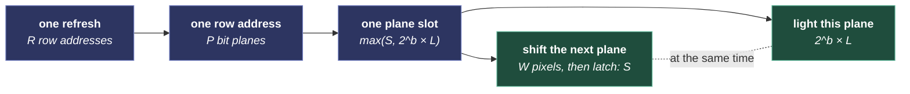

# HUB75 refresh rate by chain length and color depth

The refresh rate a chain of HUB75 panels reaches, worked out from the shift clock, the bit planes and each plane's on-time. Use it to size a chain before you wire it: driven from an ESP32's pins by the [HUB75 driver](../../moonmodules/light/drivers.md#hub75), from a Raspberry Pi's header by Henner Zeller's [`rpi-rgb-led-matrix`](https://github.com/hzeller/rpi-rgb-led-matrix), or by a ColorLight 5A-75 receiving card through [Panel Card](../../moonmodules/light/drivers.md#panelcard). Wiring and settings are in [Driving a HUB75 panel](hub75-panels.md). The figures are arithmetic from published driver timings, so each one is a ceiling: a real driver lands a little below it, and a bench reading or a camera confirms it.

Sections run in the order you use them: how a chain refreshes, the formula with one worked example, how drivers set the LSB, then tables for 8, 11 and 16 bits per channel and what they mean for sizing a chain, and last the same arithmetic for ColorLight cards.

## How a chain refreshes

The driver lights the panel one row address at a time and sends each row's color as bit planes, using binary-coded modulation (BCM). Plane *b* stays lit for 2^*b* LSB times while the next plane shifts in, so a slot lasts as long as the slower of the two.

A 128×64 panel at 1/32 scan has 32 row addresses, and each address lights two rows, one per half of the panel. Parallel chains shift at the same time on their own data lines, so the refresh rate depends on the length of one chain.

## The formula

| Quantity | Formula |
|---|---|
| Shift time per plane | S = W × t_px + t_latch |
| Refresh rate | f = 1 / ( R × Σ_{b=0}^{P−1} max(S, 2^b × L) ) |
| Duty cycle within a row slot | D = (2^P − 1) × L / Σ_{b=0}^{P−1} max(S, 2^b × L) |
| Ceiling, every plane shift-bound | f = 1 / (R × P × S) |
| Every plane on-time-bound | f = 1 / (R × (2^P − 1) × L) |

| Symbol | Meaning | Value used |
|---|---|---|
| W | Pixels in one row along the whole chain | 128 per panel, chained side by side |
| R | Row addresses: rows ÷ 2 for a panel fed from two halves | 32 for a 64-row panel at 1/32 scan |
| P | Bit planes: bits of color per channel | 8, 11 or 16 |
| t_px | Time to shift one pixel | 60.4 ns |
| t_latch | Latch and set-up time per shifted row | 0.5 µs |
| L | LSB time: how long the least significant plane stays lit | 130 ns, the `rpi-rgb-led-matrix` default, or 50 ns |

A real chain sits between the two bounds: its low planes are shift-bound and its high planes are on-time-bound. The ceiling falls as the chain grows. The on-time bound halves with each extra bit and stays the same at any chain length.

A Raspberry Pi shifts at a rate set by the Pi model and `--led-slowdown-gpio`. For a Pi, put its own t_px in the formula: the ceiling moves, and the on-time-bound rates hold.

## Worked example: two panels at 11 bits

Two 128×64 panels, 11 bits per channel, LSB 130 ns:

1. W = 256, so S = 256 × 60.4 ns + 0.5 µs = 15.96 µs.
2. Planes 0 to 6 light for 0.13 to 8.3 µs, all under S: 7 × 15.96 = 111.7 µs.
3. Planes 7 to 10 light for 16.6, 33.3, 66.6 and 133.1 µs, all over S: 249.6 µs together.
4. One row address takes 361.3 µs, and 32 of them take 11.56 ms: **f ≈ 86 Hz**.
5. The LEDs are lit for 2047 × 0.13 µs = 266.1 µs of the slot: **D ≈ 74%**.

The ceiling for the same chain is 1 / (32 × 11 × 15.96 µs) ≈ 178 Hz. At the default LSB, on-time holds the chain to half its ceiling.

## How drivers set the LSB

| Driver | What it holds fixed | What follows | Its highest rate |
|---|---|---|---|
| `rpi-rgb-led-matrix` | The LSB time, `--led-pwm-lsb-nanoseconds` | The refresh rate, from the formula | The formula's f, at up to 11 bit planes, `--led-pwm-bits` |
| HUB75 driver, on an ESP32 | One shift per plane: S = W × 50 ns at its 20 MHz pixel clock, the latch riding the last pixel | The LSB, S ÷ 2^(P−1), shortened by brightness | The ceiling, at up to 6 bit planes, `bitDepth` |
| SmartMatrix | The refresh rate, 240 Hz by default | The LSB, shrunk until every plane fits the row's time | The ceiling, with planes shorter than S padded up to it |

The ESP32 driver's ceiling for one 64×64 panel at 1/32 scan and 4 bits is 1 / (32 × 4 × 3.2 µs) ≈ 2,441 Hz; the bench reading is in [Depth, refresh and brightness](hub75-panels.md#depth-refresh-and-brightness).

At its ceiling, SmartMatrix's LSB comes out as S ÷ 2^(P−1), which is a few nanoseconds at 11 or 16 planes. Its timer ticks at the bus clock ÷ 2, so planes shorter than one tick share a single on-time. The shortest LSB a panel's driver chip honors sets the depth a chain shows, and that figure is open.

## Refresh rates for 128×64 panels at 1/32 scan

Panels stacked in one chain, such as 128×128 from two, give the same W and the same figures. Each row address is lit for 1/32 of a refresh, so the panel's average duty cycle is D ÷ 32.

### 8 bits per channel: 24-bit color

| Panels | W | Pixels | Ceiling | LSB at ceiling | D at ceiling | LSB 130 ns | D | LSB 50 ns | D |
|---|---|---|---|---|---|---|---|---|---|
| 1 | 128 | 8,192 | 474 Hz | 64.3 ns | 25% | 420 Hz | 45% | 474 Hz | 19% |
| 2 | 256 | 16,384 | 245 Hz | 124.7 ns | 25% | 243 Hz | 26% | 245 Hz | 10% |
| 3 | 384 | 24,576 | 165 Hz | 185.2 ns | 25% | 165 Hz | 17% | 165 Hz | 7% |
| 4 | 512 | 32,768 | 124 Hz | 245.6 ns | 25% | 124 Hz | 13% | 124 Hz | 5% |
| 6 | 768 | 49,152 | 83 Hz | 366.4 ns | 25% | 83 Hz | 9% | 83 Hz | 3% |
| 8 | 1024 | 65,536 | 63 Hz | 487.2 ns | 25% | 63 Hz | 7% | 63 Hz | 3% |

At 8 bits the shift clock sets the rate, and a shorter LSB only dims the panel.

### 11 bits per channel: 33-bit color, the `rpi-rgb-led-matrix` default

| Panels | W | Pixels | Ceiling | LSB at ceiling | D at ceiling | LSB 130 ns | D | LSB 50 ns | D |
|---|---|---|---|---|---|---|---|---|---|
| 1 | 128 | 8,192 | 345 Hz | 8.0 ns | 18% | 102 Hz | 87% | 201 Hz | 66% |
| 2 | 256 | 16,384 | 178 Hz | 15.6 ns | 18% | 86 Hz | 74% | 142 Hz | 46% |
| 3 | 384 | 24,576 | 120 Hz | 23.1 ns | 18% | 74 Hz | 63% | 108 Hz | 35% |
| 4 | 512 | 32,768 | 90 Hz | 30.7 ns | 18% | 65 Hz | 55% | 85 Hz | 28% |
| 6 | 768 | 49,152 | 61 Hz | 45.8 ns | 18% | 50 Hz | 43% | 60 Hz | 20% |
| 8 | 1024 | 65,536 | 46 Hz | 60.9 ns | 18% | 41 Hz | 35% | 46 Hz | 15% |

At 11 bits on-time sets the rate of a short chain. An LSB of 50 ns wins back most of the ceiling and costs brightness.

### 16 bits per channel: 48-bit color

| Panels | W | Pixels | Ceiling | LSB at ceiling | D at ceiling | LSB 130 ns | D | LSB 50 ns | D |
|---|---|---|---|---|---|---|---|---|---|
| 1 | 128 | 8,192 | 237 Hz | 0.3 ns | 12% | 3.7 Hz | 100% | 9.4 Hz | 98% |
| 2 | 256 | 16,384 | 122 Hz | 0.5 ns | 12% | 3.6 Hz | 99% | 9.2 Hz | 97% |
| 3 | 384 | 24,576 | 82 Hz | 0.7 ns | 12% | 3.6 Hz | 98% | 9.0 Hz | 95% |
| 4 | 512 | 32,768 | 62 Hz | 1.0 ns | 12% | 3.6 Hz | 98% | 8.8 Hz | 93% |
| 6 | 768 | 49,152 | 42 Hz | 1.4 ns | 12% | 3.5 Hz | 96% | 8.5 Hz | 89% |
| 8 | 1024 | 65,536 | 31 Hz | 1.9 ns | 12% | 3.5 Hz | 95% | 8.1 Hz | 85% |

A fixed LSB at 16 planes and 1/32 scan flickers at single-digit rates. SmartMatrix's 48-bit mode reaches 240 Hz on one panel with an LSB of 0.3 ns, well inside one timer tick, so its lowest planes share one on-time.

## Sizing a chain

- **A 15,000-pixel chain is two panels.** At 11 bits it refreshes at 86 Hz with the default LSB or 142 Hz at 50 ns, and at 8 bits at about 245 Hz.
- **Filming needs a high rate.** A camera catches the bit planes, and the `rpi-rgb-led-matrix` README warns of black bars on phone pictures below 300 Hz. Set the exposure to a whole number of refresh periods.
- **The eye wants about 100 Hz.** Below that, peripheral vision may see flicker.
- **One reading to compare against.** On 2026-11-01 a Raspberry Pi 5 driving 128×64 panels at chain 2, parallel 3 and 11 bits through `rpi-rgb-led-matrix` took 92 frames a second, each `SwapOnVSync` waiting for the next refresh, so the wall refreshes at 92 Hz or more. That beats the 86 Hz row, so a Pi 5 shifts a row faster than the 15.96 µs used here.

## ColorLight 5A-75 receiving cards

A ColorLight receiving card refreshes the panels itself: an FPGA on the card draws the bit planes from frames it receives as raw gigabit Ethernet, such as those from [Panel Card](../../moonmodules/light/drivers.md#panelcard). Setup: [Driving LED panels with a receiving card](panel-cards.md). The card's LEDVision settings set the refresh rate, and the formula applies to the card's own shift clock.

### The cards

| Card and sheet | HUB75 ports | Scan | Control area, conventional chips | 128×64 1/32-scan panels per card |
|---|---|---|---|---|
| 5A-75B, V8.0 (2020) | 8, with the E line | Up to 1/64 | 256×512 (131,072 pixels); 384×512 with PWM chips | 16, or 24 with PWM chips |
| 5A-75B, V7.1 (2019) | 8, with the E line | Up to 1/64 | 256×256 (65,536 pixels) | 8 |
| 5A-75B, V1.4 (2015) | 8 | 1/16: pin 8 is ground | 256×256 | 1/16-scan panels only |
| 5A-75E, V1.0 (2015) | 16 | 1/16: pin 8 is ground | 128×512 | 1/16-scan panels only |
| 5A-75E, boards V6.0 to V8.0 | 16 | Open, pending a ColorLight sheet | 256×1024, from resellers | Up to 32, once the E line is confirmed |

- **Telling a card apart:** count the HUB75 headers, 8 on a B and 16 on an E, read the version printed on the board, and check that pin 8 carries E.
- **A port** carries two RGB groups, the panel's upper and lower halves. W is the chain width one port drives: 128 × the panels on that port.
- **Row and column limit:** 8,192 pixels on the 5A-75B V8.0, 4,096 on V7.1.
- **The FPGA** is a Lattice ECP5-25 on the 5A-75B boards V6.1 to V8.2 and the later 5A-75E boards, per the chubby75 project.
- **A plain "5A-75"**, with the letter left off, is open: the sheets found are all for the B or the E.

### How the card refreshes

| Setting | What it is | Figure |
|---|---|---|
| DCLK | The shift clock, so t_px = 1 / DCLK | 0.2 to 41.7 MHz; 17.9 MHz is ColorLight's usual full-color figure |
| Minimum OE | The shortest on-time: the LSB | 8 ns, in 8 ns steps |
| Gray levels | Depth after the card's gamma | Up to 65,536: 16 bits |
| Refresh multiplier M | Sub-frames per source frame, so visible refresh = source rate × M | 60 Hz × 32 = 1920 Hz in ColorLight's example |
| Brightness efficiency | The duty cycle D, shown in LEDVision | ColorLight advises above 60% |

LEDVision computes these together; ColorLight keeps its plane-splitting method to itself. Each card has two ceilings, and both leave out the card's line blanking, which LEDVision sets:

| Ceiling | Formula |
|---|---|
| Visible refresh: each sub-frame shifts every row address at least once | M × f_source ≤ 1 / (R × S), with S = W / DCLK |
| Full depth: a whole gray cycle fits in each source frame | f_source ≤ 1 / ( R × Σ_{b=0}^{P−1} max(S, 2^b × 8 ns) ) |

At a 60 Hz source, the card lengthens the LSB to fill the frame, and the longest LSB that fits gives the highest brightness efficiency.

### Card ceilings for 128×64 panels at 1/32 scan

Visible refresh ceiling, the same at every depth:

| Panels per port | W | 17.9 MHz | 25 MHz | 41.7 MHz |
|---|---|---|---|---|
| 1 | 128 | 4,370 Hz | 6,104 Hz | 10,181 Hz |
| 2 | 256 | 2,185 Hz | 3,052 Hz | 5,090 Hz |
| 3 | 384 | 1,457 Hz | 2,035 Hz | 3,394 Hz |
| 4 | 512 | 1,093 Hz | 1,526 Hz | 2,545 Hz |

In the depth tables, "full depth" is the highest source frame rate that carries all P planes at an 8 ns LSB, and "at 60 Hz" is the highest brightness efficiency at a 60 Hz source.

**8 bits per channel:**

| Panels per port | W | 17.9 MHz: full depth | At 60 Hz | 25 MHz: full depth | At 60 Hz | 41.7 MHz: full depth | At 60 Hz |
|---|---|---|---|---|---|---|---|
| 1 | 128 | 546 Hz | 98% | 763 Hz | 99% | 1,273 Hz | 99% |
| 2 | 256 | 273 Hz | 94% | 381 Hz | 97% | 636 Hz | 99% |
| 3 | 384 | 182 Hz | 89% | 254 Hz | 94% | 424 Hz | 97% |
| 4 | 512 | 137 Hz | 82% | 191 Hz | 89% | 318 Hz | 95% |

**11 bits per channel:**

| Panels per port | W | 17.9 MHz: full depth | At 60 Hz | 25 MHz: full depth | At 60 Hz | 41.7 MHz: full depth | At 60 Hz |
|---|---|---|---|---|---|---|---|
| 1 | 128 | 392 Hz | 94% | 526 Hz | 94% | 783 Hz | 97% |
| 2 | 256 | 199 Hz | 85% | 277 Hz | 88% | 449 Hz | 94% |
| 3 | 384 | 132 Hz | 75% | 185 Hz | 82% | 309 Hz | 91% |
| 4 | 512 | 99 Hz | 63% | 139 Hz | 75% | 231 Hz | 88% |

**16 bits per channel:**

| Panels per port | W | 17.9 MHz: full depth | At 60 Hz | 25 MHz: full depth | At 60 Hz | 41.7 MHz: full depth | At 60 Hz |
|---|---|---|---|---|---|---|---|
| 1 | 128 | 53 Hz | Over budget | 55 Hz | Over budget | 57 Hz | Over budget |
| 2 | 256 | 47 Hz | Over budget | 50 Hz | Over budget | 54 Hz | Over budget |
| 3 | 384 | 42 Hz | Over budget | 46 Hz | Over budget | 51 Hz | Over budget |
| 4 | 512 | 37 Hz | Over budget | 42 Hz | Over budget | 49 Hz | Over budget |

At 1/32 scan, the on-time of 16 bits alone fills more than a 60 Hz frame: 65,535 × 8 ns × 32 rows × 60 Hz is 101% of the time. To hold 60 Hz, the card shows fewer gray levels on these panels, or the panels use PWM driver chips, which run their own gray cycle.

### Sizing a card

- **Two panels a port** is the 5A-75B V8.0's load with conventional chips, 16 panels a card. Twenty panels at 640×256 take two of those cards, or one later 5A-75E once its E line is confirmed.
- **1920 Hz at two panels a port** needs a DCLK of at least 15.7 MHz. At 17.9 MHz the ceiling is 2,185 Hz, which leaves a thin margin for blanking.
- **11 bits** fits a 60 Hz frame at two panels a port, at up to 85% brightness efficiency at 17.9 MHz. **16 bits** is over budget at every clock.
- **Two user reports fit under the ceilings.** P5 panels at 1/16 scan, 128 pixels a port and 8.3 MHz showed 1920 Hz at 50% brightness, against a ceiling of 4,053 Hz; 16 bits at 8 ns and 60 Hz predicts 50.3%. The same user's 192-pixel chain showed 42%, below the model, so the card's method adds a cost the model leaves out. Another user found 17.9 MHz the lowest clock that offered 1920 Hz.
- **The source frame rate is open.** ColorLight's example takes 60 Hz, while Panel Card sends at its default `fps` of 40. A camera on the panel measures what the card does at 40.

## Sources

- [SmartMatrix's Teensy 4 shield timings](https://github.com/pixelmatix/SmartMatrix/blob/af288cb536bd934d09be309d2346f9a8ffb51f4e/src/MatrixHardware_Teensy4_ShieldV5.h), by Louis Beaudoin (Pixelmatix) under an MIT-style license. The pixel clock is 480 MHz ÷ 26, and the header allows (32 × 26 × 1000 / 480) + 200 = 1,933 ns per 32 pixels: 60.4 ns a pixel. The latch is 100 ns, plus up to 400 ns before the first clock.
- [SmartMatrix's Teensy 4 refresh, `calculateTimerLUT`](https://github.com/pixelmatix/SmartMatrix/blob/af288cb536bd934d09be309d2346f9a8ffb51f4e/src/MatrixTeensy4Hub75Refresh_Impl.h), for how it fits the planes into a fixed refresh rate.
- [The `rpi-rgb-led-matrix` README](https://github.com/hzeller/rpi-rgb-led-matrix/blob/51d3231e370593b60952b2c3b18d2e3802329f18/README.md), at commit 51d3231, by Henner Zeller and contributors under GPL-2.0-or-later, for `--led-pwm-bits`, `--led-pwm-lsb-nanoseconds` and its refresh tuning notes.
- MoonLight's HUB75 encoder, [Hub75Slots.h](https://github.com/MoonModules/MoonLight/blob/main/src/light/drivers/Hub75Slots.h), for the ESP32 driver's one shift per plane and its lit windows.
- ColorLight's specification sheets, copies on resellers' sites: [5A-75B V8.0](https://cdn.shopify.com/s/files/1/0333/6047/8343/files/5A-75B-Specification_V8.0.pdf) (2020), [5A-75B V7.1](https://cdn.shopify.com/s/files/1/0354/4763/6013/files/5A-75B-Specification_V7.1.pdf) (2019), [5A-75B V1.4](https://cdn.shopify.com/s/files/1/0556/0126/6762/files/56949bf6cea82.pdf) and [5A-75E V1.0](https://cdn.shopify.com/s/files/1/0556/0126/6762/files/55682c0bdbb93.pdf) (2015). The DCLK range, the 8 ns OE step and the 65,536 gray levels come from the 2015 sheets.
- [Colorlit LED's performance settings for a receiver card](https://www.colorlitled.com/performance-settings-led-receiver-card/), for the refresh multiplier, DCLK, minimum OE and brightness percentage.
- [The chubby75 reverse-engineering notes](https://github.com/q3k/chubby75), by q3k and contributors, for the 5A-75B and 5A-75E board versions and FPGA.
- Forum reports of 5A-75B settings, on [auschristmaslighting.com](https://auschristmaslighting.com/threads/problems-with-ray-wu-p5-panels-colorlight-card.12585/) (2020) and [falconchristmas.com](https://falconchristmas.com/forum/index.php?topic=15249.0).
- [A reseller's 5A-75E listing](https://www.ledwallcentral.com/ColorLight-5A-75E-receiving-card.htm), for the 256×1024 load; the listing flags its own figures as unchecked.
