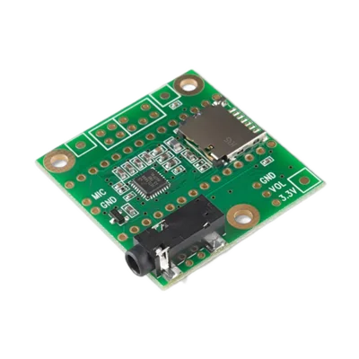

# Teensy 4.1 hardware reference

Pins, power and wiring for running MoonLight on a PJRC **Teensy 4.1**.
Its Ethernet is the board's own PHY or a WIZnet W5500 module. The board's GPIO drives WS2812B LEDs by DMA.
The one firmware, `teensy41`, finds at boot which of the two the board has; it is built and flashed from MoonDeck's [Teensy tab](../../../moondeck/MoonDeck.md#teensy-tab).

**Sources**
- Board: <https://www.pjrc.com/store/teensy41.html>
- Ethernet kit (the jack for the on-board PHY): <https://www.pjrc.com/store/ethernet_kit.html>
- W5500 module pin map (WIZ850io layout): <https://docs.wiznet.io/Product/ioModule/WIZ850io>
- Network library: QNEthernet, <https://github.com/ssilverman/QNEthernet>
- Prior art for the LED output: OctoWS2811, <https://github.com/PaulStoffregen/OctoWS2811>, and ObjectFLED, <https://github.com/KurtMF/ObjectFLED>

## The board

- NXP i.MX RT1062: one Cortex-M7 at 600 MHz, no WiFi, one core.
- 1 MB RAM: 512 KB of tightly coupled memory, shared between code and the stack, and 512 KB of OCRAM, which holds the heap.
- 8 MB flash, with 1 MB of it holding MoonLight's settings (LittleFS), kept across power cycles and USB uploads.
- Pads for 8 or 16 MB PSRAM, empty on the boards MoonLight runs on so far.
- A microSD slot (pins 42 to 47) and USB host pins.
- A regular Teensy 4.1 carries a DP83825I Ethernet PHY, wired to the jack of PJRC's Ethernet kit; the firmware drives it, with no pins to set.
- The **Teensy 4.1-NE** has no Ethernet chip, so the W5500 below gives it a network; the firmware finds the PHY missing at boot and uses the W5500.

## What a Teensy usually runs

The Teensy is a maker's board, programmed in Arduino with PJRC's loader, and these are its common uses:

- **Audio:** PJRC's Audio Library and Audio Shield, in synthesizers, effect pedals, Eurorack modules and audio installations.
- **MIDI controllers:** it appears to a computer as a USB MIDI device with no driver, for custom controllers, drum pads and instrument conversions.
- **LED art and video walls:** PJRC's OctoWS2811 drives thousands of LEDs from eight pins, the ground MoonLight works on too.
- **Keyboards:** the Teensy 2.0 powers many custom keyboards, such as the ErgoDox.
- **Machine control:** grblHAL runs CNC machines and laser cutters on a Teensy 4.1, over its Ethernet.
- **Measurement and robotics:** fast data capture, motor control and retro-computer emulation.

MoonLight differs in being a ready firmware: it is configured from a browser, with no sketch to write.

## Why MoonLight runs on it

**Compute per core.** The Cortex-M7 at 600 MHz scores about 2300 on CoreMark (PJRC's figure), where one ESP32-S3 core at 240 MHz scores about 600.
It also has a double-precision FPU, which the S3 lacks.
That pays in effects doing trigonometry or noise per light on large grids, the effects that drop the frame rate on an ESP32 first.
Stefan Petrick used Teensy boards for his compute-heavy effects for that reason.
MoonLive scripts compile to native Thumb-2 code, so a script gets the same speed.

**Wired and deterministic.** Ethernet, the board's own or a W5500, with no WiFi stack competing for the core, and LED output by DMA from many pins.

**A community.** Teensy users build audio, MIDI and LED art, and MoonLight gives them a ready firmware for the LED side.

**The costs.** One core shares rendering and networking, 1 MB RAM without PSRAM, no WiFi, and a board costing several ESP32s.
There is no GPU: the chip's PXP is a fixed-function 2D engine for displays, whose setup cost outweighs its gain on LED-sized frames.

## Installing and updating

The [web installer](https://moonmodules.org/MoonLight/install/) installs a Teensy from Chrome or Edge on a desktop computer, with no tools to install.
Choose **A board on a USB port**: a running board, MoonLight or PJRC's factory blink, is found by its USB ids and asked into its bootloader.
A board with no running program shows no port: cancel the port list, press the board's program button, and click **Teensy not listed?** below the port row.
Every install asks for one click on the bootloader, which the browser lists as `Unknown device (16C0:0478)`, since it reports no product name.
After the install the installer reads the board's address from its serial log.
With **Apply device defaults** it also sends the device model's settings over the same USB serial port.
**Erase chip first** wipes every setting along with the install, for a board whose saved state went bad; the program is replaced either way.

A running board updates over the network from its Firmware card: the browser downloads the release's `.bin` and uploads it, since the board has no TLS to fetch it.
A `.bin` file uploads the same way, and the settings survive both.
MoonCloud's usage report and Talk messages also go out through the open page, for the same reason.
Power lost in the few seconds after **Rebooting…**, while the new image replaces the old, leaves the board dark: the program-button install above brings it back, settings included.

## Ethernet: a W5500 on SPI

The firmware drives this module on a board without its own PHY, on fixed pins, so the wiring is not a setting.

The W5500 runs on the SPI port at 30 MHz, at about 1.6 MB/s.
The module below is the WIZ850io layout: two rows of six pins, one on each side of the RJ45 jack.
Seen from the jack side with the cable opening pointing away, each row starts at the cable end.
The left row (J1) reads GND, GND, MOSI, SCLK, SCSn, INTn; the right row (J2) reads GND, 3.3V, 3.3V, NC, RSTn, MISO.

| Module pin | Teensy 4.1 pin | Note |
|---|---|---|
| 3.3V | 3.3V | never 5 V: neither the Teensy's pins nor the W5500 are 5 V tolerant |
| GND | GND | one of the three is enough |
| MOSI | 11 | |
| MISO | 12 | |
| SCLK | 13 | pin 13 also drives the orange LED, which flickers with traffic |
| SCSn | 10 | chip select |
| RSTn | 9 | optional, open by default |
| INTn, NC | open | the driver polls the chip |

Keep the SPI wires under 10 cm.
The device opens by name (`http://MM-Teensy41.local`) through mDNS.

## LED outputs

Up to 16 WS2812B lanes, on any of the pins of GPIO port 6: **0, 1, 14 to 27 and 38 to 41**, in any order.
The [Parallel LED](../../moonmodules/light/drivers.md#parallel-led-details) driver's `GPIO-DMA` peripheral drives them.
One DMA channel, paced by a timer, writes each 373 ns slot into the port, so the CPU is free while a frame clocks out.
A frame of 256 lights on a lane takes 7.2 ms (a 138 fps ceiling).
The data leaves the pins at 3.3 V, below the 3.5 V a WS2812B powered at 5 V reads as a high.
So an installation puts a 3.3 V to 5 V level shifter, a 74AHCT125 or 74HCT245, between the pin and the first LED.
Wired directly, a short data wire usually works on the bench, without a guarantee: a flickering first LED is the typical sign.

## Loopback self-test

The ParallelLedDriver's loopback test sends a known frame and checks every bit it reads back, which proves the DMA, the timer and the WS2812 timing.
A jumper from a lane-capable pin (`loopbackTxPin`) to any input pin (`loopbackRxPin`) can stay in place: with the test sending on its own pin, the LEDs never receive the test pattern.

## Power

- **USB** powers the board during development and is the data path for flashing and serial.
- **VIN** takes 3.6 to 5.5 V. On the board it is joined to the USB's 5 V by a trace between two pads labeled VIN and VUSB.
  So while USB powers the board, VIN carries the USB 5 V out, and an external supply on VIN must never meet a plugged-in USB cable.
  Cutting that trace (a solder blob restores it) separates the two: USB then carries only data and VIN always powers the board.
- **3.3V** supplies 250 mA at most; the W5500 takes about 130 mA of it.
- **LEDs** get their own 5 V supply, rated for the strip, its GND joined to the board's.
  On the bench a few LEDs can take their 5 V from VIN while USB powers the board, within what the USB budget leaves.
  A port gives 500 mA, and the Teensy with the W5500 takes about 230 mA.
  A WS2812B draws about 1 mA idle and up to about 60 mA at full white.
  So even 64 LEDs at brightness 20 can pass the remaining 270 mA on a white frame.
  The 3.3 V pin is no supply for LEDs, below the WS2812B's 3.5 V minimum.

## An example setup on a breadboard

One way to set it up, on an 830-point breadboard with an MB102 power module; any wiring that keeps the pins above works as well.
One USB cable powers everything during development: the Teensy, the W5500 through the Teensy's 3.3 V pin on the bottom rail, and a short LED strip through VIN.
The MB102's rail jumpers stay off; it powers the device through VIN only when it runs standalone, without USB.

Columns are the numbers printed along the top edge; both boards straddle the center gap.
The Teensy's USB end faces left, with room before the MB102 for the plug.
The USB and Ethernet cables then leave at opposite ends.
Columns 37 to 48 hold the sensors, which keeps the SPI wires near 7 cm.

| Part | Where |
|---|---|
| Teensy 4.1 | rows D and H, columns 12 to 35, USB end at column 12 |
| Teensy pins | row D: GND, 0 to 12, 3V3; row H: VIN, GND, 3V3, 23 to 13 |
| W5500 | J1 in row I and J2 in row C, pin 1 of each at column 55 and pin 6 at column 50, the RJ45 opening facing right |
| Sensors | columns 37 to 48, below |
| LED strip | above the board |
| MB102 | both rail jumpers off |

| Wire | From | To |
|---|---|---|
| 3.3 V | A26 (Teensy 3V3) | bottom rail + |
| 3.3 V | A54 (W5500 3.3V) | bottom rail + |
| GND | A12 (Teensy GND) and A55 (W5500 GND) | bottom rail − |
| SCLK | J52 | J25 (pin 13) |
| MOSI | J53 | B24 (pin 11), down column 49 |
| SCSn | J51 | A23 (pin 10), down column 49 |
| MISO | B50 | B25 (pin 12) |
| LED data | J20 (pin 18) | the strip's DIN |
| LED GND | J13 (Teensy GND) | the strip's GND |
| LED 5 V | J12 (VIN) | the strip's +5V |
| loopback | J16 (pin 22) | J15 (pin 23), with `loopbackTxPin` 22 and `loopbackRxPin` 23 |
| VIN, standalone only | the MB102's 5 V output | I12 (VIN), with USB unplugged |

1. With everything unpowered, seat the boards, then the wires, GND first.
2. Check whether the bottom rail is split at column 30, where its printed lines break.
   If it is, bridge both − and + across the gap: the Teensy feeds the rail at column 26 and the W5500 draws at column 54.
3. Keep both MB102 rail jumpers off, or the MB102 and the Teensy drive one 3.3 V net from two regulators.
4. Plug in USB: the W5500's link LEDs light, the device boots, and the strip lights.

### With sensors

The free columns take a microphone, an IMU and a PIR.
Here that is an INMP441, an MPU6050 on a GY-521 breakout, and a mini PIR such as the AM312, which runs on 3.3 V.
Two wires carry the bottom rail's 3.3 V and GND to the top rail, which the MB102 leaves unfed with its top jumper off.
Neither Teensy firmware drives an I2S or I2C peripheral at this point; this wiring is ready for them.

| Part | Where |
|---|---|
| MPU6050 (GY-521) | VCC, GND, SCL, SDA, XDA, XCL, AD0, INT in row J, columns 38 to 45, its body over the top rail |
| INMP441 | six pins in row A, columns 38 to 43, its body over the bottom rail |
| INMP441 pin order | varies by maker: follow its silkscreen |
| PIR connector | VCC, OUT, GND in row A, columns 45 to 47, the sensor on a cable |

| Wire | From | To |
|---|---|---|
| top rail 3.3 V and GND | bottom rail + and − | top rail + and −, at columns 35 and 36 |
| MPU6050 VCC, GND | I38, I39 | top rail +, − |
| MPU6050 SCL | H40 | B27 (pin 24) |
| MPU6050 SDA | G41 | C28 (pin 25) |
| INMP441 L/R | B38 | bottom rail −, the left channel |
| INMP441 WS | C39 | I18 (pin 20) |
| INMP441 SCK | D40 | J17 (pin 21) |
| INMP441 SD | E41 | C21 (pin 8) |
| INMP441 VDD, GND | B42, B43 | bottom rail +, − |
| PIR VCC, GND | B45, B47 | bottom rail +, − |
| PIR OUT | C46 | I27 (pin 41) |

On the bench board of this example, pin 19 disturbed the W5500 when it toggled, so the example leaves it unused.
Every other lane pin tested clean.

## The Audio Shield

PJRC's [Audio Shield Rev D](https://www.pjrc.com/store/teensy3_audio.html) stacks on the Teensy: an SGTL5000 codec with line in, line out, headphones and a microphone input, and a microSD slot.
It is DEV-15845 at [Antratek](https://www.antratek.nl/teensy4-audio-board), €11.86.
No firmware drives it; audio input on the Teensy is planned work.
Its pins overlap the W5500 and the LED lanes, so it fits only once the lanes avoid them.

| Signal | Teensy pin | Overlaps |
|---|---|---|
| I2S MCLK, BCLK, LRCLK | 23, 21, 20 | LED lanes, and the INMP441 above, which uses the same I2S pins |
| I2S data in, out | 7, 8 | the INMP441's data on 8 |
| I2C SDA, SCL | 18, 19 | LED lanes; the bench panel is on 18 |
| SD card CS, MOSI, MISO, SCK | 10, 11, 12, 13 | the W5500's SPI bus and chip select |
| volume pot, when fitted | 15 | an LED lane |
| memory chip CS, when fitted | 6 | nothing here |

On a 4.1-NE with the W5500, the SD card shares the W5500's chip select, so the two cannot run together.
On a regular 4.1 with its own Ethernet the SPI bus is free, and only the LED lanes move off 15, 18 to 21 and 23.

## Possible deployments

These boards put a Teensy, LED outputs and Ethernet in one unit.
Each routes its LED outputs to OctoWS2811's pin set, which reaches beyond port 6.
So MoonLight drives them once its GPIO-DMA backend writes to any pin, as OctoWS2811 does.

- **OctoWS2811 adaptor** (PJRC, <https://www.pjrc.com/store/octo28_adaptor.html>; SparkFun PRT-28372): eight buffered 5 V outputs over two RJ45 jacks, sized for a CableGuard CG-500 outdoor enclosure.
- **TeensyLED** (open hardware, <https://oshwlab.com/bapenner818/teensyled-hw1_copy>): a 32-output Teensy 4.1 pixel controller with on-board Ethernet and optional RS-485.
- **Teensy 4.1 Pixel Pusher** (Amos Computing, <https://www.tindie.com/products/amoscomputing/teensy-41-pixel-pusher/>): 32 outputs on the Teensy's own Ethernet, made for CableGuard enclosures; listed as retired.
