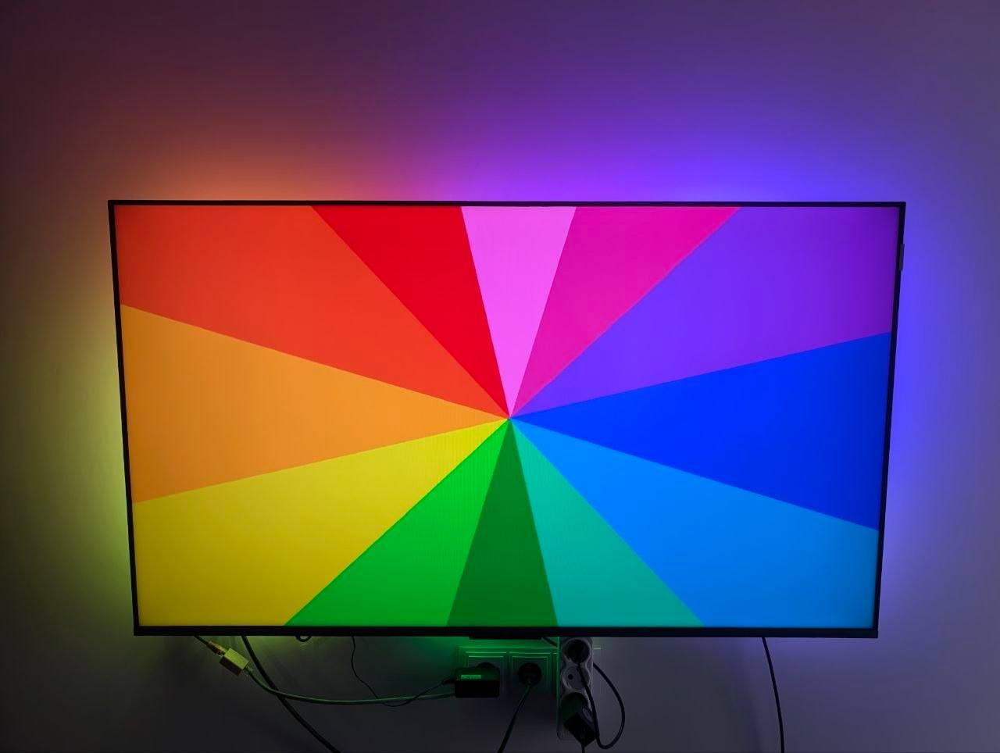

# TV backlight

A backlight lights the wall behind a TV with the colors at the edge of its picture.
Most such builds capture the picture on a Raspberry Pi or a PC running Hyperion or HyperHDR, with a microcontroller only driving the LEDs.
MoonLight captures, maps and drives it on one ESP32-P4, with no computer in between.



The build in the photo is @Gohnnyman's, who wrote the USB capture ([pull request #153](https://github.com/MoonModules/MoonLight/pull/153)).

## The parts

- **An ESP32-P4 board with a USB port it hosts**, such as the [Waveshare ESP32-P4-NANO](esp32-p4-eth.md), running the `esp32p4rev1-eth` firmware. The USB capture is in the P4 firmwares only.
- **An HDMI-to-USB grabber that streams MJPEG**, the common MS2109 dongles among them. Grabbers differ: one tested model tinted the picture green at times, and Hyperion's documentation warns about the same one.
- **An HDMI splitter**, so the TV keeps its own picture while the grabber reads a copy. It decides which modes reach the TV: the one in the photo passes 4K at 120 Hz with HDCP, so streaming services play as before.
- **A WS2812B strip** along the back of the TV, and a supply for the strip and the board; the photo's build takes both from a USB-C Power Delivery trigger.

## The wiring

```text
source (console, player)  →  HDMI splitter  →  output 1  →  TV
                                            →  output 2  →  HDMI-to-USB grabber  →  ESP32-P4 USB port
ESP32-P4 GPIO  →  WS2812B strip
```

## The modules

Three modules do the work, one in each of Services, Layouts and Effects, and an LED driver on the strip's pin outputs it, as for any strip: [LED drivers](led-drivers.md).

- **The Picture service**, in Services, with `source` on `usb capture`. The P4's JPEG engine decodes the grabber's MJPEG and shrinks it to `width` × `height`; a picture a few times the strip's light count per edge, in the TV's aspect, is plenty, such as 64 × 36. `noiseFloor` turns the grabber's near-black into black, and `staleMs` darkens the strip when the source stops. [The Picture service](../../moonmodules/core/services.md#picture).
- **The Backlight layout**, in Layouts: the MoonLive layout script `backlight.mll`. `wallCols` × `wallRows` take the picture's aspect, then come the strip's lights per edge (`top`, `right`, `bottom`, `left`), a `gapLength` and `gapStart` where a TV stand covers the strip, and the `startCorner`, `position` and `reverse` where and how the strip enters. It is Hyperion's shape, so a layout copied from Hyperion carries over.
- **The Picture effect**, in Effects on a layer, which shows the picture across the layout and gives each light the color under it. `sampling` on `area` averages each light's share, `edgeDepth` reaches further into the picture, as Hyperion's 8% does, `smoothing` settles a noisy source, and `snapAbove` lets a scene cut through at once. [The Picture effect](../../moonmodules/light/effects.md#picture).

**The Backlight layout alone, or beside a panel.** Its lights sit on the edge pixels of a `wallCols` × `wallRows` wall, and the layer takes the wall's size, so the Picture effect spreads the picture over the wall and each light reads the edge beneath it.
A Grid of `wallCols` × `wallRows` before the Backlight layout in Layouts shows the picture on a panel as well, such as a HUB75 panel of the same size. The strip's lights sit on the Grid's own pixels, so the layer stays `wallCols` × `wallRows` and an effect renders no extra pixel for the strip: an edge pixel lights its panel light and its strip light alike. The panel's lights come first, which a HUB75 driver takes as its panel, and the strip's LED driver starts after them, its `start` set to the panel's light count.

## Limits

- **HDMI-CEC stops at the splitter**: the TV and the source do not switch each other on and off.
- **Colors come out unbalanced**: orange and yellow read greenish, since the Picture service has no channel balance or HDR decoding.
