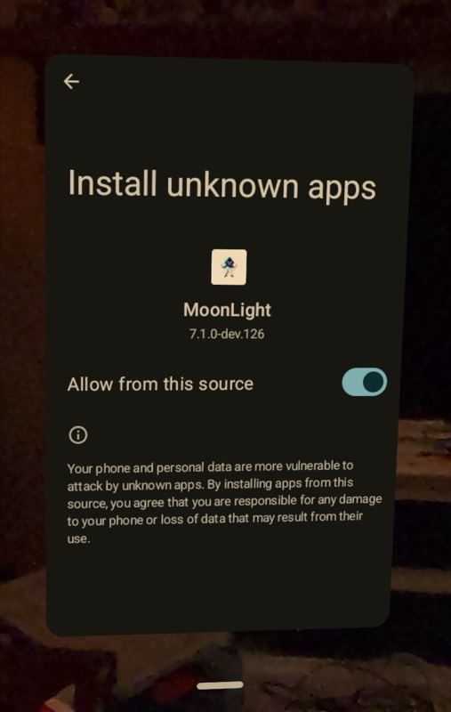

# Running MoonLight on Android

MoonLight runs as an Android app on a phone, a tablet or a headset: the same program the desktop runs, with the device as the host and its own screen as the window. Effects, MoonLive scripts and the preview run on the road with no board and no laptop, and the app drives networked fixtures over WiFi, Art-Net, DDP and E1.31, as a desktop does.

The facts follow; the steps are MoonWalk's. [Install MoonLight](../moonwalk.md#install) with Android picked.

## The device

- **Android 9 or later on a 64-bit ARM processor** (arm64), which every phone and tablet of the last years has. The app is one APK, `MoonLight-android-arm64-vX.Y.Z.apk`, on each release beside the desktop packages.
- **A headset is an Android too.** A Meta Quest (Horizon OS) runs the same APK as a panel in front of the wearer, opening wide and resizeable. It installs in developer mode: the Meta Horizon app on your phone turns that on for the headset, and `adb install` or SideQuest puts the APK on it.
- **Designed for** phones, tablets, Meta Quest and Pico headsets; **tested on** a Meta Quest 3 with Android 14.

## What the app does

- **It keeps running.** A foreground service runs MoonLight with the screen off and in the background; its notification shows the address and carries **Stop**, which ends MoonLight and the app.
- **The page is the app's window**, as a browser shows it on a desktop. Any other browser on the network reaches it at `http://<device address>:8080/`.
- **The microphone** is the Audio card's input, through Android's AAudio. The app asks for it the first time it opens.
- **The network:** the app holds Android's multicast lock, so discovery, mDNS and Art-Net broadcast reach it, and it announces itself through Android's service discovery: a service browser, Home Assistant and the other MoonLight devices find it under its name.
- **It updates itself** from the Firmware card or the Devices map, as a board does: it downloads the release's APK, checks it against the release's digest and hands it to Android's installer, which replaces the app and starts it again, settings kept. Android asks you to allow MoonLight to install apps, once, and to confirm the first update; the updates after it usually install on their own, and when Android asks again, you confirm.

    { width="300" }

- **Its settings** live in the app's own storage, in the same layout as on Linux, so a backup restores on a phone, a desktop or a board alike. Uninstalling the app removes them; back up first.

## What Android leaves out

- **The `.local` address.** Android keeps its own host name, so `<name>.local` does not resolve to the device; its services do, and its address works.
- **ColorLight panel cards over raw Ethernet** and **the HDMI screen output**, which need access an app does not get. Panel cards that take Art-Net or DDP work.
- **The NDI, HLS and RTSP outputs**, which need the NDI runtime or an ffmpeg an app does not have. The driver picker leaves all five out.
- **iPhone and iPad.** iOS forbids an app to run code it wrote, which MoonLive's compiler does, so iOS waits on a separate decision.
