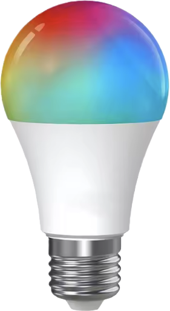

# Migrating a device to MoonLight over the air

A device running another firmware moves to MoonLight over WiFi, through that firmware's own update page, with no cable and no opening the case.
It keeps its WiFi network, and usually its address.

The file you upload is the migration image, a small program that runs once.
It writes MoonBase (MoonLight's installer) and MoonLight's partition table and restarts into MoonBase, all in about ten seconds, and from WLED it carries the WiFi network over.
MoonBase then installs MoonLight from the release.

## What can move

| From | Chip | Status |
|---|---|---|
| WLED | ESP32-C3 with 4 MB of flash | verified on WLED 0.15.0, other versions should work; the WiFi comes along |
| Another firmware, such as ESPHome or Tasmota | ESP32-C3 with 4 MB of flash | untested. It needs the old firmware to accept the upload, and the image to land clear of where MoonBase goes or find a second app slot to move into. MoonBase starts on its access point |

A migration image is built for one chip, so the chip decides which file fits.

## Steps, with WLED as the example

[Move a WLED device to MoonLight, without a cable](../moonwalk.md#migrate-wled). The device catalog, [`deviceModels.json`](https://github.com/MoonModules/MoonLight/blob/main/mooninstaller/deviceModels.json), holds the settings of every board MoonLight knows, such as the **ESP32-C3 RGBWW PWM bulb**.

## What can stop it

Before it writes anything, the migration image checks that it can finish: enough flash, no flash encryption or secure boot, room to move itself out of the way.
When a check fails, it restarts the old firmware with nothing changed.
So a device that cannot move keeps working as it was:

- The old firmware refuses the upload. A newer WLED checks an upload's release name until its option to skip that check is ticked, and an update password or a locked update refuses it too.
- The migration image refuses the board, and the old firmware comes back.
- The WiFi is not where the image looks, and MoonBase opens its access point.

One moment needs care: for about 50 milliseconds in the middle, the image rewrites the partition table.
A power cut in exactly that window leaves the device needing a USB cable to recover, which on a bulb means opening it.
A power cut at any other moment comes back on its own: the image starts over, or MoonBase takes over.

Going back to the old firmware also needs a USB cable, since MoonBase installs MoonLight only.

**The migration is at your own risk.**
It is tested on the devices named above, and another device can differ from them in ways the image cannot check.
A device that needs a cable may have to be opened, which can void its warranty.
