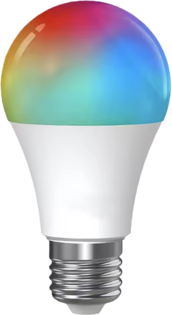

# Migrating a device to MoonLight over the air

A device running another firmware moves to MoonLight over the network, through that firmware's own update page, with no USB cable and no opening the case.
It keeps its WiFi network or its Ethernet cable, and usually its address.

The file you upload is the migration image, a small program that runs once.
It writes MoonBase (MoonLight's installer), MoonLight's bootloader and MoonLight's partition table, as a cable install leaves them, and restarts into MoonBase, all in about ten seconds, and from WLED it carries every saved WiFi network over, so MoonBase joins the one the device was on.
A WLED on Ethernet keeps its cable when its board is one of WLED's own Ethernet boards: the image writes the board's wiring for MoonLight, and the Devices map says before the move whether it does.
MoonBase then installs MoonLight from the release.

## What can move

| From | Chip | Status |
|---|---|---|
| WLED | ESP32 classic with 4, 8 or 16 MB of flash | tested on WLED 0.15.0's 4 MB build, a power cut at every step included; the WiFi comes along |
| WLED | ESP32-C3 with 4 MB of flash | tested on WLED 0.15.0, other versions should work; the WiFi comes along |
| WLED | ESP32-S3 with 4, 8, 16 or 32 MB of flash | tested on WLED 0.15.0's 16 MB build, moving to `esp32s3-n16r8`; MoonBase lands in the second app slot where the layout has no MoonBase slot, and MoonLight's first network update takes it back; the WiFi and WLED's TX power limit come along |
| WLED-MM | ESP32-P4 with 16 MB of flash, on Ethernet | tested on WLED-MM 14.5.1-dev on revision 1.3, moving to `esp32p4rev1-eth`; MoonBase comes up on the board's own Ethernet wiring, the Waveshare P4 boards' |
| Tasmota | ESP32 classic, C3 or S3 | tested on Tasmota 16.0.0 on the classic, through its safeboot; enter `SetOption128 1` once in Tasmota's console (Tools → Console), which lets the Devices map reach its update; the WiFi comes along |
| ESPHome | ESP32 classic, C3 or S3 | tested on ESPHome's ready-made firmware (ESPHome Web 2026.9.1) on the classic; a MoonLight device hands the image on through ESPHome's own update protocol; the WiFi it was given over Improv comes along, while one compiled into its YAML does not and MoonBase opens its access point |
| Any other firmware | an ESP32 chip MoonLight builds for | by hand, through the firmware's own update page, for a firmware that installs an unsigned ESP-IDF app image into a slot of at least 1.2 MB, as Arduino and ESP-IDF projects such as ESPEasy do; the WiFi comes along where the firmware left it in ESP-IDF's own store, as Arduino's `WiFi.begin` does, and otherwise MoonBase opens its access point to join |

A migration image is built for one chip family, so the chip decides which file fits: the classic ESP32, the C3, the S3, the S31, and the P4 twice, below revision 3 and from it.
It carries MoonLight's bootloader and partition table for each flash size and type the family comes in, and writes the pair for the flash the chip reports, so the board runs as a cable install leaves it: its whole flash, in QIO or octal mode as MoonLight runs it.
The Devices map takes a P4's revision from WLED-MM; a Tasmota or an ESPHome P4 gets the image for below revision 3, which a revision-3 chip's old firmware refuses before writing it.
A report of a move, working or not, is welcome as an [issue](https://github.com/MoonModules/MoonLight/issues).

An ESPHome device with an update password takes the image from ESPHome's own Python client, with the password: `python3 -c "from esphome.espota2 import run_ota; run_ota('<address>', 3232, '<password>', 'shared-migrate-esp32.bin')"`, ESPHome installed (`pip install esphome`). One that requires encryption moves by cable.

## Steps, with WLED as the example

[Move a WLED device to MoonLight, without a cable](../moonwalk.md#migrate-wled). The device catalog, [`deviceModels.json`](https://github.com/MoonModules/MoonLight/blob/main/mooninstaller/deviceModels.json), holds the settings of every board MoonLight knows, such as the **ESP32-C3 RGBWW PWM bulb**.

## What can stop it

Before it writes anything, the migration image checks that it can finish: enough flash, no flash encryption or secure boot, room to move itself out of the way.
When a check fails, it restarts the old firmware with nothing changed.
So a device that cannot move keeps working as it was:

- The old firmware refuses the upload. A newer WLED checks an upload's release name until its option to skip that check is ticked, and an update password or a locked update refuses it too.
- The migration image refuses the board, and the old firmware comes back.
- The WiFi is not where the image looks, and MoonBase opens its access point.

Two moments need care: the image rewrites the bootloader, for under half a second, and then the partition table, for about 50 milliseconds.
A power cut in exactly one of those windows leaves the device needing a USB cable to recover, which on a bulb means opening it.
A power cut at any other moment comes back on its own: the image starts over, or MoonBase takes over.

Going back to the old firmware also needs a USB cable, since MoonBase installs MoonLight only. Each firmware's own web installer writes it back from Chrome or Edge: [WLED](https://install.wled.me/), [WLED-MM](https://wled-install.github.io/), [Tasmota](https://tasmota.github.io/install/) and [ESPHome](https://web.esphome.io/).

**The migration is at your own risk.**
It is tested on the devices named above, and another device can differ from them in ways the image cannot check.
A device that needs a cable may have to be opened, which can void its warranty.
