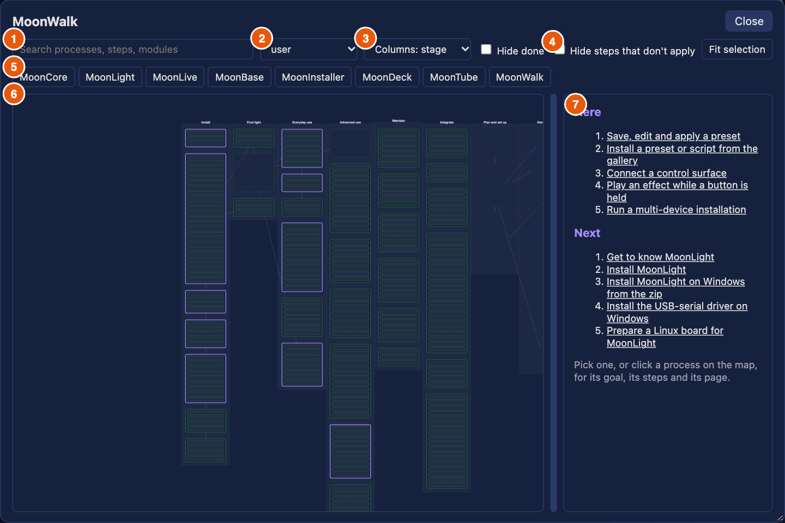
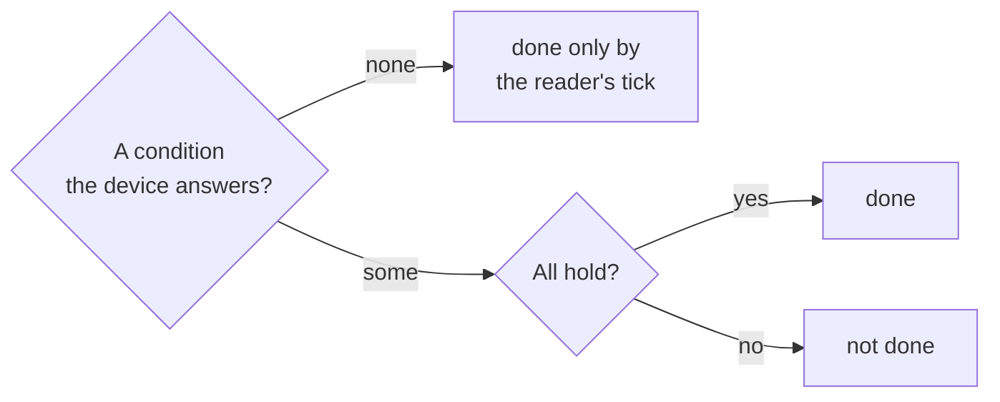
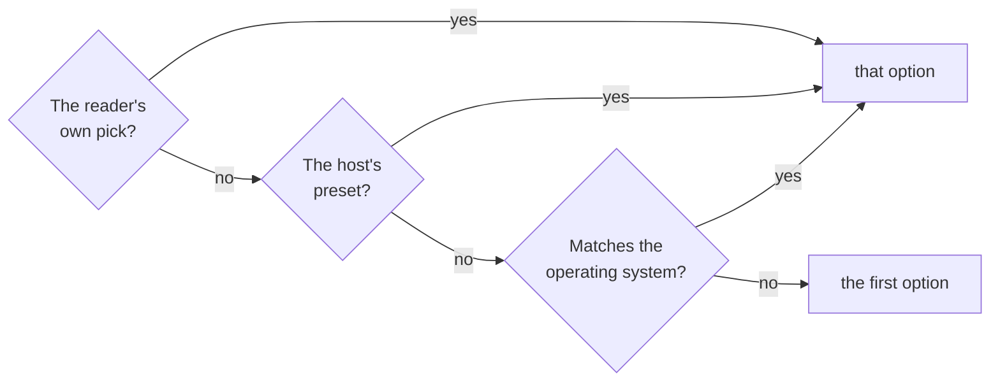
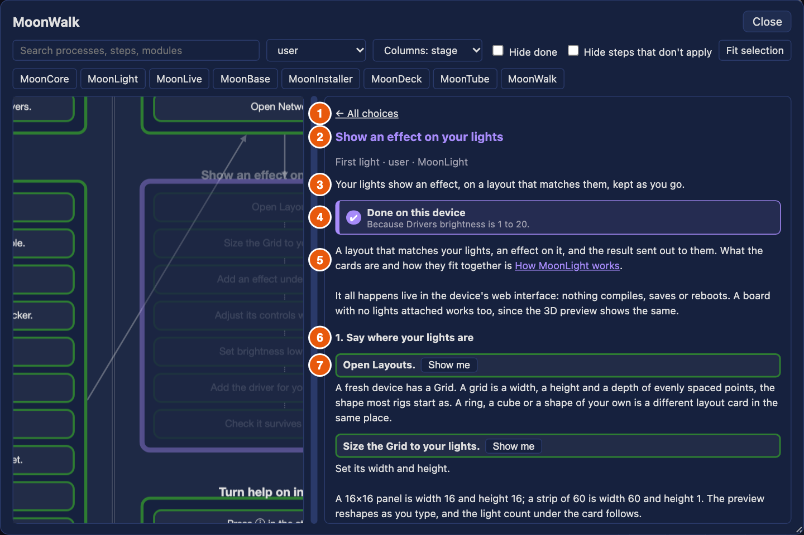
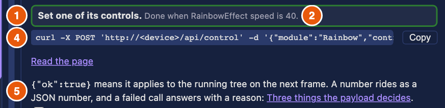
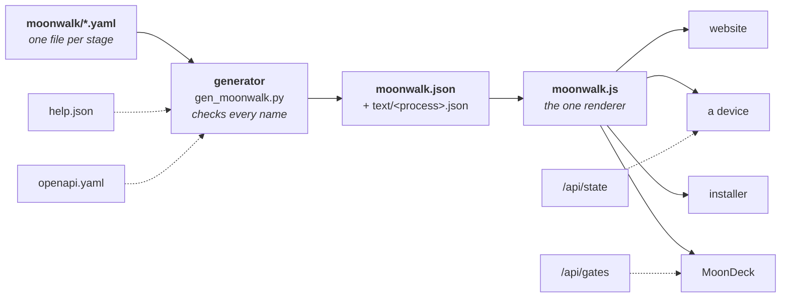

# MoonWalk

The reference for MoonWalk, the map of every MoonLight process. The map is one renderer, [moonwalk.js](https://github.com/MoonModules/MoonLight/blob/main/docs/assets/moonwalk.js), drawing one file, `moonwalk.json`, which [a generator](https://github.com/MoonModules/MoonLight/blob/main/moondeck/docs/gen_moonwalk.py) builds from the stage files under [moonwalk/](https://github.com/MoonModules/MoonLight/tree/main/moonwalk). Why it is shaped so: [the MoonWalk model](../work/future/moonwalk.md). The map itself: [MoonWalk](../moonwalk.md).

| Part | For | It covers |
|--|--|--|
| **I. Using MoonWalk** | anyone using MoonLight | the map on the website, in the app and in the installer: what you see, what marks a step done, how to find your way |
| **II. MoonWalk for contributors** | someone who builds and changes MoonLight | starting the programs that show the map, and the map in MoonDeck, which runs a change's checks |
| **III. Writing and maintaining** | someone who writes processes, or the program around them | how the map is built, the stage-file format, what the generator checks, and the interfaces the map reads |

## Part I: Using MoonWalk

### The names

| Name | What it is |
|--|--|
| **Stage** | One column of the journey, left to right: Install, First light, Everyday use, Advanced use, Maintain and Integrate are for people using MoonLight; Plan and set up, Develop, Run on hardware, Test, Document and commit, Review and merge and Release are for people building it. |
| **Process** | One task a reader has, such as "Save, edit and apply a preset". A box on the map, in one stage. |
| **Step** | One action in a process, a line in its text. Its kind says how it is done: by hand, by opening an address, reading a page, following another process, calling the device's API, adding a module or setting a control (or, for contributors, running a script). [Section 3](#3-opening-a-process) lists them. |
| **Actor** | Who does a process. You are the **user**. The others build MoonLight: the **contributor**, the **product owner**, an **agent** and **CI**. |
| **Choice** | An option the reader picks in a process, such as the platform. Steps for other options gray out. |
| **System** | A part of the architecture, MoonCore to MoonWalk, which a process touches. |
| **Condition** | What the device shows once a step holds: a control's value, or a module that exists. A step with one marks itself done. |
| **Dependency** | A process that must be done before another is offered under Next. |
| **Host** | The program showing the map: the website, a device, the installer, or MoonDeck, the contributors' console. |
| **Here, Next** | The two lists before a process is picked. |

### 1. Opening MoonWalk

The same map opens in four places; this part covers three, and MoonDeck's is in [part II](#6-moonwalk-in-moondeck). Each host tells the map what it knows, and the map starts where that is.

| Host | Opens from | Starts as | What the lists show |
|--|--|--|--|
| The website | [moonwalk.html](../moonwalk.md), or a **MoonWalk** button on a page | every actor, the whole journey | **Next** only. An address `moonwalk.html#<process>` opens that process, and `?focus=<page>` the processes of a page |
| A device | the 🗺️ button in the app's header | the user | **Here**: the processes that touch the cards in view. **Next** after it |
| The installer | the **MoonWalk** link beside "Not sure which way to install?" | the user | **Here**: the install process, with the platform choice on ESP32 |



The picture shows a device with the preset and control-surface cards in view. What it shows, left to right and top to bottom:

1. **The search box.** It matches a process's title, goal and systems, and every step's text and action. Matches stay lit, the rest fade, and the map zooms to the matches.
2. **The actor select.** It shows the processes of one actor: you are the user. A device and the installer start on the user, the website on every actor. The choice is kept for the next visit.
3. **Columns.** The columns are the stages of the journey, or, switched to system, the systems of [the architecture](../explanation/architecture/index.md). Kept for the next visit.
4. **Hide steps that don't apply.** A step for another option of a choice, or one a change does not need, leaves the text instead of graying out.
5. **The system chips**, MoonCore to MoonWalk. One chip per system some process touches. Switched on, a chip keeps only the processes of that system, and several chips add up. None on means every system.
6. **The map.** A column per stage, a box per process holding one row per step. The border says the actor: green the user, blue the contributor, purple the product owner, orange an agent, gray CI. A thick accent border marks the processes the text on the right lists, as the picture shows. Solid arrows between processes are dependencies, a process waiting for another. Drag the map to pan it, scroll to zoom, and click a process or a step to read it.
7. **The text panel.** Before a process is picked it holds two lists and a hint:
    - **Here** lists up to six processes the host is about, open ones only. It appears only when the host names some: a device names those touching the cards in view, and the installer its install process. A process already done, or one of another actor than the select shows, is left out. It reads "Everything here is done." when none is left.
    - **Next** lists up to five processes that are not done and whose dependencies all are, in the journey's order, minus those already under Here. It reads "Nothing left on this path." when none is left.
    - Picking an entry, or clicking a process on the map, opens it: its goal, its steps and its page.

### 2. What the map knows, by host

A host hands the map what it knows, and the map draws with it. What the host cannot tell, the reader marks by hand: a **done** checkbox at the foot of a process, kept in the browser.

#### On a device

The app hands the map the device's whole state, read when the map opens, and the cards in view.

**Where it opens.** The processes whose steps name a module type in view are listed under **Here**, and the map zooms to them. With no card in view that is named by a process, only **Next** shows.

**What is done.** A step may carry a *condition*: what the device shows once the step holds. A condition is a module that exists, a control that has a value or differs from one, or a control whose number lies in a range. It holds when any module of that type on the device meets it. A step with no condition, such as one that reads a page or flashes a board, the device cannot answer.

Every step with a condition says it under its instruction, in every host: "Done when Drivers brightness is 1 to 20", or "Done when a MoonLiveEffect module exists". A reader who wonders why a process is gray reads these lines.




A process is **done** when at least one of its steps has a condition and every condition the device can answer holds. A done process is drawn at 40% opacity. A process with no condition anywhere is done only when the reader ticks it. The text of a done process says "Done on this device" in place of the checkbox, and each step the device shows done reads "done". A process the device shows done only through one of several steps is done on that step alone; the steps without a condition may still be open.

The marks the installer handed over count as done too. The state is read once, when the map opens. Reopen the map to see a change.

**Show me.** On a step that names a module, **Show me** opens that card, its page and tab, expands its controls, scrolls to the control the step sets, and highlights it.

**Following a process.** **Show me** also closes the map and follows the process. A bar floats under the control the step targets and reads "Step 2 of 5: <what to do>".

- When the device shows the step done, the bar moves to the next step by itself, skipping every step already done.
- A step the device can answer has a **Skip** button. One it cannot has a **Done** button, which the reader presses.
- Clicking the bar's text reopens the map at that step. **✕** stops following. At the end it reads "<process>: done".

#### In the installer

The installer hands no device state. It names the install process as **Here**, zooms to it, and presets the platform choice to ESP32. A reader's own pick of a platform wins over it, and is kept. After an install it hands the device the install process as done, and the device keeps that as a mark (see On a device).

#### On the website

The website hands nothing but an address. The map reads the reader's ticks, their choices and the address: `moonwalk.html#<process>` opens a process, `#<process>/<step>` a step, and `?focus=<page>` the processes naming that page. There is no Show me, since a page cannot touch a device. **Copy** on a call step still gives the line to run elsewhere.

#### Choices



A choice, such as the platform, takes the reader's own pick first, then the host's preset, then the reader's operating system, then the first option. The pick is kept per choice name, in the browser's storage for that host's address, so the website and a device each keep their own.

### 3. Opening a process

Click a process on the map, or an entry under **Here** or **Next**. The text panel shows it from top to bottom in this order. A process with prose widens the panel to read it; its prose, the intro, the outro and every step's detail, arrives from its own file when the process first opens, so the map a page loads stays small.

| Part | What it holds |
|--|--|
| **← All choices** | Back to the **Here** and **Next** lists. Shown where the host has them. |
| **Title and meta line** | The process's title, then its stage, actor and systems, separated by dots. |
| **Goal** | One sentence: what is true once it is done. |
| **Done card** | The card of section 2 or 6, when the device, or in MoonDeck the scripts, show the process done. |
| **Intro** | What the process is for, and what its choice decides. |
| **Choice** | A row of buttons, one per option, with the question before it. The chosen one is filled. Steps for the other options gray out, or leave when **Hide steps that don't apply** is on. The pick is kept. |
| **Steps** | One block per step, under numbered chapter headings. See below. |
| **Outro** | What to do next, once the steps are done. |
| **Done checkbox** | At the foot, for a process the host cannot show done. Ticking it keeps the mark in the browser. |

A process with no prose of its own shows its steps as a plain numbered list under a link to its page.



The numbers: 1 the back link, 2 the title, 3 the goal, 4 the done card, 5 the intro, 6 a chapter heading, 7 a step. The meta line sits under the title, and the outro and the done checkbox at the foot, below the picture.

#### A step

A step is one block in the panel, and a row on the map. Its parts, in order:

1. **The instruction.** One action in a box, bordered in the color of its actor. Where a step's actor differs from the process's, the actor follows in parentheses, "(contributor)".
2. **The notes after it,** in quieter text: the choice option it belongs to ("platform: Windows"), what it changes, and "Done when …" for a condition.
3. **The state.** "✔ done" when the device shows it, as section 2 describes. Otherwise the button the kind gives, below.
4. **What to do.** The step's call to copy, a link, or the prose.
5. **The detail,** written text that explains the step, with links and examples.
6. **"Tested by",** under the step: the scenarios and unit tests that prove it. A test that names the step itself comes first (`steps_proved` in a scenario, `// @step process/step` above a unit test), then the scenarios that set or expect the control the step sets. Each opens its entry on [the test page](../tests.md).

A chapter heading starts a group of steps. It is numbered by the chapters that hold a step that applies, and grayed when all of its steps are grayed.



The numbers follow the list above: 1 the instruction, 2 its notes, 4 what to do, 5 the detail. The state (3) is empty here, since this device does not yet hold the condition; it reads "✔ done" once it does.

**What each kind gives:**

| Kind | A step of this kind | In the panel | Example |
|--|--|--|--|
| `manual` | something to do by hand, on a screen or on hardware | its words under the instruction | "Plug your board in with a data cable." (`install`) |
| `open` | an address to open | the address as a link, in a new tab | "Open the web installer." opens `moonmodules.org/MoonLight/install/` (`install`) |
| `read` | a page of the docs, at a section | **Read the page**, at the section | "Read what MoonLight is." opens `index.md` at "What it is" (`know-moonlight`) |
| `process` | another process to do here | the other process's title; clicking it opens that process | "Follow the OSC process." opens `osc-control` (`control-surface`) |
| `call` | one call of the device's [REST API](api.md) | the curl line, a **Copy** button and a link to the operation's entry on the API page | "Read the module types the device knows." gives `curl 'http://<device>/api/types'` (`http-api`) |
| `add` | a module to add on the device | **Show me** where the host can show a card; the step's condition says the module exists | "Add the Midi service." adds a MidiService (`control-surface`) |
| `set` | a control to set on the device | **Show me**; the condition says the control has the value | "Set brightness low in Drivers." sets `brightness` to 20 (`first-light-show`) |

**Copy** is no kind of its own but the button of every step that carries a line: a `call`, or a `run` in contributors' processes. It puts the line on the clipboard and reads "Copied" for a moment. Where the browser keeps the clipboard from an insecure page, as on a device's own `http` address, it selects the line instead, to copy by hand.

### 4. Finding your way on the map

The bar above the map filters it. Every filter acts on the whole map at once.

**Search** matches a process's title, goal and systems, and every step's text and action, so a module or a script name finds the processes that use it. Matches stay lit and the rest fade to 8%. The map zooms to the matches, and clearing the box shows the whole journey again.

**Actor, chips and Hide done** combine: a process shows when it passes the actor, any switched-on system chip, the search, and Hide done, all at once. **Hide done** leaves out every process marked done, by the device or by the reader's tick. **Fit selection** zooms to what the filters leave, and never closer than 1.2 times.

**The map.**
- Drag the background or a box to pan, and scroll to zoom. A tap on a box without moving opens it; a drag that ends on a box does not.
- A tap on a process opens it, and a tap on a step opens its process at that step.
- A solid arrow between processes is a dependency: the process it points to waits for the one it starts at, and shows under **Next** only once that one is done. A dotted line runs between the steps of a process, in order.
- Fading marks what a filter hides (8%), a done process (40%), and a step for another option of a choice, or a step a change does not need (25%).

**What is kept.** The browser keeps, per host's address: the actor, the columns, and both checkboxes; the share between map and text; the reader's choices (platform and the like); and the processes the reader ticked done. A private window keeps them for the visit only. The process you had open is kept for the browser tab, so closing the map and opening it again returns to it; **← All choices** forgets it. The search text is not kept.

**When something fails to load.** If the map cannot load, the area reads "The map could not load" with the reason. If one process's prose cannot load, its panel says so and the map stays usable. If the renderer itself cannot load, as on a device with no route to the site, the app says "MoonWalk could not load" and goes on.

## Part II: MoonWalk for contributors

### 5. Try it

To see the map yourself, start these, each in its own terminal, from the repository:

| To see | Run | Open |
|--|--|--|
| a device | `uv run moondeck/build/build_desktop.py`, then `uv run moondeck/run/run_desktop.py` | <http://localhost:8080/> |
| MoonDeck | `uv run moondeck/moondeck.py` | <http://localhost:8420/> |
| the website | `uv run moondeck/docs/build_docs.py --serve` | <http://localhost:8422/MoonLight/moonwalk.html> |
| the installer, and your working copy of MoonWalk in a device | `uv run moondeck/run/preview_installer.py` | <http://localhost:8421/>, and <http://localhost:8080/?help=local> |

The device loads MoonWalk from the website. `?help=local` makes it load the renderer, the map and the help from the preview server on 8421 instead, so a change in the working tree shows after a page reload. The device asks once whether to load from there. Stop the servers with `pkill MoonLight`, `pkill -f preview_installer` and `pkill -f build_docs`.

To run the checks behind the map: `uv run moondeck/test/test_host.py` runs every test, and `uv run moondeck/docs/gen_moonwalk.py --out /tmp/moonwalk.json` builds the map and reports every fault in the stage files.

### 6. MoonWalk in MoonDeck

MoonDeck hands the map its gates ([what they hold](#10-what-moondeck-serves-gates)): for each process, each script step the current change triggers, whether its last pass still holds, and how long it took. It hands no device state, so a condition means nothing here.

- **Where it opens.** On the stages with a process of an actor other than the user, filtered to the contributor, since these are MoonDeck's.
- **What is done.** A process is done when every script step the current change triggers has a pass that still holds, and there is at least one. The text says "Done: its scripts last passed".
- **A step.** One the change does not trigger reads "not needed for this change" and grays out. A fresh one reads "passed", a running one "running". An unmeasured step's button reads "Not measured yet", a measured one gives the longest of its recent runs, `42s` or `3m05s`.
- **Run.** A script step has **Run** in place of Show me. It closes the map, opens the script's tab and card, and runs exactly that step's call, with its output in the card's log. A step that runs a subprocess is read as that subprocess's steps together.

The map opens from the 🗺️ MoonWalk button in MoonDeck's header, on the stages with a contributor's processes. Its **run** steps are the ones MoonDeck can run:

| Kind | A step of this kind | In the panel | Example |
|--|--|--|--|
| `run` | a script, as MoonDeck runs it | the command line with **Copy**, and **Run** | "Check the specs." gives `uv run moondeck/check/check_specs.py` (`commit`) |

## Part III: Writing and maintaining

### 7. How the map is built


The solid line is the map's way from the stage files to the four hosts. The dotted lines are what each side checks against or reads: the generator checks every module, control and operation a step names against `help.json` and `openapi.yaml`, a device hands the map its state, and MoonDeck its gates.

The stage files are the source and the map is generated, so a fault is fixed in the YAML, never in the map. The generator is `moondeck/docs/gen_moonwalk.py`, and the renderer `docs/assets/moonwalk.js` knows no process: it draws whatever the map holds. The next sections are for whoever writes or changes processes, or the program around them.

Each host calls the renderer's `drawMap` with what it knows, and the renderer adapts:

| | Device | MoonDeck | Installer | Website |
|--|--|--|--|--|
| Loads the renderer from | the website, or the preview server with `?help=local` | the repository | the repository | the site |
| Starts on | the user, the processes whose modules are in view | the contributor, the contributor's stages | the user, the `install` process | every actor, or the address |
| Hands over | `state` from `/api/state`, the types of the cards in view | `steps` from `/api/gates`, and `run` | `choices: {platform: ESP32}` | the address |
| A step is done when | its conditions hold on the state, or the reader ticked | its script's last pass is fresh | the reader ticked | the reader ticked |
| Show me, follow | yes | no | no | no |

The installer's link to a new device carries `?walked=install`, which the device keeps as a mark until MoonWalk records it.

### 8. Writing a process

A process is an entry in a stage file, `moonwalk/NN-<stage>.yaml`. The first line of each file, `# yaml-language-server: $schema=moonwalk.schema.json`, makes an editor check it as you type, and the generator checks it again (section 9). Save the file and reload: the preview server on 8421 and the docs server rebuild the map on every request. The steps are a process too: [Change or add a MoonWalk process](../moonwalk.md#change-moonwalk).

The format follows [Arazzo](https://spec.openapis.org/arazzo/latest.html), the OpenAPI Initiative's workflow standard: a process is a workflow, with `dependsOn` and `inputs` as Arazzo has them. A step is shaped as Given, When, Then, as in Gherkin. Arazzo has no UI, shell or manual steps, which is why a step's `when` has its own verbs.

An example, from `first-light-show`, shortened:

```yaml
- id: first-light-show                      # unique across all stage files
  title: Show an effect on your lights
  actor: user
  goal: Your lights show an effect, on a layout that matches them.
  systems: [MoonLight]
  dependsOn: [first-look]
  steps:
    - id: brightness
      section: Send it to your lights       # opens a numbered chapter
      say: Set brightness low in Drivers.
      when: { set: { module: Drivers, control: brightness, value: 20 } }
      then: [{ module: Drivers, control: brightness, minimum: 1, maximum: 20 }]
      detail: |
        20 is plenty on a bench.
```

#### A process

| Field | What it holds |
|--|--|
| `id` | lowercase words with hyphens, unique across all stage files |
| `title`, `goal` | a title of at most 10 words, and one sentence for what is true once it is done |
| `actor` | `user`, `contributor`, `product-owner`, `agent` or `ci` |
| `systems` | the systems it touches, named as the architecture's Part table names them. The generator adds what the steps imply |
| `dependsOn` | processes that come first. They decide what shows under **Next** |
| `inputs` | the reader's choice: a name with at least two options, as `platform: {enum: [...]}`, and a description for the question |
| `page` | the docs page that holds the process's reference. It must exist |
| `intro`, `outro` | markdown before and after the steps |
| `steps` | the steps, in order |

#### A step

| Field | What it holds |
|--|--|
| `id` | unique within the process |
| `say` | one action, at most 8 words. It is the instruction on the map, in the bar, and in a test's name |
| `section` | starts a numbered chapter with this heading; later steps stay in it |
| `actor` | who does this step, when it is not the process's actor |
| `given` | when the step applies. A list of conditions, below |
| `when` | what the step does. Exactly one verb, below |
| `then` | what the device shows once the step holds, as in section 2. Left out, the generator derives it for `add` and `set`, whose result is their action |
| `detail` | markdown that explains the step, at most 120 words |

#### What `when` can be

| Verb | Holds | Example |
|--|--|--|
| `open` | `module`, or `view`, or a `url` | `{ open: { module: SystemModule } }` |
| `set` | `module`, `control`, `value` | `{ set: { module: Drivers, control: brightness, value: 20 } }` |
| `add` | `module` (the container) and `type` | `{ add: { module: Services, type: MidiService } }` |
| `replace` | `module` and `type` | the same, replacing what is there |
| `delete`, `clear` | `module` | `{ delete: { module: RainbowEffect } }` |
| `apply` | a state document, as `PATCH /api/state` takes it | `{ apply: { modules: [...] } }` |
| `call` | `operation` from `openapi.yaml`, `params` for its path and query, `body` as the reader sends it | `{ call: { operation: getModule, params: { name: Rainbow } } }` |
| `run` | `script` and `args`, a MoonDeck script, or a `command` | `{ run: { script: moondeck/check/check_specs.py } }` |
| `read` | a docs `page` and a `section` | `{ read: { page: index.md, section: What it is } }` |
| `process` | the id of another process | `{ process: osc-control }` |
| `manual` | a string: the step is prose | `{ manual: "Plug your board in with a data cable." }` |

A select control's value reads as its option's name too, so `equals: USB` holds for the option named USB.

Every module type a step names is the type's name in `help.json`, such as `GridLayout`, and a control is its name there too. That is what the generator checks.

#### What `given` can be

`given` is a list, and the step applies when all of its entries hold.

| Entry | Holds when |
|--|--|
| a process id | that process is done first |
| an expectation, as in `then` | the device shows it |
| `{ changed: [globs] }` | the change in the working tree touches one of the paths, as GitHub Actions' `paths`. MoonDeck uses this to gray out steps a change does not need |
| `{ input: <name>, equals: <option> }` or `{ input: <name>, in: [<options>] }` | the reader chose that option of the process's `inputs` |

#### What `then` can be

The five expectations are the module existing (`exists`), a control's value (`equals`, `notEquals`, `minimum`, `maximum`), an HTTP `status`, and a `file` that exists, with `contains` or `equals`. The device app answers the first two; `status` and `file` have no answer from a device's state and are for a test.

#### Prose and caps

A process's `intro`, `outro` and each step's `detail` are markdown, in the voice of [the documentation standards](../contributing/documentation-standards.md). The generator moves them out of the map into `moonwalk/text/<process>.json`, which the map fetches when the process opens, so the map stays small. Links in them are checked (section 9). Keep to the limits of section 9, or the process splits: a process of more than ten steps for one reader folds some into a subprocess, called by a `process` step.

### 9. What the generator checks

Two things read the stage files and check them: the generator, `gen_moonwalk.py`, which the docs build and the preview server run, and `check_docgen`, the commit's docs check. A fault of the first kind stops the build and names the file and the step. A fault of the second kind is a warning that `check_docgen` counts, and the count may only fall.

#### What stops the build

| It checks | Fails when |
|--|--|
| **The file's shape**, against `moonwalk.schema.json` | a field is missing, misspelled or of the wrong kind |
| **The short fields** | a title is over 10 words, a goal over 25 words or more than one sentence, a step's instruction over 8 words |
| **Identity** | two processes or two steps in one process share an id |
| **Names a process uses** | `dependsOn` or `given` names a process that does not exist; `given` names an input or an option the process does not offer; a system is not in the architecture's Part table |
| **Pages** | a page, a `read` step's page or its anchor does not exist |
| **The REST API** | a `call` names an operation that is not in `openapi.yaml`, lacks one of its path parameters, or gives one it does not take |
| **help.json** | a step names a module type or a control that `help.json` does not know |
| **Scripts and scenarios** | a `run` step's script is not in the repository, its `--name` is not a scenario, or a path it names does not exist (unless a build makes it) |
| **Processes** | a `process` step runs a process that does not exist |
| **Links in the prose** | a link in an intro, an outro, a detail or a note leaves a page or an anchor that does not exist |
| **Tests naming steps** | a test names a process step that no process has, so a renamed step cannot leave a dead claim |

#### What `check_docgen` warns about

The limits keep the map one a reader can take in:

| Part | Limit |
|--|--|
| A step's detail | 120 words |
| An intro or an outro | 150 words |
| A process, as one reader reads it | 600 words and 10 steps; past it, the process splits or its steps fold into a subprocess |
| A stage | 8 processes |
| The map with its renderer, gzipped | 50 KB |

It also warns when two processes repeat two or more steps in a row, since both should call one process. It also lists, as information and not a warning, the processes no runner verifies: none of their steps has a test, CI or an agent that performs it, or a condition the device state answers, so only a person can tell that they work. Most are by-hand or judgment work, which no check replaces, so the list is not counted.

**To see a check fail,** change a stage file, for example a step's `operation` to a misspelling, and run `uv run moondeck/docs/gen_moonwalk.py --out /tmp/moonwalk.json`. It prints the fault and writes nothing. Undo the change.

### 10. What MoonDeck serves: gates

MoonDeck answers `GET /api/gates` with what the map needs to mark script steps, from `moondeck/docs/walk_status.py`. Nothing there runs a step.

| Query | Meaning |
|--|--|
| `base=<ref>` | compare the working tree to this git ref instead of the last commit |
| `every=1` | treat every step as triggered, as a release does |
| `model=1` | add the map itself, as the stage files are now, so one request draws the map |

The answer holds `processes`, keyed by process id, each a list of its script steps:

| Field | Holds |
|--|--|
| `id`, `process` | the step and its process |
| `script`, `args` | the call that runs |
| `triggered` | the change touches a path the step's `given.changed` names, matched as GitHub Actions matches `paths`; `every=1` makes all true |
| `fresh` | the step ran and passed, and the files it covers are unchanged since. A run records the working tree as a git tree id, written through a temporary index so yours stays untouched |
| `seconds`, `slow` | the longest of its recent passing runs on this machine, and whether it passes 45 seconds |

A step that runs a subprocess stands for the subprocess's steps together. MoonDeck also serves `/moonwalk/moonwalk.json`, a process's prose at `/moonwalk/text/<process>.json`, and the renderer's own import `/assets/help.js`, so a contributor's map is their working copy.

### 11. Help and MoonWalk, linked

The help says what a module or a control is, and MoonWalk what to do with it. Each links to the other, and neither repeats the other's text.

- **One key.** A step names a module by its type and a control by its name, the keys `help.json` already uses. The generator checks every one in the same build (section 9), so a renamed control fails the build and leaves no dead pointer. The device's done check matches its modules by the same type.
- **One text each.** A step's instruction says what to do, and the card's help explains. A step does not carry the explanation, and the help does not carry the procedure.

**From the help to MoonWalk.** The generator writes two indexes into the map: `byModule`, from a module type to the steps that name it, and `byControl`, from `Type.control` to the steps that set it or expect it.

- **A module card's help** lists the processes that use the module, once each, at its first step, as "MoonWalk: <process title>".
- **A control row's help** names the step that sets it.
- **A link** opens the map at that process or step in the device's own page, not a new tab.

**From MoonWalk to the help.** **Show me** on a step opens the card it names and highlights the control, where the card's own help line explains it. The follow bar then shows one line with the current step above that card (section 2).

**When the links are missing.**
- The links show only with help on, under the help's one consent, which also covers the map: both load from the docs site, so both show that site the browser's address.
- Without a route to the site, as on a device's own access point, the help shows without these links and the map does not open.
- A device on an older release can lack a control a step names. Its link does not show, and Show me finds nothing, though the bar still says what to do.
