# Videos

Every clip of the series, in the order you would meet them. Each one plays on the page that documents its subject; the link under the title goes there.

## What is new in 7

<video src="assets/moontube/17-whats-new-in-7.webm" controls playsinline width="720" title="What version seven adds that you can see on a screen: a game, the FSEQ player, network streams and the Gallery."></video>

## How they are made

No clip is filmed by hand. [MoonTube](../moondeck/moontube/moontube.md) performs a run file in the real interface, the way a person would, narrates its captions with a synthesized voice and records the result. The same run file is a test, so a clip that drifts from the interface fails instead of going stale, and the whole series can be recreated against each release with one command per clip.

## Start

| | |
|--|--|
| [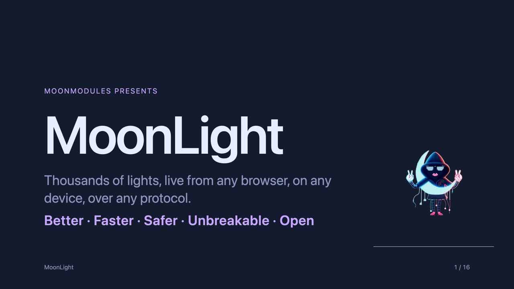](getting-started.md#the-introduction) | **Why MoonLight was rebuilt** Luna introduces MoonLight: what MoonModules built before, what she built from their prompts, and the principles that survived the rewrite. [Getting started](getting-started.md#the-introduction) |
| [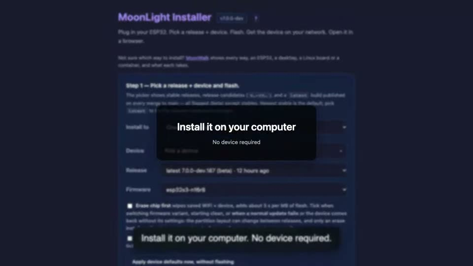](getting-started.md#three-ways-in) | **No hardware needed** The same installer, pointed at this computer: pick a release and download the app. [Three ways in](getting-started.md#three-ways-in) |
| [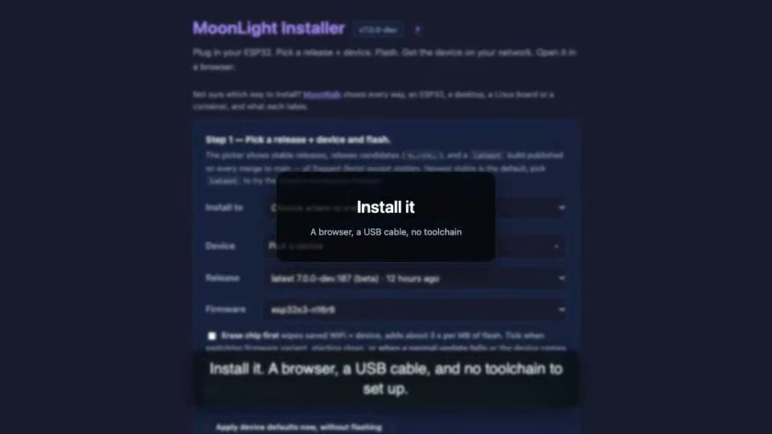](getting-started.md#three-ways-in) | **Install it** The web installer onto a device: erase, flash, join WiFi, and open the UI that comes back. [Three ways in](getting-started.md#three-ways-in) |

## Look around

| | |
|--|--|
| [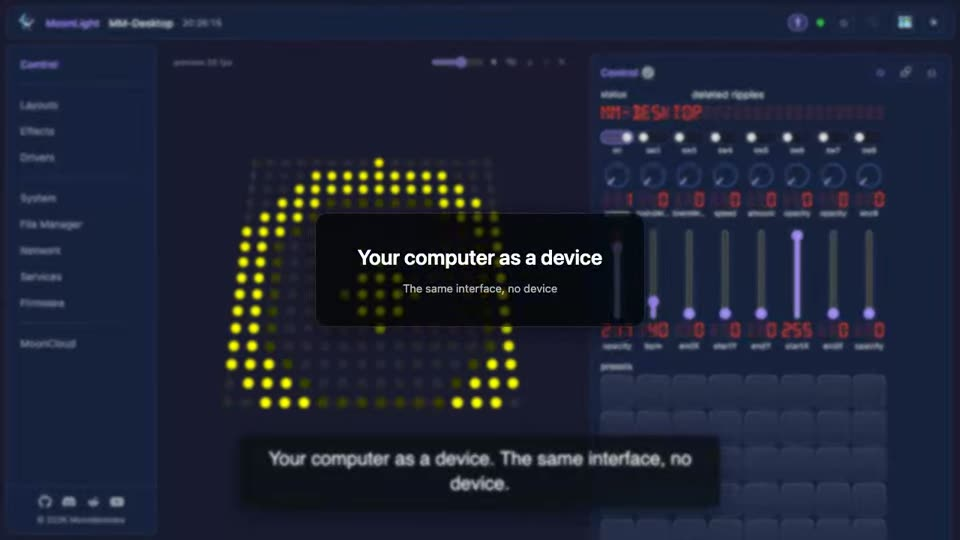](explanation/how-moonlight-works.md) | **Look around** The same tour on a computer: every module, and what sits inside each one. [How MoonLight works](explanation/how-moonlight-works.md) |
| [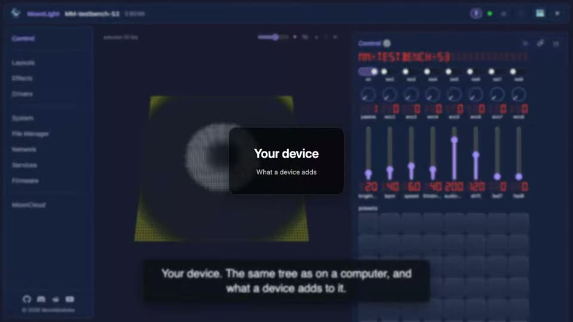](explanation/how-moonlight-works.md) | **On real hardware** The same tree on real hardware: what a device adds that a computer cannot, from LED pins to a microphone. [How MoonLight works](explanation/how-moonlight-works.md) |
| [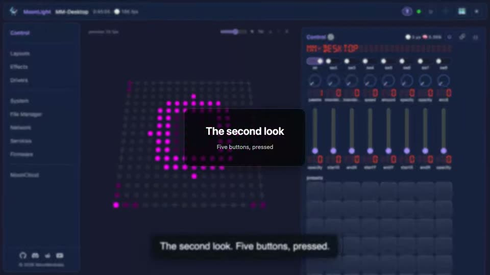](explanation/how-moonlight-works.md) | **Change your mind freely** The parts of the interface every card shares, each one pressed so you see what it does. [How MoonLight works](explanation/how-moonlight-works.md) |

## Build a show

| | |
|--|--|
| [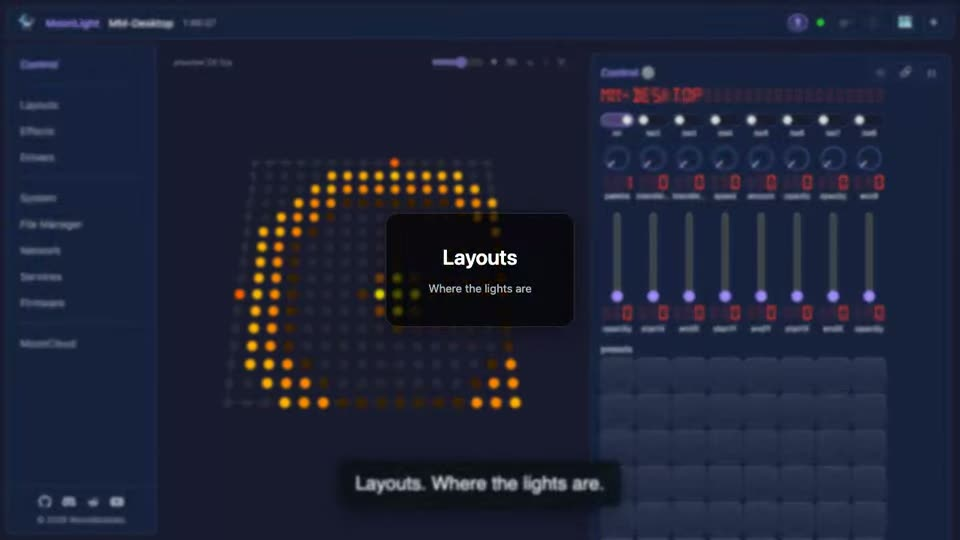](explanation/how-moonlight-works.md) | **Say where the lights are** Where the lights physically are: compiled layouts for the common shapes, and scripted ones for anything else. [How MoonLight works](explanation/how-moonlight-works.md) |
| [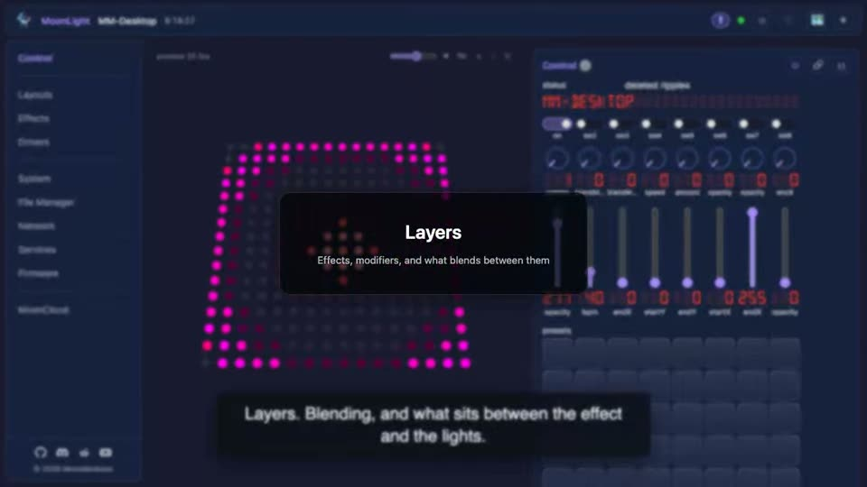](explanation/how-moonlight-works.md) | **Paint them** An effect, a modifier reshaping it, and a second layer doing the same, blended over the first. [How MoonLight works](explanation/how-moonlight-works.md) |
| [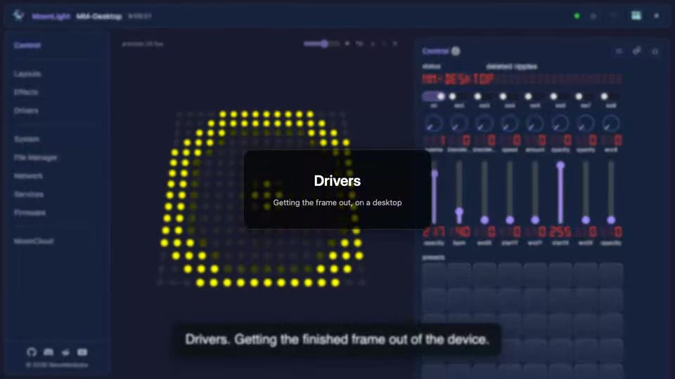](moonmodules/light/drivers.md) | **Get the frame out** What carries the frame out of the device, on a desktop: a preview, the video senders, and the network protocols a fixture listens on. [Drivers](moonmodules/light/drivers.md) |
| [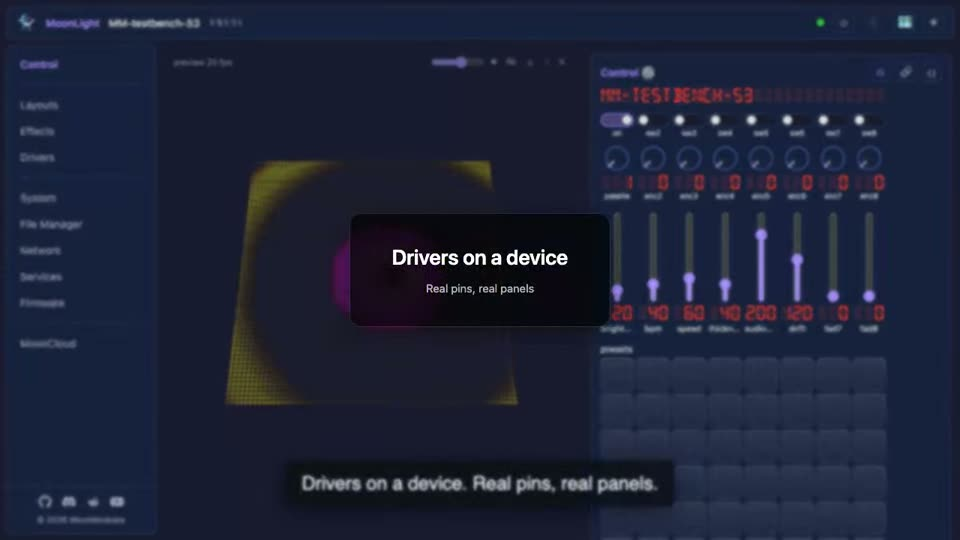](moonmodules/light/drivers.md) | **And out of a device** What carries the frame out of a device: the LED pins only real hardware has, the panel protocols, and the network senders it shares with a desktop. [Drivers](moonmodules/light/drivers.md) |
| [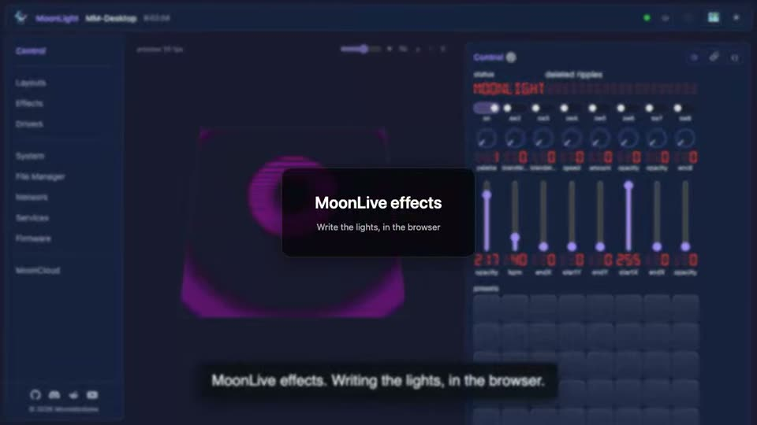](moonmodules/light/moonlive.md) | **Write your own** Scripting the lights in the browser: a library effect downloaded and run, then one written from nothing, from a single line to a particle system. [MoonLive](moonmodules/light/moonlive.md) |

## Control it

| | |
|--|--|
| [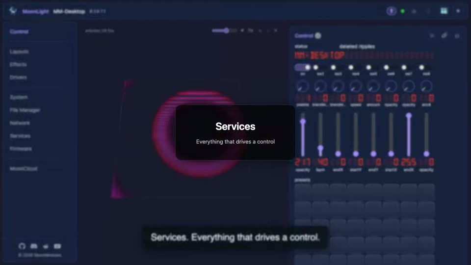](moonmodules/core/services.md) | **Everything that drives a control** Inputs: the compiled services that read a button, a pin or a remote, and a scripted one for anything with a condition in it. [Services](moonmodules/core/services.md) |
| [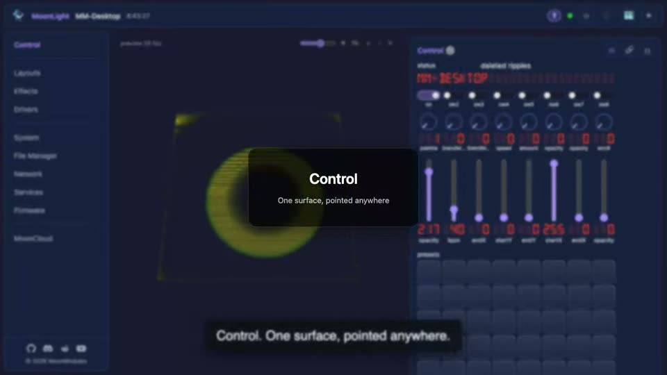](reference/control-surface.md) | **One surface, pointed anywhere** The surface: eight switches, encoders and faders, each pointed at any control on the device, and the one place external control arrives. [Control surface](reference/control-surface.md) |
| [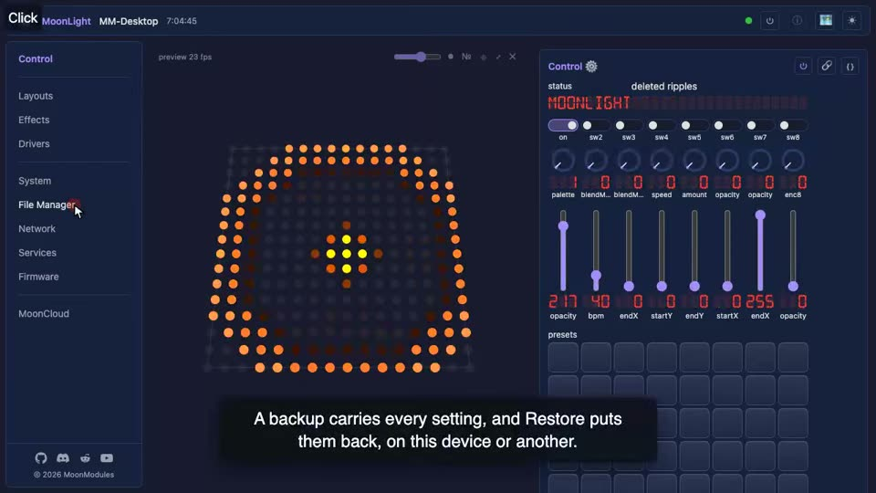](reference/backup-and-restore.md) | **Restore a backup** A backup from before config files were state documents, restored through the File Manager's Restore. [Backup and restore](reference/backup-and-restore.md) |

## The project

| | |
|--|--|
| [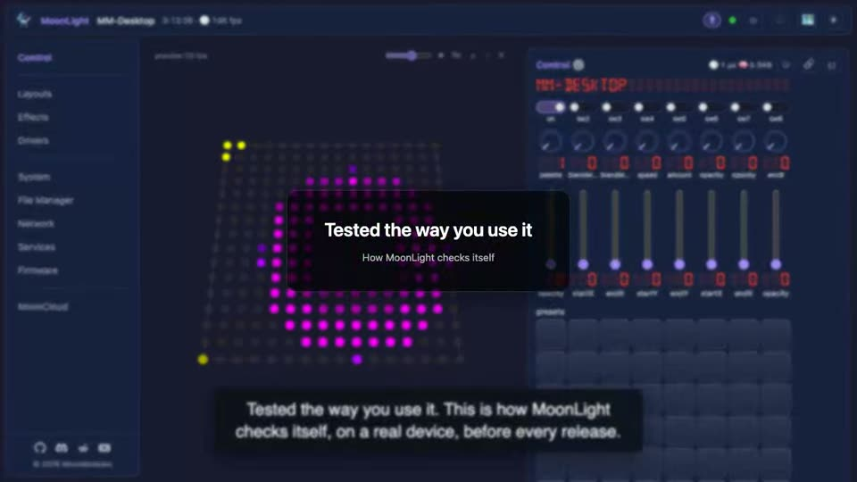](reference/testing.md) | **Tested the way you use it** How MoonLight checks itself: a scenario driving the running device while you watch. [Testing](reference/testing.md) |
| [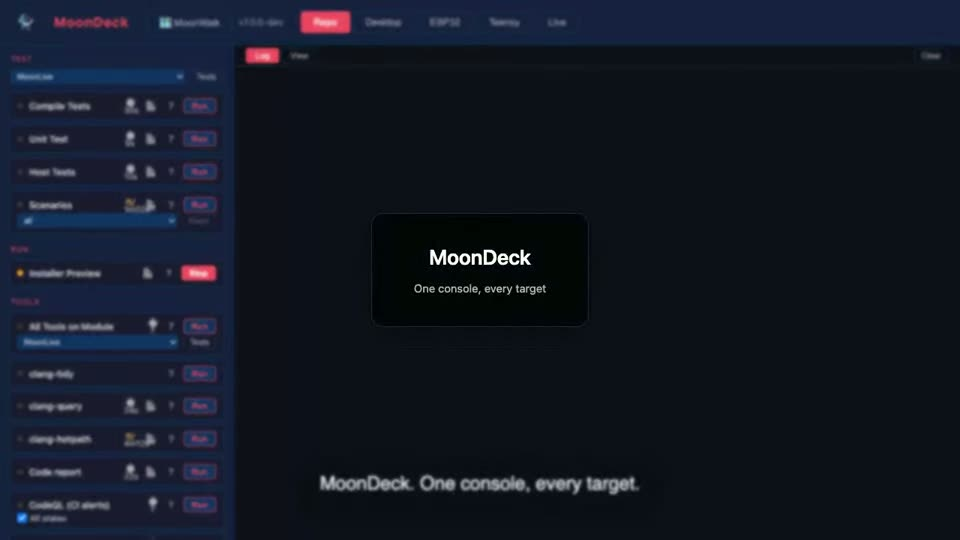](explanation/architecture/moondeck.md) | **The console it is built from** The developer console: one page that builds, flashes, tests and checks the project, and why it is ours rather than PlatformIO. [MoonDeck](explanation/architecture/moondeck.md) |
| [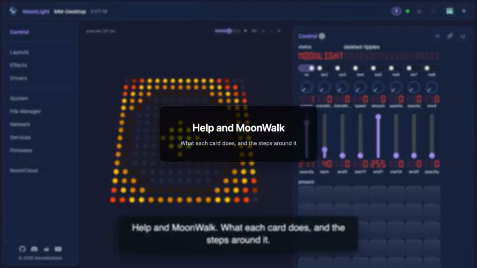](moonwalk.md) | **Help and MoonWalk** Help on every card and control, the MoonWalk step a card takes part in, and the test that checks a control. [MoonWalk](moonwalk.md) |
| [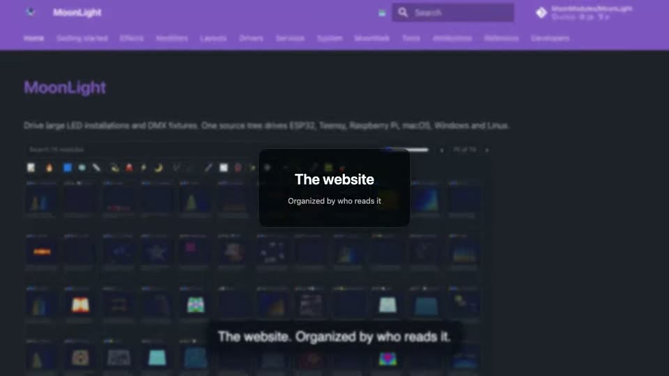](getting-started.md#the-introduction) | **The website** The documentation site, tab by tab: the home page, getting started, the catalogs generated from the code, MoonWalk, the tests, and the reference and developer pages. [Getting started](getting-started.md#the-introduction) |
| [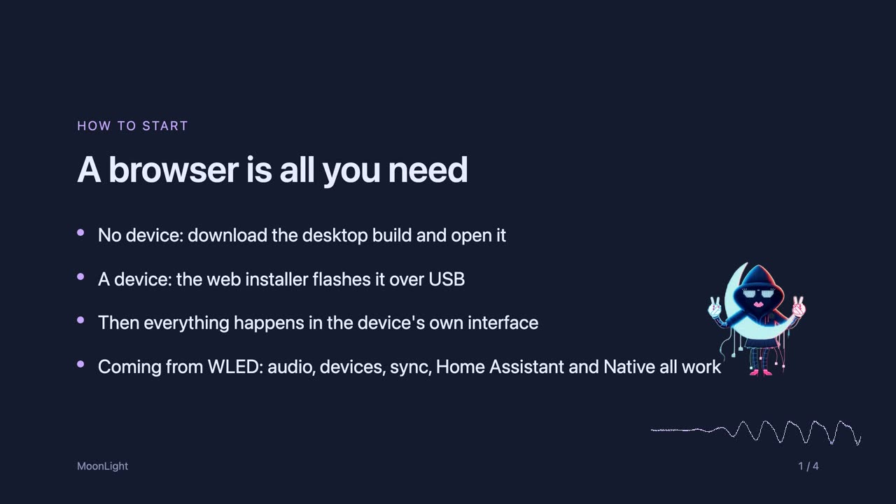](contributing/index.md) | **How to start** How to start, how to contribute, and what comes next. [Contributing](contributing/index.md) |
| [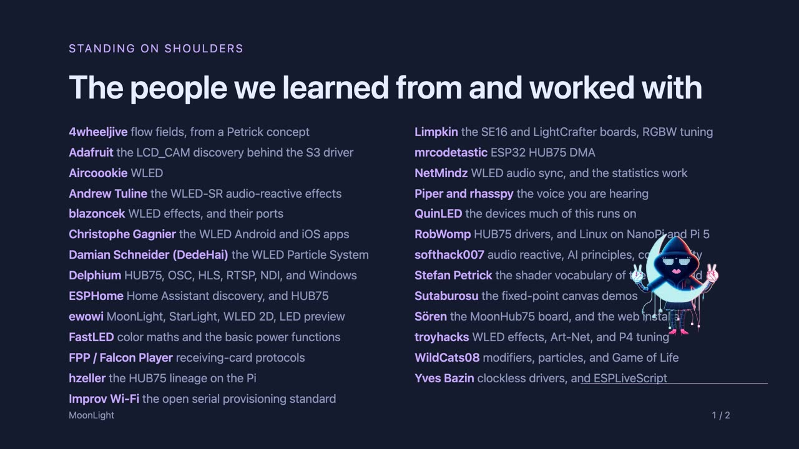](reference/attributions.md) | **Standing on shoulders** Who we learned from, and the standard algorithms MoonLight is built on. [Attributions](reference/attributions.md) |
