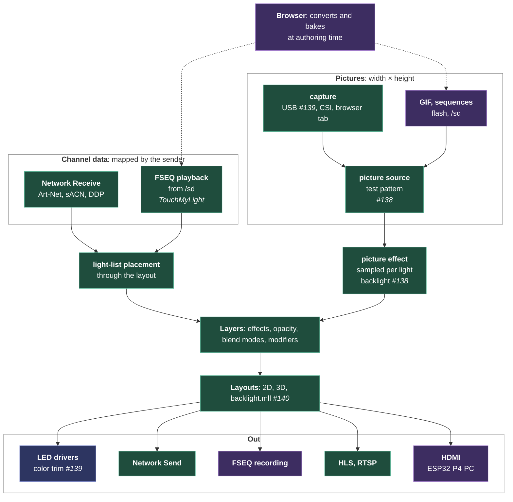

# Plan: streams, every frame from outside, one model

Plan, for the product owner's approval; started as an analysis on 2026-10-13, when three pull requests by Gohnnyman (#138 a backlight effect and VideoService, #139 USB video capture, #140 backlight wiring) arrived the same week TouchMyLight announced an FSEQ player for a 20 × 20 × 20 cube (on #134). Read one by one they look like unrelated features: a TV backlight, a capture card, a show player. Read from MoonLight's architecture they are the same thing: a stream of frames arriving from outside the device. This plan models that once, by the textbook, so cameras, video, files, the network and the browser become combinations of a few parts rather than a feature each.

## The textbook model: three independent axes

Every media framework separates the same three questions: GStreamer, FFmpeg, Media Foundation and Video4Linux all do. Where do the bytes come from, how are they encoded, and what shape is the frame? Each axis varies on its own.

| Axis | Values in MoonLight's world |
|---|---|
| **Transport** | a file on flash or the SD card, the network (UDP, TCP, the browser's WebSocket), USB, a camera port (MIPI-CSI) |
| **Format** | raw RGB, PPM, GIF, MJPEG, FSEQ, the DDP, Art-Net and E1.31 framings; H.264 on the way out |
| **Geometry** | a picture (width × height), a light list (N lights, mapped by the sender), a volume (width × height × depth) |

A source is then a transport plus a decoder, delivering frames with a small descriptor: the geometry, the pixel format and the frame's time. An output is an encoder plus a transport. Everything users ask for is a combination:

| What users ask for | Transport | Format | Geometry |
|---|---|---|---|
| An xLights show (FSEQ) | SD file | FSEQ | light list |
| Network Receive today | UDP | DDP, Art-Net, E1.31 | light list |
| A GIF animation | flash or SD file | GIF | picture |
| An HDMI grabber (#139) | USB | MJPEG | picture |
| A camera on the P4 | MIPI-CSI | raw, through the image processor | picture |
| A screen shared from a browser tab | WebSocket | raw or DDP | picture or light list |
| A volumetric show for a cube | SD file | FSEQ | volume, or a light list placed in 3D |
| HLS and RTSP (shipped) | HTTP, RTSP | H.264 | picture |
| Recording | SD file | FSEQ | light list |

## How it lands on what MoonLight has: two families

The three axes describe any stream, and they do not make every stream one module: two families, each with its own semantics, meeting in the layer, as [MoonLight, frames from outside](../explanation/architecture/moonlight.md#frames-from-outside) describes. The roadmap across both:

| | Channel data, the pixel protocols | Pictures |
|---|---|---|
| Live in | Network Receive: Art-Net, sACN (E1.31), DDP | capture: USB, MIPI-CSI, a browser tab |
| Recorded in | FSEQ playback | GIF, image sequences |
| Out | Network Send, FSEQ recording | HLS and RTSP, HDMI |
| Data | values mapped by the sender | width × height pixels |
| Into a layer by | placement through the layout | sampling per light |

Recording is the bridge between transports and files: a live stream in, an FSEQ file out, written from the drivers' output. Art-Net "from the SD card" is that recording, as Falcon Player records it; FSEQ does not travel as a stream, since Falcon Player copies the file to its remotes.

Mapped by the receiver or by the sender, `mapped_by`, and the paths a sender-mapped frame takes: [MoonLight, frames from outside](../explanation/architecture/moonlight.md#frames-from-outside). What each path costs: [Performance, Network Receive](../reference/performance.md#network-receive).

## Real time and not real time

Streams split a second way, by who sets the pace, and the split is the textbook one between live and on-demand media.

| | Live (real time) | Recorded (not real time) |
|---|---|---|
| Examples | Network Receive, USB and CSI capture, a browser tab, MIDI-driven content | FSEQ, GIF and image sequences from flash or SD, a baked show |
| Who sets the pace | the sender: a frame arrives when it arrives | the device's clock: it pulls the frame the timeline asks for |
| Late or missing frames | the newest frame wins and an old one is dropped, never queued, since a queued frame is a late frame | none: the next frame is read ahead, one frame of buffer at most |
| Seek, loop, pause | not possible | the frame index comes from the clock, so they are arithmetic |
| Sync across boards | each board shows what it receives | clock sync: every board computes the same frame index from the shared clock |
| What it costs | latency, which the design keeps to one frame | storage bandwidth, which the design keeps to one frame per tick |

Each source states which kind it is, so its effect knows whether to show the newest frame or the frame the clock asks for. The transport decides it: a socket, a USB grabber and a camera are live; a file is recorded. A file can also be played live, at the pace of a sender elsewhere, which is how a recording replays exactly what arrived.

Not real time also names a third case that never reaches the device as a stream: **authoring**. Baking a picture or a video into FSEQ for a layout runs in the browser at whatever speed it takes, and only its result plays in real time.

## The roadmap

Each family's consumer is an effect doing one gather per frame, and modifiers stay the one home for geometry: [MoonLight, frames from outside](../explanation/architecture/moonlight.md#frames-from-outside).



Green ships, blue waits on its contribution (the color trim), purple is proposed: recording here, GIF, HDMI and the browser in [Video in, LED walls out](Plan-20261024%20-%20Video%20in%2C%20LED%20walls%20out%20(0%20of%2010).md). The diagram is configuration, not runtime stages.

## Where MoonLight stands among the tools

The tools look different, but they share this pipeline and put their weight in different places.

| Tool | Weight on | Runs on |
|---|---|---|
| Resolume | video clips in layers, pixel mapping to fixtures | PC |
| TouchDesigner | a general dataflow graph, anything to anything | PC |
| MADRIX | LED pixels: generative effects, layers, a 2D and 3D patch, media and capture, many outputs, record and replay on a standalone player | PC, standalone nodes |
| xLights with Falcon Player | sequencing offline, playback standalone | PC, Raspberry Pi |
| Hyperion, HyperHDR | capture to LED zones | Raspberry Pi, PC |
| WLED | effects on segments, a realtime override | ESP32 |

MoonLight is closest to MADRIX: generative effects, layers, 2D and 3D layouts and many outputs. The difference is that it runs on the controller itself. MADRIX's media, capture, and record-for-standalone-playback are what this stream model adds. The position is MADRIX-class pixel control, embedded, which no tool in the list occupies.

## What WLED did, and where it stopped

Checked 2026-10-13 against WLED main and WLED-MM.

- **One picture format, decoded on the device.** The Image effect (Aircoookie, PR #3835, finished by netmindz, shipped in WLED 16.0, May 2026) plays a GIF from the internal file system, up to 320 × 320, with about 24 KB of decoder RAM (bitbank2's AnimatedGIF). It scales by nearest neighbor, decodes one image at a time across all segments, and redraws only changed pixels, which upsets brightness limiting. WLED-MM backported it.
- **Every conversion in the browser.** DedeHai's PixelForge (PR #4982, WLED 16.0) crops, scales and encodes a GIF in the page and uploads it; Video Lab turns video into GIFs, Pixel Paint draws on the matrix, Font Factory makes scrolling-text fonts.
- **No capture on the device.** The only video path is a browser page streaming DDP over the WebSocket (DedeHai, PR #4997). Hyperion does all backlight processing on a computer and drives WLED over DDP.
- **FSEQ: five attempts, none merged** (#2413, #3551, #4570, #5641 open since May 2026). They bolted playback onto the realtime override, which replaces effects rather than composing with them, and each bundled an SD driver, a player, a UI and Falcon Player sync in one pull request. Recording was planned and never built.
- **SD** is a usermod nothing in core reads.

ESPixelStick, the reference small-device FSEQ player, plays uncompressed FSEQ v2 with sparse ranges from SD, floors the step at 25 ms, takes the frame index from a monotonic clock plus a sync offset, and seeks per frame, which keeps looping and sync trivial.

What it teaches: GIF first among picture formats, decoded per source rather than in one global decoder; conversion as browser pages; the layer as the home of every stream, which is exactly where WLED's FSEQ attempts went wrong; FSEQ starting where ESPixelStick stops. New beyond WLED: a stream composing in layers on any layout, 3D included; area sampling in linear light; capture decoded on the device; recording; synchronized playback across boards; the SD card as a first-class file store.

## Browser and device

One rule decides the split, and MoonLight already follows it where the device cannot do a job (the Firmware card's download for a board without TLS, MoonCloud's outbox, scripts fetched from GitHub by the page): **what must run with no browser open belongs on the device; what happens once, with a person at the screen, belongs in the browser.** In the stream model the browser is one more transport, and an authoring tool.

| Tier | Where | Examples |
|---|---|---|
| Authoring: once, a person present | browser | crop, scale and convert images; video to GIF or to FSEQ; fonts; an xLights model imported as a layout |
| Live, a browser as the source | the browser samples, the device displays | a screen (`getDisplayMedia`), a webcam or a video in a tab, streamed over the existing WebSocket |
| Run time: autonomous | device | effects, playback from flash or SD, USB and CSI capture, sync, recording, a show running for days |

**The browser can bake for this layout.** It already knows every light's position, since it draws them in the preview. So it can do the expensive part once, sampling a picture or a video per light with the area filter in linear light, and write the result as an FSEQ file. The device then plays it with the same cheap light-list path as an xLights show, on any layout, with no decoder.

| | Baked in the browser (FSEQ) | Decoded on the device (GIF) |
|---|---|---|
| Device cost | lowest: read and copy | decode and sample every frame |
| Follows a layout change | no: bake again | yes |
| Storage | large: 8000 lights at 40 fps is about 1 MB/s, so SD only | small: fits in flash |

A live browser source costs bandwidth, lights × 3 bytes × fps: about 60 KB/s for a 600-light TV frame at 30 fps, too much for 8000 lights over WiFi. USB and CSI capture run with no browser, so they belong on the device. A TV's picture from a set-top box or console never passes through a computer, so a backlight following it needs the grabber on the board (#139).

## 3D layouts

TouchMyLight's cube is the first user, so 3D works from the start.

- **A light list is mapped by the sender, and carries no positions:** placed by the layout on 1D, 2D and 3D layouts alike ([MoonLight, frames from outside](../explanation/architecture/moonlight.md#frames-from-outside)), with the layout numbering its lights as the xLights model does ([the FSEQ player's card](../moonmodules/light/effects.md#fseqplayer)).
- **A picture reaches a 3D layout by projection:** each light samples the picture at its position seen along one axis, the planar projection media servers use.
- **A volume is the native 3D stream:** a frame per depth slice, copied straight into a 3D layer.

## The P4 and its codecs

The P4's hardware video codec encodes H.264 but does not decode it; its JPEG codec works both ways. So video arrives as MJPEG from a grabber, raw from a camera, or baked in the browser, while video leaves through the H.264 encoder HLS already drives.

**One board carries every piece.** The Olimex ESP32-P4-PC (February 2026, on the PO's bench) has HDMI and MIPI-DSI out, a MIPI-CSI camera connector, four USB 2.0 host ports, a microSD slot, Ethernet with PoE and 32 MB of PSRAM: capture in, HDMI out and FSEQ from the card on one P4.

## What each contribution becomes

| Contribution | In the plan |
|---|---|
| `VideoService` (#138) | the picture source, renamed for what it is |
| #138's backlight effect | the picture effect's area sampler, edge depth among its settings |
| USB capture (#139, first commit) | a picture source's USB transport and MJPEG decoder, behind the platform seam, in the P4 images with room |
| Per-die trim (#139, second commit) | a separate idea: output calibration in fixture profiles and correction, judged against a 3×3 correction matrix |
| Backlight wiring (#140) | a layout: Hyperion's classic layout, xLights' frame models |
| FSEQ player (TouchMyLight) | its own thin effect beside Network Receive, both on one channel-data sink (staging, hold-last-frame, `mapped_by`, the placement, the counters); a third user later records a live stream to FSEQ |
| Network Receive (shipped) | kept as the pixel-protocol family, gaining a `mapped_by` setting: `receiver` as today, `sender` through the light-list placement |

## What we do not do, and what we do differently

The work follows the idea, not the pull requests: a contribution lands where it fits the plan, in the shape the plan gives it.

**Not part of the idea:**

| What | From | Why not |
|---|---|---|
| The backlight as an effect of its own | #138 | it is one sampler setting of the picture effect; a card of its own duplicates the picture path |
| PPM as a user format | #138 | chosen only for want of a software JPEG decoder; GIF covers that need with the tools users already own, and PPM stays a test fixture |
| HDR tone curves (PQ, HLG) | #114, partly #138 | no planned source delivers HDR; the descriptor carries sRGB or linear until one does |
| Video decoding beyond MJPEG on the device (H.264, software JPEG) | implied by "video" | the browser bakes video into GIF or FSEQ; the device decodes only what its hardware decodes |
| FSEQ extras up front: zstd, `.xlz` archives, FPP Connect upload, FPP MultiSync | the pattern of WLED's attempts | the bundling that stalled all five of them; uncompressed v2 first, each extra on a measurement or a user who needs it |
| One module for every transport and data type | the first draft of this plan | the standard is one module model with typed data, as GStreamer and TouchDesigner do; MoonModule is that model, and a single module would flatten the pixel protocols' semantics (universes, discovery, sync, priorities) |
| A cap on the current a frame draws, a WiFi TX-power cache | #114 riders | not this idea; already dropped |
| FSEQ as a decoder in a generic stream source | the first draft of this plan | FSEQ is recorded channel data, so the player is a thin effect beside Network Receive on one sink, each with its own settings (decided 2026-10-14) |
| Sender mapping through the inverse of the layer's mapping | G1's first form | composed with the layout the inverse cancelled the static modifiers too; the layout's own positions replace it |
| A setting that writes one feed straight into the drivers' output, bypassing the layer | WLED's realtime override | it gives up blending, modifiers and composition; G5 takes that path on its own where nothing composes |

**In a different shape:**

| What | As proposed | Instead |
|---|---|---|
| Who builds the groundwork | the contributor shapes `VideoService` and the descriptor | MoonLight builds the groundwork below, since core owns the hard constructs; contributors add sources on top in small pull requests |
| USB capture | linked into every P4 image | only into images with room, measured as the SD card was (#136), and after the browser tab source, which serves every board |
| Smoothing | a backlight setting | a picture effect setting, since temporal smoothing applies to any picture, or dropped |
| Letterbox detection | built in | a later sampler option, when a user asks; every setting names the user who needs it |
| The capture seat, one instance per board | the default for every source | only for transports with exclusive hardware (USB, CSI); files and the network feed several sources at once |
| Multi-board sync | FPP MultiSync, as WLED's attempts did | MoonLight's own clock sync from the core backlog first; FPP compatibility later, as an adapter, if users mix in Falcon Player |

**As proposed:** #140's start corner, direction and offset (the textbook layout model, and small); area sampling in linear light (#138); the capture seam's shape, an opaque handle with a generation counter and formats learned at enumeration (#139); FSEQ playback, starting on the cube.

## The groundwork

What MoonLight builds first, so that every contribution after it is one source in a small pull request:

| # | Piece | Where | What it does |
|---|---|---|---|
| G1 | **Light-list placement** ✅ built | `Layer::placeByLayout` | a sender-mapped frame placed by the layout's positions: [frames from outside](../explanation/architecture/moonlight.md#frames-from-outside) |
| G2 | **Network Receive's `mapped_by`** ✅ built | `NetworkReceiveEffect` | `receiver` or `sender`, the status naming the path: [its card](../moonmodules/light/effects.md#networkreceive), the cost in [Performance](../reference/performance.md#network-receive) |
| G3 | **The picture source** ✅ built | `PictureService` | from #138's `VideoService`, a test pattern its first source: [its card](../moonmodules/core/services.md#picture) |
| G4 | **The picture effect** ✅ built | `PictureEffect` | from #138's sampler, point or area in linear light, fit or stretch: [its card](../moonmodules/light/effects.md#picture) |
| G5 | **Sender mapping skips the board's mapping** ✅ built | `Layer::wiringSource`, `Drivers` | a sender-mapped frame alone on its layer goes to the output in one copy on any layout: [frames from outside](../explanation/architecture/moonlight.md#frames-from-outside) |
| G6 | **The channel-data sink** ✅ built | `ChannelDataSink` | extracted from Network Receive, so a file source is a thin effect on it: [its header](../../src/light/effects/ChannelDataSink.h) |
| G7 | **A contributor page** ✅ built | docs | [Adding a picture or channel-data source](../reference/adding-a-stream-source.md) |

The picture sources still to come, the browser among them, are steps of [Video in, LED walls out](Plan-20261024%20-%20Video%20in%2C%20LED%20walls%20out%20(0%20of%2010).md).

G3 and G4 took #138's core part, credited to Gohnnyman.

## How contributions arrive

Each later piece is a small pull request, one topic, based on current main, with only its own commits:

| Pull request | Who | On |
|---|---|---|
| ✅ **Backlight wiring** (#140): start corner, direction, a count per edge and a gap, [the layout script](../../moonlive/layouts/backlight.mll) | Gohnnyman | nothing |
| ⏳ Color trim, split from #139 | Gohnnyman | nothing; a separate idea |
| ✅ **FSEQ playback** from the filesystem with a playlist, on the channel-data sink: [its card](../moonmodules/light/effects.md#fseqplayer) | TouchMyLight | G1, G2, G6 |
| ✅ **Border sampling**: edge depth, smoothing, [the Picture effect's card](../moonmodules/light/effects.md#picture) | Gohnnyman | G4 |
| ✅ **USB capture** with its MJPEG decoder on the P4: [the Picture service's card](../moonmodules/core/services.md#picture), the seam in [platform.h](../../src/platform/platform.h) | Gohnnyman | G3 |
| ⏳ Recording the drivers' output to FSEQ on SD, clock sync | open | FSEQ playback |

Pull requests #138 and #139 close with thanks once G3 and G4 land, their good parts credited in the groundwork; a stacked pull request waits for the one below it, as [CLAUDE.md](../../CLAUDE.md) says.

## Skeletons for the contributions

What each pull request builds, settled before code so it arrives small and on design. The names follow the open naming question below. Each passes `check_specs` with a card, and its tests pass on the desktop before a board sees it.

**FSEQ player (TouchMyLight), on G6** ✅: built as [the FSEQ player](../moonmodules/light/effects.md#fseqplayer).

**The picture source (G3) and the picture effect (G4), from #138** ✅: built as [the Picture service](../moonmodules/core/services.md#picture), [`PictureFrame`](../../src/core/util/PictureFrame.h) and [the Picture effect](../moonmodules/light/effects.md#picture).

**Backlight wiring (#140)** ✅: built into [the Backlight layout script](../../moonlive/layouts/backlight.mll), Hyperion's count per edge and gap included.

**Color trim (#139's second commit).** Output calibration, so it lives in the fixture profile and the correction, judged against a 3×3 correction matrix before code.

```cpp
// light/drivers/FixtureProfilesModule.h: per profile, beside the channel roles
uint8_t trimRed = 255, trimGreen = 255, trimBlue = 255;   // gain per channel
// light/drivers/Correction.h: rebuild() folds the trim into each channel's table, so the hot path is unchanged
```

Tests: a trim scaling one channel and leaving the others; a trim of 255 being the identity; the trim surviving a profile save and load.

## Where it stands

Built: G1 to G7, the FSEQ player, border sampling, USB capture and the backlight wiring. Around them, measuring Network Receive on real boards built:

- **Network Receive's receive task** on core 1 and its `packets_per_s` and `frames_per_s`: [its card](../moonmodules/light/effects.md#networkreceive).
- **TryLock's release by exchange**, which PSRAM's emulated read-modify-write needs: [its header](../../src/core/util/TryLock.h).
- **The receive defaults**, a UDP mailbox of 32 and 30 Ethernet receive buffers on the P4: the reasons beside them in [the base sdkconfig](../../esp32/sdkconfig.defaults) and [the P4's](../../esp32/sdkconfig.defaults.esp32p4rev1-eth).
- **Network Send's paced packets**, `packet_gap`: [its card](../moonmodules/light/drivers.md#networksend).
- **Scenarios over several boards** (`--board name=host`): [Testing, several boards](../reference/testing.md#several-boards).
- **The measurements**: [Performance, Network Receive](../reference/performance.md#network-receive).

Open here: the color trim, recording and clock sync; the picture sources are in [Video in, LED walls out](Plan-20261024%20-%20Video%20in%2C%20LED%20walls%20out%20(0%20of%2010).md). The rest is in the backlog below.

## Backlog, found while measuring

- **12,288 lights received at 270 packets a second, 2026-10-22.** P4 Ethernet to shiffy over WiFi, DDP at 40 fps: about 270 of 1,040 packets a second arrive and 10 frames, where the table above has 616 and 23. Not the 3,840-light ring shiffy now drives (the same with ParallelLed off), not WiFi's code in flash (the same with it in IRAM), and 64x64 Art-Net arrives whole at about 1,000 small packets a second; about 400 KB/s against 900 then points at the link, the access point's channel that day, a hypothesis until a run on another channel or access point. The scenario's observed values were not updated from it.

- **The UDP mailbox of 32 and the paced send task on boards without PSRAM.** `CONFIG_LWIP_UDP_RECVMBOX_SIZE=32` is in the base defaults for every board. It costs about 128 bytes per socket, and on WiFi the queued packets are WiFi's own receive buffers, capped at 32. On Ethernet without PSRAM they come from the internal heap at about 1.6 KB each, so a full queue holds about 50 KB on a classic board with 100 to 170 KB free, which could starve the HTTP server during a burst. Measure it with `scenario_NetworkReceive_two_boards` on a classic Ethernet board (the Olimex at 192.168.1.210) receiving from a P4, reading free heap and the HTTP answers; if it hurts, the 4 MB classic fragments override it with a smaller value. Measure Network Send's paced task there too, with the classic as the sender: about 5.5 KB of internal RAM per driver (a 4 KB stack, the 1.45 KB packet buffer, a timer), and on a single-core chip such as the C3 the send task outranks the frame loop, so each packet briefly interrupts it.
- **The two-board scenarios on every platform.** `scenario_NetworkReceive_two_boards` and `scenario_NetworkSend_one_sender_many_receivers` run today on S3 boards over WiFi and P4 boards over Ethernet, in all four pairings. Add the Teensy 4.1 (Ethernet), desktop builds over WiFi, and the NanoPi over Ethernet, as sender and as receiver, so every platform's receive cost and loss sits in the same table. A desktop or NanoPi board joins with `--board name=<ip>:8080`. The Teensy build runs bare-metal with no scheduler, so Network Send and Network Receive work inside their tick (`spawnPinnedTask` returns false); QNEthernet fills its receive buffers in an interrupt, so a late drain loses less there. Its runs show whether threads (TeensyThreads or a FreeRTOS port, with stacks in its tight RAM and shared structures made thread-safe) are worth it.
- **E1.31 multicast never arrives.** Network Receive binds 5568 but never joins the multicast groups, so both receivers in `scenario_NetworkSend_one_sender_many_receivers` read 0 packets while Network Send multicast; `UdpSocket::membership` exists in the platform layer and goes unused. Join the groups of the universes the layer covers, from `universe_start` on.
- **The Art-Net broadcast counts do not add up.** In the same scenario at 64x64 (about 1,000 packets/s sent, 40 frames), the S3 counted 1,212 packets/s and 96 frames/s while the P4 counted 488 and 39. Another bench board broadcasting, or duplicates over WiFi; a packet capture on port 6454 settles it.
- **A sending P4 reboots with 30 Ethernet transmit buffers.** With 30 x 1600 bytes for transmit a P4 rebooted about 15 s into sending; IDF takes every Ethernet DMA buffer from internal RAM, about 96 KB with 30 + 30, so internal-heap exhaustion is the suspect, unverified. troyhacks raised and reverted the same values within 26 minutes ([bdf6c17e](https://github.com/troyhacks/esp32-arduino-libs/commit/bdf6c17e), [c8a43b7e](https://github.com/troyhacks/esp32-arduino-libs/commit/c8a43b7e)). Transmit stays at 10.
- **The P4's HTTP server answers "incomplete request body" under a stream.** Two `set_control` writes and one `apply_state` failed this way while the P4 received DDP over Ethernet; the same short body window [backlog/core](https://github.com/users/MoonModules/projects/5?pane=issue&itemId=287075256) already names.
- **`CONFIG_ETH_IRAM_OPTIMIZATION=y` on the P4.** The one Ethernet change troyhacks kept; measure it with `scenario_NetworkReceive_two_boards`, P4 to P4.
- **A UDP mailbox of 64 on the P4.** Espressif's own P4 Arduino default; 32 against 64 measured the same on the S3 over WiFi, so measure it P4 to P4 over Ethernet, where bursts arrive at wire speed.
- **The receive task's priority on Ethernet.** Ours runs at 3 on core 1, below the driver task (`mmEncode`, 5); troyhacks' Art-Net receive runs at 20 on core 0, blocking in `recvfrom()`, above lwIP's own thread (`tcpip`, 18), which a busy drain could starve. On the S3 over WiFi 6 against 3 changed nothing, the loss being at the access point. Measure 6 (above the driver task) and 19 (above lwIP) P4 to P4.
- **Network Send paces its packets.** Back-to-back bursts are what the access point drops (a 0.5 ms gap recovered 96% on WiFi) and what loses the push packet at the end of an Ethernet burst. Spread a frame's packets over part of the frame period, and back off on a full transmit queue (`ENOMEM`) rather than adding buffers, as Espressif advises ([esp-idf#13602](https://github.com/espressif/esp-idf/issues/13602)) and troyhacks' raw Ethernet driver does.
- **The live runner restores no board when a board fails mid-run.** A two-board run whose receiver rebooted left the sender's scenario canvas and its Network Send on P4 .139, still streaming to the S3. The restore of every board belongs in a `finally`, so an exception or a dead board still puts the others back.
- **HTTP to an S3 fails under a stream from the same computer.** With a 40 fps DDP stream from the Mac into either S3 over WiFi, 4 to 6 of 20 HTTP probes from that Mac answered, while the render loop stayed healthy (log: 5.5 ms ticks, the HTTP server idle) and the Ethernet P4 took the same stream with every probe answered. A phone opening the S3's page during such a stream tells whether the S3's WiFi suffers or only the sending computer's link carrying both.

## Open questions

- The names: `PictureService` and `PictureEffect`, or names closer to the industry's (media source, pixel map)?
- Whether a layout reads xLights model exports, so a 3D model's node order and positions come from the file that designed the show.

## Prior art

- GStreamer and FFmpeg: transport, format and geometry as separate concerns; one element model with typed outputs.
- TouchDesigner: one operator model, separated by data type into channel operators (CHOPs: DMX In, Art-Net, MIDI, audio) and texture operators (TOPs: video, files, capture), the reference for the two families.
- Inverse mapping: a GPU fragment shader sampling a texture through a composed coordinate transform, and OpenCV's `remap` with a precomputed table; the reason MoonLight composes geometry instead of chaining frames.
- MADRIX: the closest tool, LED pixels with effects, layers, a 3D patch, media, capture and standalone playback.
- Resolume: video layers with pixel mapping to fixtures on a PC.
- Hyperion and HyperHDR: grabbers, LED layout, mean-color zones, smoothing, black-border detection.
- xLights and the FSEQ format (v2: header, channel count, frame count, step time, optional zstd and sparse ranges); Falcon Player for standalone playback and MultiSync; ESPixelStick for FSEQ from SD on an ESP32.
- WLED: the Image effect (PR #3835), PixelForge (PR #4982), DDP over WebSocket (PR #4997), and the unmerged FSEQ attempts (#2413, #4570, #5641).
