# Small boards: RP2350, RP2040 and Nordic

The microcontroller boards MoonLight's next ports target, and where to buy them in the EU. **No MoonLight firmware runs on these boards.** They are the targets of the next ports, and a board moves from here to a page of its own when its port ships. The Teensy 4.1 has [its own page](../../reference/hardware/teensy-4-1.md).

Prices are from 2026-10-11 and include Dutch VAT unless marked ex. AliExpress is worth it only for Waveshare, Seeed and WeAct boards through their official stores, checking the seller per listing; Raspberry Pi and Nordic have no official store there.

## RP2350

| | Board (maker) | Why | Where, price |
|--|--|--|--|
| 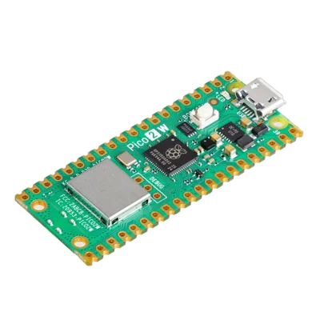 | [Pico 2 W](https://www.antratek.nl/raspberry-pi-pico-2-w) (Raspberry Pi) | The reference board, with WiFi | Antratek €12.04, [Kiwi](https://www.kiwi-electronics.com/en/raspberry-pi-pico-2-w-with-header-20342) €8.77 |
| 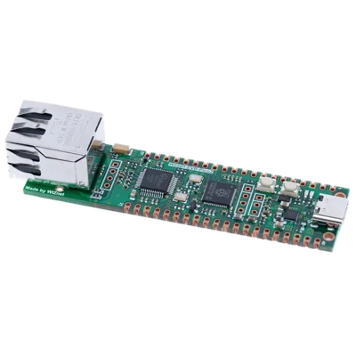 | [W5500-EVB-Pico2](https://thepihut.com/products/wiznet-w5500-evb-pico2) (WIZnet) | Wired Ethernet | The Pi Hut £11.20 |
| 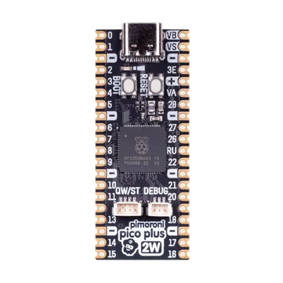 | [Pico Plus 2 W](https://shop.pimoroni.com/products/pimoroni-pico-plus-2-w) (Pimoroni) | 8 MB PSRAM, 16 MB flash, WiFi | about €25, pre-order |
| 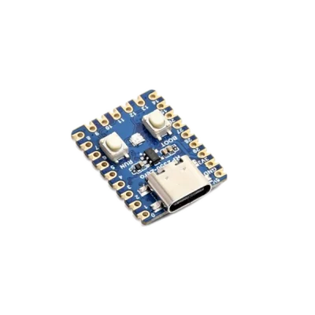 | [RP2350-Zero](https://www.tinytronics.nl/en/development-boards/microcontroller-boards/others/waveshare-rp2350-zero-mini-development-board) (Waveshare) | The tiny one | Tinytronics €6, [AliExpress](https://www.aliexpress.com/w/wholesale-waveshare-rp2350-zero.html) about €6 |

## RP2040

The RP2040's Cortex-M0+ runs only 16-bit Thumb, so MoonLive needs a restricted encoder there; the rest of the platform layer is shared with the RP2350.

| | Board (maker) | Why | Where, price |
|--|--|--|--|
| 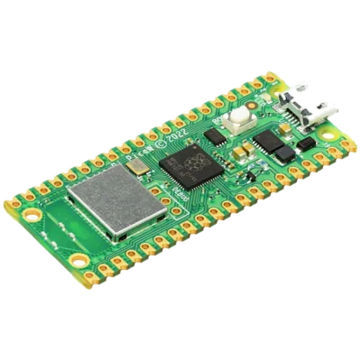 | [Pico W](https://www.antratek.nl/raspberry-pi-pico-w) (Raspberry Pi) | The only RP2040 with WiFi | Antratek €9.08, Kiwi €6.52 |
| 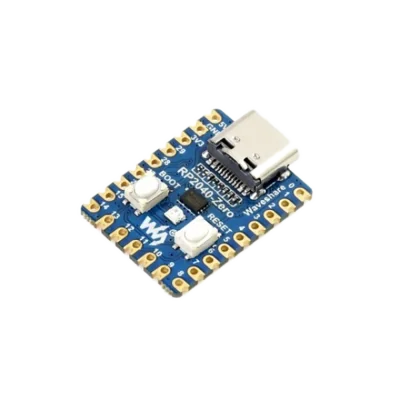 | [RP2040-Zero](https://www.tinytronics.nl/en/development-boards/microcontroller-boards/others/waveshare-rp2040-zero) (Waveshare) | The mini one people own | Tinytronics €5, [AliExpress](https://www.aliexpress.com/w/wholesale-waveshare-rp2040-zero.html) |
| 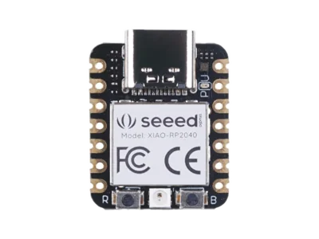 | [XIAO RP2040](https://www.kiwi-electronics.com/en/seeed-studio-xiao-rp2040-10969) (Seeed) | The XIAO form factor | Kiwi €4.46 |

## Nordic

No Nordic development kit is needed: the XIAO and the Debug Probe below cover the nRF52840, and the nRF5340 comes after it, on a module board.

| | Board (maker) | Why | Where, price |
|--|--|--|--|
| 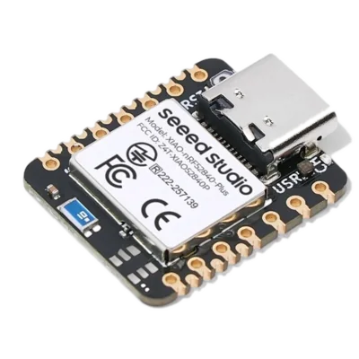 | [XIAO nRF52840 Plus](https://www.antratek.nl/seeed-studio-xiao-nrf52840-plus) (Seeed) | Tiny, UF2 bootloader, debugged through the Debug Probe | Antratek €12.09 |
| 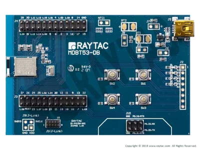 | [MDBT53-DB-40](https://www.digikey.nl/en/products/detail/raytac/MDBT53-DB-40/16630695) (Raytac) | The nRF5340, once the nRF52840 port runs. Zephyr supports it. | DigiKey, about €15 ex. Raytac ships it in about 14 days, with its own shipping fee. |

## Tools

| | Tool (maker) | Why | Where, price |
|--|--|--|--|
| 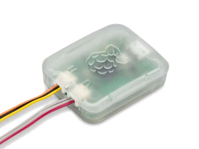 | [Debug Probe](https://www.kiwi-electronics.com/en/raspberry-pi-debug-probe-11345) (Raspberry Pi) | SWD for the RP2040, the RP2350 and both Nordic chips, through pyOCD or OpenOCD | Kiwi €13.18 |
| 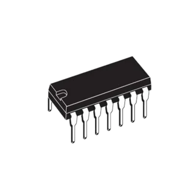 | [SN74AHCT125N](https://www.tinytronics.nl/en/components/ics-and-microcontroller-chips/ics/sn74ahct125n-4-channel-level-converter-3.3v-to-5v-14-pin-dip) (TI), two or three | 3.3 V to 5 V for WS2812 data, since every board here drives its pins at 3.3 V | Tinytronics €1 each |

## Where to order

- Antratek: the Pico 2 W, the Pico W and the XIAO nRF52840 Plus, together with any Teensy items.
- Tinytronics: the level shifters and both Zero boards.
- Kiwi: the Debug Probe.
- The Pi Hut: the W5500-EVB-Pico2.
- DigiKey: the Raytac board, when the nRF5340 comes up.
