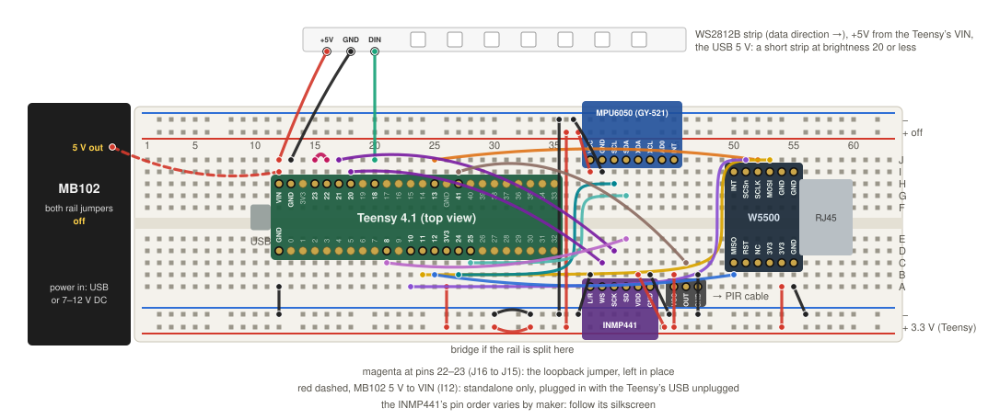
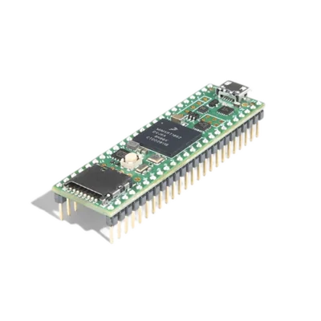
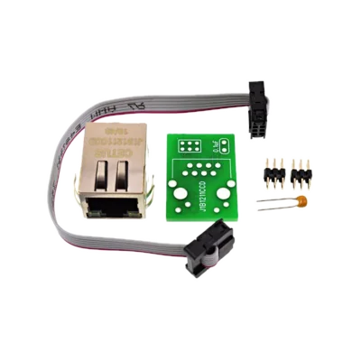
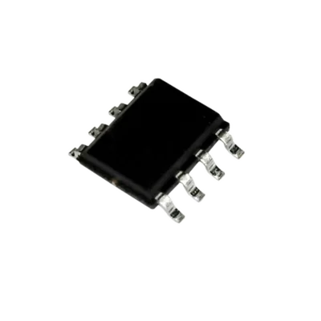

# Plan: MoonLight on the Teensy 4.1

The README and the platform layer name Teensy as a target, but no Teensy platform exists: `src/platform` holds `esp32` and `desktop`. This plan adds `src/platform/teensy` behind the existing seam (`platform.h`), in phases that each end in something visible on the board.

The bench board is a **Teensy 4.1-NE**: no Ethernet PHY, so the PJRC MagJack kit has nothing to plug into. Ethernet comes from a **W5500 SPI module** through QNEthernet's W5500 driver, which runs lwIP on the chip's raw frames, so the W5500's own 8-socket limit does not apply. A regular Teensy 4.1 with the kit runs the same firmware on QNEthernet's native driver: both drivers are in one build, and the board's chip is found at boot, so no board needs a build of its own.

✅ **One firmware for both Ethernet chips** (phase 6 step 7, replacing an earlier pair `teensy41` and `teensy41-w5500`). `teensy41` carries QNEthernet's two drivers, the board's own PHY (a DP83825I behind PJRC's Ethernet kit) and the W5500 for the 4.1-NE, as a chip's firmware carries every Ethernet driver the chip can host. QNEthernet builds one driver, so each is compiled with its `driver` namespace renamed (per-file defines in `teensy/CMakeLists.txt`), and `src/platform/teensy/qnethernet/` holds the external driver its `qnethernet_external_driver.h` hook takes: it asks the PHY first, then the W5500, once, and forwards every call. The stack keeps lwIP's defaults, which both drivers support: no frame pad, and checksums in software. Verified on the 4.1-NE: it found the W5500, came online with its settings, and took a network update; the PHY half waits for a regular 4.1.

## The hardware

The board, the W5500 wiring, the LED pins, power and an example breadboard setup live in the [Teensy 4.1 hardware reference](../../reference/hardware/teensy-4-1.md).

## Decisions for the product owner

1. **Network library license.** QNEthernet is AGPL-3.0-or-later; MoonLight is GPL-3.0. GPLv3 section 13 allows the combination, and the Teensy firmware then carries the AGPL's network term: a user of it over the network can obtain the source, which a "source" link in the UI satisfies. The alternative is plain lwIP (BSD) with our own W5500 frame driver, more work. Recommendation: QNEthernet, with the source link.
2. **Build system.** No maintained CMake build of the Teensy cores exists, so the compile flags and the linker script adjustments are ours to keep. PlatformIO's `teensy` platform owns those, at the price of a second build system. Chosen: a CMake toolchain file over an SDK that `setup_teensy.py` installs into `~/teensy` at pinned versions, each from its publisher: PJRC's cores at Teensyduino's tag, LittleFS and SPI at that release's commits, Arm's GNU toolchain (checksum-verified), and teensy_loader_cli compiled from its tag. `build_teensy.py`, `flash_teensy.py` and `monitor_teensy.py` wrap the rest.
3. **Where settings live.** Decided by measurement: LittleFS in program flash keeps `/.config` across a power cycle and across a teensy_loader_cli upload, so settings stay in program flash. The SD card remains an option for bulk files once the `/sd` mount point exists (PR #134's rework).

## Why PJRC's core, and what replaces it

The Teensy has no vendor SDK in the way an ESP32 has ESP-IDF: PJRC's Teensy 4 core is the lowest layer, writing the i.MX RT registers directly behind the Arduino API.
It provides the startup (clocks, the FlexRAM bank split, the MPU, the caches), USB serial with the reboot request the loader uses, timing, GPIO and the ADC, and the libraries the later phases build on (LittleFS, QNEthernet, OctoWS2811 or ObjectFLED, FlasherX).
Its headers appear only in `src/platform/teensy` and `teensy/main.cpp`, as ESP-IDF's appear only in `src/platform/esp32`.

Two bases could replace it:

| Base | What it is | Cost |
|---|---|---|
| NXP MCUXpresso SDK | NXP's own SDK for the chip, the true ESP-IDF equivalent | We write the startup, the USB stack and the loader's reboot protocol ourselves. QNEthernet, LittleFS_Program, OctoWS2811 and FlasherX all depend on PJRC's core, so each one is replaced |
| Zephyr | An RTOS with an official Teensy 4.1 board port, plus W5500 and native Ethernet drivers, LittleFS, USB and threads | A second build system (west and devicetree), a large footprint, and none of the Teensy LED libraries |

Either costs weeks for what the platform boundary already gives, so PJRC's core stays, confined to the platform layer.

## Phases

✅ ready, 🚧 work in progress; a step without a mark has not started.

✅ **Phase 1: boots and runs on serial.** Toolchain, `src/platform/teensy/platform_config.h` (`hasWiFi`, `hasOta`, `hasImprov` false, every LED lane count 0, `MM_MOONLIVE_HAS_HOST_JIT 0`), and the easy seam groups: time, heap, filesystem (LittleFS), GPIO table, logging, boot record (a LittleFS file), reboot, identity. `mm_main` ticks and prints its line on USB serial; a setting survives a soft reboot. Proves the C++20 build on the Teensy toolchain and the RAM fit. Works on the NE alone.

✅ **Phase 2: the UI over Ethernet.** QNEthernet with the W5500 driver: `TcpServer`, `TcpConnection::writeSome`, `UdpSocket` with multicast, mDNS, DHCP and static IP, rewritten onto its callback API (there is no BSD socket layer). The browser opens the device by name, shows the module tree, and the preview renders. Proves the socket port and the heap under HTTP and WebSocket load. This phase is the largest unknown and goes before LEDs.

🚧 **Phase 3: LEDs.** A `GpioDmaPeripheral` as a new `LedPeripheral` for `ParallelLedDriver`: one eDMA channel, paced by a QTimer4 channel through the XBAR's edge-detected DMA request, writes each slot of the encoder's frame, widened to a 32-bit port word, into `GPIO1_DR`. The slot is 56 ticks of the 150 MHz bus clock (373 ns, a 1.12 µs WS2812 bit); the trailing zero slots the driver already appends are the latch. The lanes are any 16 of the port's pins, in any order, all on the headers and clear of the W5500's pins 9 to 13: 0, 1, 14 to 27 and 38 to 41. Pin 19 disturbed the W5500 on the bench board, so the bench leaves it unused. Each lane pin moves from the fast GPIO6 to GPIO1 through `IOMUXC_GPR_GPR26`, since DMA reaches only GPIO1 to 4, which also keeps every other pin deaf to the write. The frame sits in OCRAM, flushed from the D-cache before each transfer; above about 455 lights per lane at 8 lanes the transfer is a scatter/gather chain of DMA descriptors, since one descriptor counts at most 32767 slots. The loopback self-test captures the rx pin's edges with the cycle counter, the shape of `rmtWs2812RxCapture`.

Measured on the bench: `GPIO1_DR` ignores 8- and 16-bit DMA writes and honours 32-bit ones (a byte and a halfword written into bits 16 to 31 left the register unchanged; the same transfer at 32 bits set it and the pins followed). So every slot is a 32-bit word with the lanes in its upper half, 12 bytes per WS2812 bit: about 74 KB per buffer for 16 lanes of 256 lights. OctoWS2811's three-channel shape stores 4 bytes per bit and is the scale path once a wall needs 1,000 or more lights per lane:

| | One DMA channel, 32-bit slots (built first) | OctoWS2811's three-channel shape (the scale path) |
|---|---|---|
| Memory per WS2812 bit | 3 slots of 4 bytes, 12 bytes | one 4-byte word of the lanes that go low, 4 bytes |
| 16 lanes of 256 lights | about 74 KB per buffer | about 25 KB |
| 16 lanes of 1,000 lights | about 288 KB, no double buffer, near the 380 KB heap | about 96 KB |
| Encoder | the existing slot encoder | a second encoder variant, reusing the bit transposes |
| Timing | one DMA channel, one QTimer channel | three DMA channels and three QTimer channels, phase-locked |

Steps, each verified on the bench:
1. ✅ Loopback: a jumper from pin 22 (`loopbackTxPin`) to pin 23 (`loopbackRxPin`) stays in place, and the self-test captures all 6144 pulses of a 256-light frame and decodes every bit.
2. ✅ One strand: an 8x8 WS2812B panel on pin 18, driven directly at 3.3 V and powered from VIN, shows the colors right. A 256-light frame takes 7.2 ms on the wire, and the next frame encodes during it, so the tick is the wire time plus the effects.
3. Eight lanes, then sixteen, with the frame time and the encode time measured on one core.

Backlog: the first LED of an 8x8 panel on pin 18 flickers under the Lines effect, though the loopback decodes every bit and the slot matches the ESP32 drivers' 375 ns. The first LED is the only one fed the Teensy's raw 3.3 V edge, so the lane pad's drive strength and slew rate are the first suspects; a DMA request delayed under network load would glitch the whole panel instead.

Seen since (2026-10-11), and present in commit 48fe8d4a as well, so it predates the batch that found it: random lights across the whole panel flash one channel, R, G or B, even at brightness 0, where every frame on the wire is zeros. A larger layout makes it worse, though the driver stays capped at the panel's 64 lights, and the effect does not matter. One channel lit is one bit read wrong, a 0-bit taken for a 1, which points at the wire timing rather than the data: the 0-bit high of 373 ns sits at the top of the WS2812B's window (see Timing margin below), and a larger layout adds the CPU's memory traffic (the layer, its mapping, the preview copy) that the DMA reading its frame from the same OCRAM contends with. To test in order: the pad settings below, a DMA frame in DTCM away from that traffic, and a shorter 0-bit high.

What a comparison with another timer-and-DMA driver for this chip taught, each to be measured before it is adopted:
- **Pad settings.** A lower drive strength (DSE 3), the slow slew rate and the lowest speed on every lane pad give cleaner edges than the core's `pinMode` defaults (DSE 6, speed 2). This is the first suspect for the flicker above, tested with the loopback and the panel.
- **Timing margin.** The 0-bit high is 373 ns, the top of the newer WS2812B's window (220 to 380 ns), where 250 to 300 ns sits in its middle. The 3-slot grid ties the 0-bit high to one slot, so a shorter one means a shorter slot, or a 4-slot grid at four thirds the memory. Real strips decide.
- **Beyond 16 lanes.** One DMA request can write the same slot to GPIO1 to 4 through the minor loop's destination offset, so the lanes are no longer bounded by one port.
- **Loopback in hardware.** A FlexPWM channel captures both edges into a DMA buffer, so the self-test needs neither interrupts off nor a 7 ms busy loop.
- **Pin advisories.** A lane on a UART, SPI or I2C pin earns a warning in the status.

Memory bounds a lane's length. The frame stays resident twice, the encoded slots and the wider copy the DMA reads: 16 lanes of 256 lights take about 116 KB. Measured beside a 128x128 layer, the driver's budget holds 551 lights on one lane and 474 per lane at 16; past that its status names the lights that fit. The step past it streams the wide copy through a ring of DMA descriptors over a few small buffers, each widened at its half-complete interrupt. That caps the memory at the ring and brings back a refill deadline of a few hundred microseconds, comfortable at 600 MHz. The three-channel shape in the table above is the other route, at 4 bytes per bit, and PSRAM on the empty pads a third.

🚧 Live scenarios on the Teensy: `run_live_scenario --host` ran 30, of which 19 passed and 6 skipped (5 run only on request, 1 only in-process). Of the 5 failures, the full filesystem (64 KB blocks, now 4 KB) and the state document (an empty `deviceModel`, now accepted) are fixed, and three expected a fresh device, its boot effect Pulse on a 16x16 grid, and now lay their own canvas. Palettes passes with MoonLive, after a core fix: a saved script palette came back as the first built-in at every boot, on every target, because its name was applied before the list it names was published. Still open:
- ✅ The preview on larger layouts: at 128x128 it carried 122 KB/s, stride 4, where HTTP downloads reach 1.5 MB/s. The preview drains on `tick20ms`, one TCP send buffer a pass, and QNEthernet's buffer was 4 segments (5.8 KB). A patch makes `TCP_SND_BUF` overridable and the build sets 16 segments, so the preview now carries 373 KB/s, mostly stride 2 at about 20 fps, with the render rate unchanged. 32 segments measured the same, so the buffer is no longer the bound; how often lwIP gets to process acknowledgments between drains is the next suspect.
- At 128x128 the Layer degraded to 64x64 while the driver held 256 lights; with 64 driver lights it gets its full 48 KB buffer. To check with a larger driver frame, now that the driver reports its own budget.

Considered and set aside: FlexIO in parallel mode, since no 8 contiguous FlexIO1 or FlexIO2 pins remain free beside the W5500, and FlexIO3, whose 20 contiguous pins have no DMA. OctoWS2811 and ObjectFLED (MIT) are the prior art for the timer, XBAR and DMA setup.

**Merge order with PR #136 (the SD card at `/sd`).** That PR merges into main first, and PR #137 (phases 1 to 3) waits for it, so its contributor resolves no conflicts with this work; the two touch ten of the same files. Teensy work continues on `teensy4.1` meanwhile, and each commit extends PR #137. Once PR #136 is in main:
1. `teensy4.1` takes main, and the ten shared files are resolved here.
2. The Teensy gets the side of PR #136 it needs: `hasSdCard = false`, `SdCardModule.cpp` in the Teensy CMake list, a real read stream over LittleFS (every download goes through it after PR #136, flash included), and stubs for the SD-only functions. The 4.1's own microSD slot can carry `/sd` for real in phase 4.
3. The gates run again, with a Teensy build and a download checked on the board, and PR #137 merges.

🚧 **Phase 4: services.** I2C, PWM, an I2S microphone, USB MIDI host for a desk, the watchdog (WDOG1). Each one a seam group, each verified on the bench.
- ✅ The UDP services, verified on the board over the socket layer phase 2 built:
  - OSC receive writes the surface's faders, switches and encoders (`send_osc.py`), and feedback sends the whole surface to the host that wrote first, never echoing that host's own values.
  - WLED audio sync arrives over the multicast group and drives the audio card ("receiving from" the sender, its level and peak frequency).
  - Sending audio sync is a local microphone's role, so it waits for the I2S microphone below.

Pins for the first sensors, clear of SPI (10 to 13), the LED lane (18), pin 19 and the loopback (22, 23); the breadboard keeps columns 37 to 48 for them:

| Sensor | Bus | Teensy pins |
|---|---|---|
| I2S microphone (INMP441) | I2S1 | SCK to 21 (BCLK1), WS to 20 (LRCLK1), SD to 8 (IN1), L/R to GND, VDD to the 3.3 V rail |
| IMU (MPU6050) | Wire2 | SDA to 25, SCL to 24; Wire on 18 and 19 would take the LED lane and pin 19 |
| PIR (AM312) | GPIO | OUT to 41, powered from the 3.3 V rail |

✅ **Phase 5: MoonLive.** A Thumb-2 backend in the shape of the RISC-V one (MicroPython's `asmthumb.c` is MIT prior art).

The MoonLive half, in steps, each verified before the next:
1. ✅ **The encoder, on the desktop.** `moonlive_asm_thumb2.h` and `.cpp` in `src/platform/teensy/`, guarded on `__ARM_ARCH_7EM__`, implementing the assembler contract the RISC-V backend implements (573 lines with its emit file). A `unit_moonlive_codegen_thumb2.cpp` includes the shared device checks (goldens, refusal, size, entry alignment, every shipped script), and `emit_isa.cpp`, `disasm.py` and `check_encodings.py` gain a `thumb2` entry, so the toolchain's own assembler agrees with every encoding before a board runs one.
2. ✅ **Thumb state in core.** A function pointer to Thumb code carries bit 0, so the places core casts the code block to a function go through `MoonLive::asFunction`, which adds `platform::codeAddressBits`: 1 on the Teensy, 0 on every other target.
3. ✅ **Executable RAM.** `allocExec` takes 32-byte-aligned blocks from the OCRAM heap, and one extra MPU region over them lifts PJRC's execute-never; code already runs from flash through the instruction cache, so OCRAM costs nothing in speed, where ITCM has 9 KB to spare. `writeExec` copies, cleans the data cache, invalidates the instruction cache, and barriers, as the ESP32's does.
4. ✅ **On the board.** The Teensy CMake list swaps the noarch stub for the backend. Six shipped effects (plasma, octopus, fractal, ripples, noise, fluid, up to 3 KB of code each) compile and run, a palette script's colors come out as its code computes them, and plasma costs 85 µs a frame on 64 lights. A first check confirmed the MPU's 16 regions and a heap function returning 42 through the Thumb bit.

Decisions in the encoder: no IT blocks and no literal pools, so a compare and a 32-bit conditional branch, `MOVW` and `MOVT` for constants, `BL` for internal calls, register-offset loads and stores, `SMMUL` for the high multiply; division stays a host call, as on every target. The registers: r0 to r6, r8 to r11 and lr for values, r7 the frame pointer, r12 scratch, a full `PUSH {r4-r11, lr}` frame on entry.

The three risks, all settled on the board: the fifth argument (`ctrls`) arrives on the stack and the prologue loads it, so scripts with controls run; the MPU has 16 regions and the last one lifts execute-never; and `check_encodings.py` agrees with the toolchain's assembler on all 41 Thumb-2 cases.

🚧 **Phase 6: updates over the network, and the web installer.** A board installed once updates without a cable, and the web installer installs a Teensy as it installs an ESP32. Steps, each verified before the next:

1. ✅ **A flat image beside the HEX.** The build also writes `MoonLight.bin` (`objcopy -O binary --gap-fill 0xff`, since erased flash reads 0xFF where objcopy fills 0x00), and the release ships `firmware-<fw>-v<ver>.bin` beside the `.hex`. The HEX stays for `teensy_loader_cli` and PJRC's loader, which read only Intel HEX; both new writers take raw bytes at an offset. Verified on the desktop: every byte of the `.bin` matches the HEX and the 40 gap bytes read 0xFF; CI runs on the next push.
2. ✅ **One firmware list for every platform.** `firmwares.json` rows gain a `platform` field (`esp32`, `teensy`, `desktop`, and the [small boards](../future/small-boards.md)' families as their ports arrive), generated from one registry, `moondeck/build/firmwares.py`, that `build_esp32.py`, `build_teensy.py`, `repo_health.py` and the workflows read rather than restating it; that removes four of today's five copies of the Teensy list. The release matrix and the manifest test select their platform from it, and CMake takes the Ethernet driver as an option instead of restating the names. Verified: `check_firmwares` (16 variants), `test_host --python` and `--js`, and both Teensy images built with the right driver; CI runs on the next push.
3. ✅ **Updates by upload on the Teensy** (`platform_teensy_ota.cpp`). `otaWriteStream` stages the image in the free program flash above the running one, from the next 64 KB boundary up to the LittleFS area, so it fits while the two images together fit 6.75 MB. It refuses a HEX file, an image without the boot header and image vector table, and an image whose variant mark (`MoonLight image for <firmware>;`) names another firmware or is missing. `reboot()` then copies the staged image over the program from ITCM, every NVIC source and SysTick off and WDOG1 fed, in 64 KB blocks, skipping the blocks the two images share, and resets. The core's flash routines are the primitives; FlasherX was not needed, and its 16 KB reserve would have let the copy erase LittleFS. `http_fetch_to_ota` refuses with "no TLS on this board", since GitHub serves release assets over HTTPS only. Verified on the bench (W5500 build): a HEX, the other variant and a text file each refused with no reboot; four updates by `curl` with the settings intact, one changing 16 of 19 blocks including the boot header, the new build stamp showing after each; 1.2 MB staged in about 33 s, back up 8 to 12 s later; an upload from the Firmware card in the UI, verified by the PO, whose overlay says "Writing to flash…" with a pulsing bar through each erase pause, since the board reads nothing from the network while it erases; and by the PO, the cable pulled within seconds of "Rebooting…" on an image differing in 16 of 19 blocks: the board stayed dark, and the web installer's program-button install brought it back with its settings and effect intact.
4. ✅ **The installer and the device UI see the Teensy.** `generate_manifest.py` reads the firmware registry and writes a Teensy manifest as one part, the `.bin` at offset 0, under the family `Teensy 4.1`, which `build_teensy.py` adds to the registry's one family vocabulary; the release generates a manifest for every shipping firmware, and the installer preview stages the built Teensy images. `deviceModels.json` gains "Teensy 4.1" and "Teensy 4.1-NE + W5500", and `check_devices` checks every `chip` against that vocabulary and every listed firmware against the registry and its family. The installer reads the port's USB ids before any ESP32 handshake and reports a Teensy as found (`16C0:0483`). `/api/firmware/url` answers 501 on a device without TLS, and the Firmware card then downloads the release's `.bin` from its Pages copy, which allows a cross-origin read, and uploads it. Verified: the manifest test covers every platform, `check_devices` fires on a wrong family, the JS and Python suites pass, the bench board answers 501, and a headless browser drove the card's URL install on the W5500 board with the image served by the installer preview in place of Pages: downloaded, uploaded, rebooted, settings intact. Verified by the PO on 2026-10-13 from the first release carrying the Teensy images, `6.1.0-dev.87`: a network update from the Firmware card, the image fetched from the release's Pages copy.
5. **The installer flashes a Teensy** (built, awaiting the bench). `teensy-writer.js` speaks HalfKay as `teensy_loader_cli` does: a running board enters the bootloader through a 134-baud Web Serial open, then 1088-byte reports, each a 64-byte header carrying the block's offset and 1024 bytes of image, block 0 first with a 45 s allowance since it erases the chip, blank blocks after it skipped, and a boot report to finish. A board held in its bootloader by the program button is offered after a canceled port pick ("Teensy not listed?"), the one moment it is needed, so the port row keeps one way in. Either way the browser's chooser opens straight from the Install click while that click still counts, and the page's own step, saying what to do, opens it when the click has expired or the user cancels; every install picks the bootloader once, since Chrome does not remember the grant (`chrome://settings/content/hidDevices` lists nothing after a pick), although the bootloader reports a USB serial number (`001E0D21`, the board's serial in hex; ioreg) and only lacks a product name, so why is open. The orchestrator picks the writer by the manifest's `chipFamily` before touching the device, so each next port adds a writer and nothing else: the RP2040, the RP2350 and the XIAO nRF52840 boot into a UF2 bootloader that shows a USB drive, so one UF2 writer serves all of them (PICOBOOT over WebUSB for the Picos as the direct route). After the boot the installer finds the re-enumerated serial port, reads `MM_IP` and `MM_DEVICE` for the success link, and with **Apply device defaults** sends the catalog state as APPLY_OP frames over it: the Teensy's USB serial listener (`platform_teensy_improv.cpp`, polled from the module's tick through `improvPoll`) takes that one command through the core helper `improvApplyOp`, which the ESP32's listener now shares. **Erase chip first** zeroes the settings' LittleFS superblock pair (offset 0x6C0000) after the image, so the firmware formats it at boot; the bootloader erases only the program area otherwise. Verified on the bench: the zeroed superblocks through `teensy_loader_cli` reset a marker setting to the defaults with the board booting normally, and an APPLY_OP document over USB serial got its acknowledgement and changed a setting; the unit tests pin the shared handler. Still to verify by the PO in the browser: an install with both boxes ticked. Verified so far: a node test pins the report layout, the skipped blocks, the boot report and the refused images, and that writing the reports onto erased flash reproduces the image; and on the bench by the PO, from the local installer preview, installs of the W5500 board's firmware from the program button, reached through the "Teensy not listed?" hint, and from a running board, with no button press, the browser's chooser opening straight from the Install click, the settings intact, each ending on the board's IP and `.local` links; the program-button path asks one click to grant the board's serial port, which the browser then remembers. Chrome lists the bootloader as "Unknown device (16C0:0478)". Verified by the PO on 2026-10-13: an install of `6.1.0-dev.87` from the published installer at moonmodules.org, the board coming up with its defaults. Still to verify: `teensy41` once a regular 4.1 arrives.
6. Optional, once: the desktop builds join the same list (`platform: desktop`), replacing the installer's hand-written asset pattern, which misses `linux-arm64` and `.deb`.

**Once steps 3 to 5 ship in a release: tell PJRC.** Paul Stoffregen, PJRC's founder and the author of the Teensy core, HalfKay and `teensy_loader_cli`, reads forum.pjrc.com. A post there announces a Teensy firmware installed from the browser with no tools and updated over Ethernet from its own page, and asks two things: why Chrome does not keep the bootloader's grant although HalfKay reports a serial number, and whether HalfKay could report a product name, so browsers stop listing it as "Unknown device".

**After the phases: TLS on the Teensy, once a real need asks for it.** The browser covers what the board needs today: the Firmware card downloads a release and uploads it, MoonCloud hands Stats and Talk requests to the open page through a hidden outbox (verified on the bench: the install report reached the server with a 200), and the UI fetches scripts and gallery items from GitHub itself. TLS would add what needs no page open: updates without a browser (an "update all devices" from MoonDeck), MQTT to cloud brokers on 8883, MoonCloud Sync's continuous connection, and other outbound HTTPS. The route: Mbed TLS 3.6 LTS pinned in `setup_teensy`, with lwIP's mbedTLS adapter ported to 3.x as a patch in `teensy/patches/` (the adapter in lwIP 2.2.2 targets 2.x, whose 2.28 line ended in 2024; Linaro's port for U-Boot went to lwIP as pull request #47), the chip's TRNG for entropy, a small root bundle for GitHub and MoonCloud, SNTP for certificate dates, and a small HTTPS client behind `http_fetch_to_ota` and `httpsPost`. Measured first in a spike: flash, heap during a handshake (40 to 60 KB expected, of about 325 KB free) and handshake time. The browser fallbacks stay either way, since they serve every board without TLS.

**After the phases: a second Ethernet port for the lights.** With both chips in one firmware, a regular 4.1 can carry a W5500 as well: the W5500 for the UI and the network, and the board's own PHY, the faster port, on an isolated light network with deterministic traffic and no switch shared with the UI. That port can send Art-Net or DDP, or raw ColorLight frames through QNEthernet's raw-frame support, which `PanelCardDriver` would need the Teensy's raw-L2 seam for. A ColorLight card requires a 1 Gbit link and the Teensy's MAC and PHY reach 100 Mbit, so a gigabit switch goes between them: the card then links at 1 Gbit and receives each packet at gigabit wire speed, but a whole frame still takes the sender's 100 Mbit time to arrive, so whether a wall stays inside the card's inter-frame window is for the bench to measure (a 128x64 panel is about 25 KB a frame, 2 ms at 100 Mbit; a 256x256 one about 200 KB, 16 ms, against a 25 ms window at 40 fps). Needs a regular 4.1 and a gigabit switch.

**After the phases: the W5500's chip select as a setting.** The SPI port's pins are fixed in the hardware (MOSI 11, MISO 12, SCK 13), and chip select is 10, which the documented wiring and the common adapters use. QNEthernet's driver takes the chip select at runtime (`set_chip_select_pin`), so once a board wires it elsewhere it becomes the one Ethernet setting a Teensy shows, and that board's catalog entry carries the pin.

**After the phases: WiFi through a coprocessor.** An ESP32-C6 on SPI or SDIO gives the Teensy WiFi, as the C6 does for the P4 through Espressif's esp-hosted. Its host side is written for ESP-IDF and Linux, so this means porting that driver and attaching it to QNEthernet's lwIP as a second interface, weeks of work rather than a step; the P4 measured the hosted link as its bottleneck, and wired Ethernet stays the Teensy's strength, so WiFi is an option for installations without a cable rather than the default.

**After the phases: other Thumb-2 boards.** Every Cortex-M3 or newer runs the Thumb-2 encoder unchanged, so MoonLive costs such a target only its executable memory and `codeAddressBits`; the platform layer around it is the real work. Two follow-ups, with the boards on order:
- **The RP2350 (Raspberry Pi Pico 2), two Cortex-M33 cores.** Cheap and common, with PIO blocks for LED output, the same route the [Pi 5 analysis](../future/leddriver-analysis-bottom-up.md#raspberry-pi) points to; TrustZone may need the code memory marked non-secure. The RP2040 (Pico 1, RP2040-Zero) shares the platform layer through the Pico SDK and is worth supporting for the boards people own; its Cortex-M0+ runs only 16-bit Thumb (ARMv6-M), so MoonLive there needs a restricted encoder with literal pools, plain multiplies and short branches, and scripts refuse cleanly until it exists. Either chip reaches the network through WiFi (Pico 2 W, Pico W) or a W5500 on SPI, as the Teensy does.
- **Nordic's nRF52840 (Cortex-M4F) and nRF5340 (Cortex-M33).** [The nRF analysis](../future/nrf-zephyr-target-analysis.md) finds them a poor fit for large LED counts (one-lane serial DMA, no PSRAM, 256 to 512 KB of RAM) and a promising small BLE showcase of the core on Zephyr, where MoonLive comes along almost free.

**The boards to order** (researched 2026-10-11, prices including Dutch VAT unless marked ex). The Teensy items are below; the RP2350, RP2040 and Nordic boards and the tools for them are on [the small boards reference](../future/small-boards.md). PJRC sells no Teensy on AliExpress, and the listings there cost more or are counterfeit ([PJRC's warning](https://www.pjrc.com/teensy/counterfeit.html)).

| | Board (maker) | Why | Where, price |
|--|--|--|--|
|  | [Teensy 4.1 with pins](https://www.antratek.nl/teensy-4-1-pins), with the Ethernet chip (PJRC) | The `teensy41` firmware | Antratek €42.96, Tinytronics €38.25 |
|  | [Ethernet Kit](https://www.antratek.nl/ethernet-kit-for-teensy-4-1) (PJRC) | The jack for the on-board PHY; needs soldering | Antratek €12.04, Tinytronics €9.50 |
|  | [PSRAM APS6404L 8 MB](https://www.tinytronics.nl/en/components/ics-and-microcontroller-chips/ics/aps6404l-3sqr-psram-8mb-sop8) (AP Memory) | Optional, once a layout outgrows the RAM | Tinytronics €3 |

**After the phases: offer the patches upstream.** The files in `teensy/patches/` fix upstream code, so each goes back to its maintainer once the port is done, which lets the patch files go.
- `teensy_loader_cli-match-own-devices.patch`: ✅ opened 2026-10-13 as [PaulStoffregen/teensy_loader_cli#96](https://github.com/PaulStoffregen/teensy_loader_cli/pull/96), from the fork `ewowi/teensy_loader_cli`, fixing its open issue #60 ("Error opening HID Manager" on macOS) at the cause. The macOS HID manager matches every HID device, keyboards included, which needs the Input Monitoring permission; matching only the bootloader and the rebootor needs none. Reproduced on macOS 27.0.1 before opening it: master waits forever with the board in its bootloader, the patched build flashes it. The patch file goes once Paul merges it.
- `QNEthernet-w5500-bounded-waits.patch` and `QNEthernet-tcp-snd-buf-overridable.patch`: pull requests to ssilverman/QNEthernet. The first bounds the W5500 driver's waits on the chip at 20 ms, which ended the device's freezes; the second lets a build set `TCP_SND_BUF`, as it already can `MEM_SIZE` and `TCP_WND`.
- `QNEthernet-recv-window-on-read.patch`: a pull request to ssilverman/QNEthernet, after a reproduction with a plain QNEthernet sketch. QNEthernet reopens the receive window when it copies data into its buffer rather than when the sketch reads it, so a fast sender overruns the buffer and lwIP drops what follows: a 1 MB upload took 30 s with 35% retransmitted, and 4.8 s with none once the window reopens on read.
- `QNEthernet-mdns-nsec.patch`: an issue with the patch to ssilverman/QNEthernet, asking whether it belongs in QNEthernet's lwIP copy or in lwIP's patch tracker first. lwIP's mDNS responder sends no NSEC answer (still a TODO on lwIP master), so a build without IPv6 leaves a client's AAAA question unanswered and a `.local` lookup waits 5 s; the patch answers it per RFC 6762 §6.1.

## What the core already handles

- One core: the render and encode split switches itself off when a worker task cannot be spawned (`Drivers.h`), so phase 1 needs no core change for it.
- No FreeRTOS outside `src/platform`: the boundary holds.
- No MoonLive JIT: the no-JIT build compiles scripts to a refusal and runs every other module.

## Risks, riskiest first

1. The socket port onto QNEthernet's callback API, about 600 lines, and the non-blocking partial writes the HTTP server relies on.
2. The W5500 driver is lightly tested by its author; throughput caps large DDP or Art-Net streams.
3. Program-flash LittleFS disables interrupts while it writes, which stalls LED output during a save.
4. Single-core timing: render and encode share one core, so the frame budget is the sum.

## What comes out

The backlog line "Teensy 4.1: toolchain-file build, `.hex` for Teensy Loader" in `backlog-core.md` moves into this plan. `building.md`'s Teensy section ("Ethernet is built in on Teensy 4.1 and optional on 4.0", "OctoWS2811 gives excellent DMA-based LED output") is rewritten from what ships.

## Sources

- Teensy 4.1 and its variants: https://www.pjrc.com/store/teensy41.html
- Ethernet kit (MagJack, no PHY): https://www.pjrc.com/store/ethernet_kit.html
- QNEthernet, drivers for the Teensy 4.1 and the W5500: https://github.com/ssilverman/QNEthernet
- Throughput, native and W5500: https://github.com/grblHAL/teensy41_ethernet
- Linker script and MPU setup: https://github.com/PaulStoffregen/cores/tree/master/teensy4
- OctoWS2811: https://github.com/PaulStoffregen/OctoWS2811 ; ObjectFLED: https://github.com/KurtMF/ObjectFLED
- teensy_loader_cli: https://github.com/PaulStoffregen/teensy_loader_cli
- FlasherX: https://github.com/joepasquariello/FlasherX
- MicroPython Thumb emitter: https://github.com/micropython/micropython/blob/master/py/asmthumb.c
