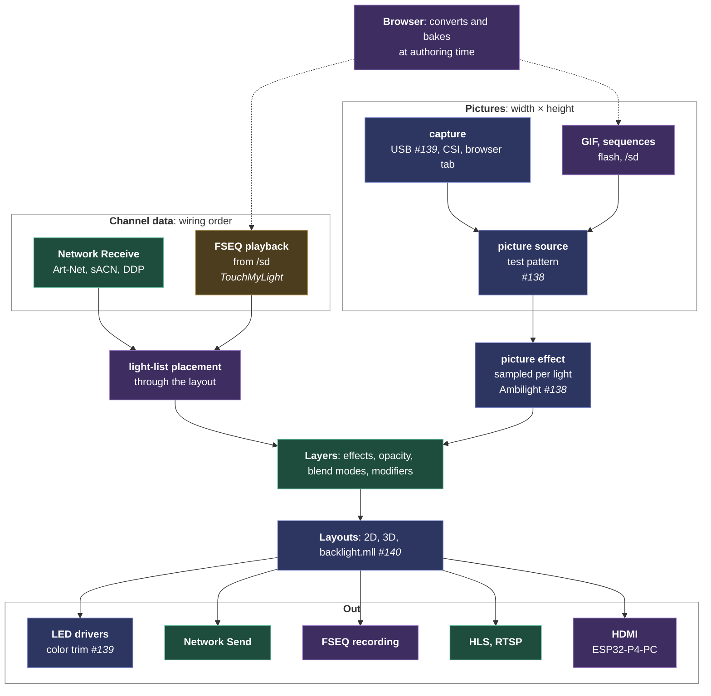

# Plan: streams, every frame from outside, one model

Plan, for the product owner's approval; started as an analysis on 2026-10-13, when three pull requests by Gohnnyman (#138 Ambilight and VideoService, #139 USB video capture, #140 backlight wiring) arrived the same week TouchMyLight announced an FSEQ player for a 20 × 20 × 20 cube (on #134). Read one by one they look like unrelated features: a TV backlight, a capture card, a show player. Read from MoonLight's architecture they are the same thing: a stream of frames arriving from outside the device. This plan models that once, by the textbook, so cameras, video, files, the network and the browser become combinations of a few parts rather than a feature each.

## The textbook model: three independent axes

Every media framework separates the same three questions: GStreamer, FFmpeg, Media Foundation and Video4Linux all do. Where do the bytes come from, how are they encoded, and what shape is the frame? Each axis varies on its own.

| Axis | Values in MoonLight's world |
|---|---|
| **Transport** | a file on flash or the SD card, the network (UDP, TCP, the browser's WebSocket), USB, a camera port (MIPI-CSI) |
| **Format** | raw RGB, PPM, GIF, MJPEG, FSEQ, the DDP, Art-Net and E1.31 framings; H.264 on the way out |
| **Geometry** | a picture (width × height), a light list (N lights in wiring order), a volume (width × height × depth) |

A source is then a transport plus a decoder, delivering frames with a small descriptor: the geometry, the pixel format and the frame's time. An output is an encoder plus a transport. Everything users ask for is a combination:

| What users ask for | Transport | Format | Geometry |
|---|---|---|---|
| An xLights show (FSEQ) | SD file | FSEQ | light list |
| Network Receive today | UDP | DDP, Art-Net, E1.31 | light list |
| A GIF animation | flash or SD file | GIF | picture |
| An HDMI grabber (#139) | USB | MJPEG | picture |
| A camera on the P4 | MIPI-CSI | raw, through the image processor | picture |
| A screen shared from a browser tab | WebSocket | raw or DDP | picture or light list |
| A volumetric show for a cube | SD file | FSEQ | volume, or a light list placed in 3D |
| HLS and RTSP (shipped) | HTTP, RTSP | H.264 | picture |
| Recording | SD file | FSEQ | light list |

## How it lands on what MoonLight has: two families

The three axes describe any stream, and they do not make every stream one module. The standard is **one module model with typed data:** GStreamer gives every source the same element model and types each output (`video/x-raw` and `audio/x-raw` connect only to their own kind), and TouchDesigner, the most general tool here, separates its operators by data type, CHOPs for channels (DMX In, Art-Net, MIDI In, audio) and TOPs for textures (video, files, capture). MoonLight's module model is that element model: every source is a MoonModule with one lifecycle. On top of it, two families exist in the industry and in MoonLight, each with its own semantics, and they meet in the layer.

| | Channel data, the pixel protocols | Pictures |
|---|---|---|
| Live in | Network Receive: Art-Net, sACN (E1.31), DDP | capture: USB, MIPI-CSI, a browser tab |
| Recorded in | FSEQ playback | GIF, image sequences |
| Out | Network Send, FSEQ recording | HLS and RTSP, HDMI |
| Data | values in wiring order | width × height pixels |
| Into a layer by | placement through the layout | sampling per light |

**Channel data is a protocol family, not a decoder.** Art-Net, sACN and DDP carry universes and channels, discovery (ArtPoll), sync packets, priorities and merging between senders, and Network Receive and Network Send are the two halves of the family. An FSEQ file is a recording of exactly that data, which is why Falcon Player plays FSEQ and outputs sACN. So FSEQ joins this family as a sibling of Network Receive, not as a decoder in a generic stream source.

**Pictures are their own family:** a picture source publishing frames, and an effect that samples them per light. `VideoService` from #138 is that source, renamed for what it is.

**What the families share, and only that:**

1. **Light-list placement:** writing values in wiring order into the layer through the layout. FSEQ needs it, and so does Network Receive for senders that send in wiring order (below). One helper, two users.
2. **The timing rule:** live (the newest frame wins) or recorded (the clock picks the frame), below.
3. **The layer:** both families end as an effect in a layer, so they compose with effects, blend modes and modifiers.

Two rules keep the picture side small enough for a microcontroller, where GStreamer's generality would not fit:

- **Decoders always deliver RGB888,** so nothing negotiates formats.
- **The picture descriptor stays a handful of fields:** size, frame time, live or recorded, and the tone curve a picture carries so the sampler averages light rather than bytes.

## Image order and wiring order

Network Receive copies channel k into logical cell k of its layer, and the layer's mapping then carries each logical cell to its physical light, so it follows the pipeline like any effect. Whether that is right depends on the order the sender's data is in, and the industry uses two conventions:

| Sender sends | Examples | Copied into the layer by index |
|---|---|---|
| **Image order:** row by row, like a picture, expecting the receiver to apply its own wiring | image-based tools that leave the wiring to the controller | correct: the layer's mapping applies this board's serpentine or 3D wiring once |
| **Wiring order:** arranged in the order the lights are wired, because the sender did the mapping itself | xLights, FSEQ files, Falcon Player, pixel-mapping software with a fixture patch, MoonLight's own Network Send (it sends driver output) | mapped twice: the sender already applied the wiring and the layer applies it again, so a serpentine panel gets every other row reversed |

On a plain grid without modifiers the two orders coincide, which is why the difference stays invisible on simple setups.

**So Network Receive gains a `data order` setting,** image or wiring:

- **Image order** is today's copy, unchanged, so nothing changes for anyone using it now.
- **Wiring order** places channel k through the light-list placement, which is the inverse of the layer's mapping: composed, the two cancel, so channel k reaches physical light k while still blending and taking modifiers.
- **FSEQ is always wiring order,** since xLights writes it that way, so the FSEQ effect uses the placement without a setting.

**The hot path stays as fast as today.** Network Receive is on it: at 16,000 lights and 40 frames a second every per-light step counts. The placement follows the rule the layer's mapping already follows, which keeps no table at all when logical order equals physical order (`hasLUT()` false):

- **Orders coincide** (a plain grid, no modifiers): the placement is a `memcpy`, zero cost over today.
- **Orders differ** (serpentine, 3D, a mapped layout): a per-light gather through the table, where the copy by index would have mapped twice.
- **Only on new data,** as today: a frame without new packets costs nothing.

A measurement gates it: `run_live_scenario` on the S3 with Network Receive on a large grid, before and after, in both the identity and the serpentine case; an identity path that moves at all does not merge.

One more option exists for a single feed that must be the absolute fastest: writing straight into the drivers' output, bypassing the layer, which is what WLED's realtime override does. It gives up blending, modifiers and composition, so it is not the default; it is a setting to add only when a user needs it.

## Real time and not real time

Streams split a second way, by who sets the pace, and the split is the textbook one between live and on-demand media.

| | Live (real time) | Recorded (not real time) |
|---|---|---|
| Examples | Network Receive, USB and CSI capture, a browser tab, MIDI-driven content | FSEQ, GIF and image sequences from flash or SD, a baked show |
| Who sets the pace | the sender: a frame arrives when it arrives | the device's clock: it pulls the frame the timeline asks for |
| Late or missing frames | the newest frame wins and an old one is dropped, never queued, since a queued frame is a late frame | none: the next frame is read ahead, one frame of buffer at most |
| Seek, loop, pause | not possible | the frame index comes from the clock, so they are arithmetic |
| Sync across boards | each board shows what it receives | clock sync: every board computes the same frame index from the shared clock |
| What it costs | latency, which the design keeps to one frame | storage bandwidth, which the design keeps to one frame per tick |

Each source states which kind it is, so its effect knows whether to show the newest frame or the frame the clock asks for. The transport decides it: a socket, a USB grabber and a camera are live; a file is recorded. A file can also be played live, at the pace of a sender elsewhere, which is how a recording replays exactly what arrived.

Not real time also names a third case that never reaches the device as a stream: **authoring**. Baking a picture or a video into FSEQ for a layout runs in the browser at whatever speed it takes, and only its result plays in real time.

## Modifiers and the single pass

A small device cannot run a PC pipeline, where each stage hands a full frame to the next. MoonLight never does: geometry is composed into coordinates at prepare time, and each frame does one pass.

- **Modifiers are coordinate folds,** composed into the layer's mapping table at prepare (`Layer::rebuildLUT`). Mirror, rotate, tile and multiply change where a logical cell lands, never the pixels; an animated modifier remaps coordinates per frame (`modifyLive`), still without an intermediate frame.
- **Effects write colors for their own logical cells** into one buffer per layer, and the mapping table carries them to the physical lights.

The textbook name is inverse mapping: compose every transform into one coordinate function, then sample the source once per output pixel. A GPU fragment shader works this way, and so does OpenCV's `remap` with a precomputed table.

**Both families follow that rule, so their consumers are effects, not modifiers.** Sampling is what an effect does: a color for its own coordinates, read from a decoded frame instead of computed from a formula.

- **At prepare** each builds a small table, as the layer builds its mapping: the picture effect maps each logical cell to a source pixel or, for area sampling, a source rectangle; the light-list placement maps light k to the logical cell it lands in, which is the physical-to-logical fold the layer's mapping build already computes.
- **Per frame** each does one gather into the layer buffer, and the existing mapping does the rest.

**Modifiers stay the one home for geometry transforms** and apply to a stream like any effect, as the architecture already says: the same RotateModifier rotates Fire, Noise or a network-received frame. So the picture effect has no rotate, mirror, scroll or offset of its own. It keeps only what belongs to sampling: fitting or stretching the picture onto the grid, point or area averaging, and the edge depth Ambilight samples at.

**The picture side keeps the same budget:** decoding runs off the render tick, the effect does one gather per frame, and area sampling is capped per zone so a large source never costs a read per source pixel.

**The one full frame is the decoded picture,** the texture the shader samples, and it is an input rather than a stage: the P4's JPEG hardware decodes whole frames and a GIF composes onto a canvas, so a decoder produces it anyway. Channel data needs none: an FSEQ or DDP frame is written into the layer buffer through the placement table as it is read.

**What it removes.** Ambilight stops being an effect of its own and becomes the picture effect's area sampler. Network Receive keeps its protocol family and gains wiring order as a second convention, at no cost in the identity case. FSEQ reuses Network Receive's placement instead of growing its own. No stage holds a frame of its own, and no geometry option is duplicated inside an effect.

Green ships today, blue is an open pull request, gold is planned by a contributor, purple is this plan's proposal. The diagram is configuration, not runtime stages: each family does a single gather into its layer, then the existing mapping. Everything from the layers down already exists.

## Where MoonLight stands among the tools

The tools look different, but they share this pipeline and put their weight in different places.

| Tool | Weight on | Runs on |
|---|---|---|
| Resolume | video clips in layers, pixel mapping to fixtures | PC |
| TouchDesigner | a general dataflow graph, anything to anything | PC |
| MADRIX | LED pixels: generative effects, layers, a 2D and 3D patch, media and capture, many outputs, record and replay on a standalone player | PC, standalone nodes |
| xLights with Falcon Player | sequencing offline, playback standalone | PC, Raspberry Pi |
| Hyperion, HyperHDR | capture to LED zones | Raspberry Pi, PC |
| WLED | effects on segments, a realtime override | ESP32 |

MoonLight is closest to MADRIX: generative effects, layers, 2D and 3D layouts and many outputs. The difference is that it runs on the controller itself. MADRIX's media, capture, and record-for-standalone-playback are what this stream model adds. The position is MADRIX-class pixel control, embedded, which no tool in the list occupies.

## What WLED did, and where it stopped

Checked 2026-10-13 against WLED main and WLED-MM.

- **One picture format, decoded on the device.** The Image effect (Aircoookie, PR #3835, finished by netmindz, shipped in WLED 16.0, May 2026) plays a GIF from the internal file system, up to 320 × 320, with about 24 KB of decoder RAM (bitbank2's AnimatedGIF). It scales by nearest neighbor, decodes one image at a time across all segments, and redraws only changed pixels, which upsets brightness limiting. WLED-MM backported it.
- **Every conversion in the browser.** DedeHai's PixelForge (PR #4982, WLED 16.0) crops, scales and encodes a GIF in the page and uploads it; Video Lab turns video into GIFs, Pixel Paint draws on the matrix, Font Factory makes scrolling-text fonts.
- **No capture on the device.** The only video path is a browser page streaming DDP over the WebSocket (DedeHai, PR #4997). Hyperion does all ambilight processing on a computer and drives WLED over DDP.
- **FSEQ: five attempts, none merged** (#2413, #3551, #4570, #5641 open since May 2026). They bolted playback onto the realtime override, which replaces effects rather than composing with them, and each bundled an SD driver, a player, a UI and Falcon Player sync in one pull request. Recording was planned and never built.
- **SD** is a usermod nothing in core reads.

ESPixelStick, the reference small-device FSEQ player, plays uncompressed FSEQ v2 with sparse ranges from SD, floors the step at 25 ms, takes the frame index from a monotonic clock plus a sync offset, and seeks per frame, which keeps looping and sync trivial.

What it teaches: GIF first among picture formats, decoded per source rather than in one global decoder; conversion as browser pages; the layer as the home of every stream, which is exactly where WLED's FSEQ attempts went wrong; FSEQ starting where ESPixelStick stops. New beyond WLED: a stream composing in layers on any layout, 3D included; area sampling in linear light; capture decoded on the device; recording; synchronized playback across boards; the SD card as a first-class file store.

## Browser and device

One rule decides the split, and MoonLight already follows it where the device cannot do a job (the Firmware card's download for a board without TLS, MoonCloud's outbox, scripts fetched from GitHub by the page): **what must run with no browser open belongs on the device; what happens once, with a person at the screen, belongs in the browser.** In the stream model the browser is one more transport, and an authoring tool.

| Tier | Where | Examples |
|---|---|---|
| Authoring: once, a person present | browser | crop, scale and convert images; video to GIF or to FSEQ; fonts; an xLights model imported as a layout |
| Live, a browser as the source | the browser samples, the device displays | a screen (`getDisplayMedia`), a webcam or a video in a tab, streamed over the existing WebSocket |
| Run time: autonomous | device | effects, playback from flash or SD, USB and CSI capture, sync, recording, a show running for days |

**The browser can bake for this layout.** It already knows every light's position, since it draws them in the preview. So it can do the expensive part once, sampling a picture or a video per light with the area filter in linear light, and write the result as an FSEQ file. The device then plays it with the same cheap light-list path as an xLights show, on any layout, with no decoder.

| | Baked in the browser (FSEQ) | Decoded on the device (GIF) |
|---|---|---|
| Device cost | lowest: read and copy | decode and sample every frame |
| Follows a layout change | no: bake again | yes |
| Storage | large: 8000 lights at 40 fps is about 1 MB/s, so SD only | small: fits in flash |

A live browser source costs bandwidth, lights × 3 bytes × fps: about 60 KB/s for a 600-light TV frame at 30 fps, too much for 8000 lights over WiFi. USB and CSI capture run with no browser, so they belong on the device.

## 3D layouts

TouchMyLight's cube is the first user, so 3D works from the start.

- **A light list carries wiring order, not positions.** An FSEQ frame holds values in the order xLights numbers the model's lights, the order the outputs drive them. Copied into the layer by index, wiring-order data is mapped twice wherever the layer's order differs from the wiring, as on a cube (see image order and wiring order above). The light-list placement puts light k at the coordinate the layout gives light k, and the layer's mapping carries it back to that physical light: correct on 1D, 2D and 3D layouts, and still composing with layers and modifiers. The user-side requirement is the one every FSEQ player has: the MoonLight layout and the xLights model number their lights the same way.
- **A picture reaches a 3D layout by projection:** each light samples the picture at its position seen along one axis, the planar projection media servers use.
- **A volume is the native 3D stream:** a frame per depth slice, copied straight into a 3D layer.

## The P4 and its codecs

The P4's hardware video codec encodes H.264 but does not decode it; its JPEG codec works both ways. So video arrives as MJPEG from a grabber, raw from a camera, or baked in the browser, while video leaves through the H.264 encoder HLS already drives.

**One board carries every piece.** The Olimex ESP32-P4-PC (February 2026, on the PO's bench) has HDMI and MIPI-DSI out, a MIPI-CSI camera connector, four USB 2.0 host ports, a microSD slot, Ethernet with PoE and 32 MB of PSRAM: capture in, HDMI out and FSEQ from the card on one P4. HDMI out is also the textbook way to feed commercial LED walls: Novastar and Colorlight sending cards take HDMI or DVI as their input.

## What each contribution becomes

| Contribution | In the plan |
|---|---|
| `VideoService` (#138) | the picture source, renamed for what it is |
| `AmbilightEffect` (#138) | the picture effect's area sampler, edge depth among its settings |
| USB capture (#139, first commit) | a picture source's USB transport and MJPEG decoder, behind the platform seam, in the P4 images with room |
| Per-die trim (#139, second commit) | a separate idea: output calibration in fixture profiles and correction, judged against a 3×3 correction matrix |
| Backlight wiring (#140) | a layout: Hyperion's classic layout, xLights' frame models |
| FSEQ player (TouchMyLight) | its own effect beside Network Receive, sharing the light-list placement and the universe settings |
| Network Receive (shipped) | kept as the pixel-protocol family, gaining a `data order` setting: image order as today, wiring order through the light-list placement |

## What we do not do, and what we do differently

The work follows the idea, not the pull requests: a contribution lands where it fits the plan, in the shape the plan gives it.

**Not part of the idea:**

| What | From | Why not |
|---|---|---|
| Ambilight as an effect of its own | #138 | it is one sampler setting of the picture effect; a card of its own duplicates the picture path |
| PPM as a user format | #138 | chosen only for want of a software JPEG decoder; GIF covers that need with the tools users already own, and PPM stays a test fixture |
| HDR tone curves (PQ, HLG) | #114, partly #138 | no planned source delivers HDR; the descriptor carries sRGB or linear until one does |
| Video decoding beyond MJPEG on the device (H.264, software JPEG) | implied by "video" | the browser bakes video into GIF or FSEQ; the device decodes only what its hardware decodes |
| FSEQ extras up front: zstd, `.xlz` archives, FPP Connect upload, FPP MultiSync | the pattern of WLED's attempts | the bundling that stalled all five of them; uncompressed v2 first, each extra on a measurement or a user who needs it |
| One module for every transport and data type | the first draft of this plan | the standard is one module model with typed data, as GStreamer and TouchDesigner do; MoonModule is that model, and a single module would flatten the pixel protocols' semantics (universes, discovery, sync, priorities) |
| A cap on the current a frame draws, a WiFi TX-power cache | #114 riders | not this idea; already dropped |

**In a different shape:**

| What | As proposed | Instead |
|---|---|---|
| Who builds the groundwork | the contributor shapes `VideoService` and the descriptor | MoonLight builds the groundwork below, since core owns the hard constructs; contributors add sources on top in small pull requests |
| USB capture | linked into every P4 image | only into images with room, measured as the SD card was (#136), and after the browser tab source, which serves every board |
| Smoothing | an Ambilight setting | a picture effect setting, since temporal smoothing applies to any picture, or dropped |
| Letterbox detection | built in | a later sampler option, when a user asks; every setting names the user who needs it |
| The capture seat, one instance per board | the default for every source | only for transports with exclusive hardware (USB, CSI); files and the network feed several sources at once |
| Multi-board sync | FPP MultiSync, as WLED's attempts did | MoonLight's own clock sync from the core backlog first; FPP compatibility later, as an adapter, if users mix in Falcon Player |

**As proposed:** #140's start corner, direction and offset (the textbook layout model, and small); area sampling in linear light (#138); the capture seam's shape, an opaque handle with a generation counter and formats learned at enumeration (#139); FSEQ playback, starting on the cube.

## The groundwork

What MoonLight builds first, so that every contribution after it is one source in a small pull request:

| # | Piece | Where | What it does |
|---|---|---|---|
| G1 | **Light-list placement** | a helper in `src/light/layers/` | at prepare, maps light k to the logical cell it lands in, from the layer's own physical-to-logical fold, with no table when the orders coincide; per frame, writes values in wiring order into the layer buffer |
| G2 | **Network Receive's `data order`** | `NetworkReceiveEffect` | image order as today, wiring order through G1; the first user of G1 and the path FSEQ copies; gated by the before-and-after measurement |
| G3 | **The picture source** | a core service, from #138's `VideoService` | the descriptor, publishing in `AudioService`'s pattern, a test pattern as its only source |
| G4 | **The picture effect** | a light effect, from #138's sampler | point or area sampling in linear light, fit or stretch, a table at prepare and one gather per frame |
| G5 | **A contributor page** | docs | how to add a channel-data source and how to add a picture source, with the test pattern as the template |

G1 and G2 come first: they add the second convention every wiring-order sender needs, and wait on no naming. G3 and G4 take #138's core part, credited to Gohnnyman. Before code: the double mapping confirmed on the bench (a serpentine grid fed by xLights, expected to show every other row reversed) and the open questions below decided.

## How contributions arrive

Each later piece is a small pull request, one topic, based on current main, with only its own commits:

| Pull request | Who | On |
|---|---|---|
| Backlight wiring, today's #140 resubmitted on main | Gohnnyman | nothing; it can come now |
| Color trim, split from #139 | Gohnnyman | nothing; a separate idea |
| FSEQ playback from SD: uncompressed v2, sparse ranges, the frame index from the clock, verified on a 3D layout | TouchMyLight | G1, G2 |
| Border sampling: edge depth, smoothing | Gohnnyman | G4 |
| GIF decoder, PPM as a test format | open | G3 |
| USB capture with its MJPEG decoder, P4, with Teensy stubs | Gohnnyman | G3 |
| Browser pages: converter, baking to FSEQ, a live tab source | open | G1 to G4 |
| Recording, HDMI out on the ESP32-P4-PC, clock sync | open | FSEQ playback |

#138 and #139 close with thanks once G3 and G4 land, their good parts credited in the groundwork; a stacked pull request from a fork always shows its parents, so it is reviewed only after the one below it merges.

## Open questions

- The names: `PictureService` and `PictureEffect`, or names closer to the industry's (media source, pixel map)?
- FSEQ as its own effect beside Network Receive (proposed), or a second source of one channel-data effect, which would rename Network Receive?
- Where the light-list placement lives: a helper beside the layer's mapping build, or a method of the layer itself?
- Does a recording capture the layer's input (before mapping) or the drivers' output (after correction)? xLights expects the output.
- How far video goes on a board without a hardware decoder: GIF and image sequences, or a software decoder measured in flash first.
- How HDMI out is wired on the ESP32-P4-PC: its sources name HDMI and MIPI-DSI but no bridge chip; Olimex's separate P4 HDMI adapter uses Lontium's LT8912B (MIPI-DSI to HDMI, up to 1080p60), so check the schematic.
- Whether a layout reads xLights model exports, so a 3D model's node order and positions come from the file that designed the show.

## Prior art

- GStreamer and FFmpeg: transport, format and geometry as separate concerns; one element model with typed outputs.
- TouchDesigner: one operator model, separated by data type into channel operators (CHOPs: DMX In, Art-Net, MIDI, audio) and texture operators (TOPs: video, files, capture), the reference for the two families.
- Inverse mapping: a GPU fragment shader sampling a texture through a composed coordinate transform, and OpenCV's `remap` with a precomputed table; the reason MoonLight composes geometry instead of chaining frames.
- MADRIX: the closest tool, LED pixels with effects, layers, a 3D patch, media, capture and standalone playback.
- Resolume: video layers with pixel mapping to fixtures on a PC.
- Hyperion and HyperHDR: grabbers, LED layout, mean-color zones, smoothing, black-border detection.
- xLights and the FSEQ format (v2: header, channel count, frame count, step time, optional zstd and sparse ranges); Falcon Player for standalone playback and MultiSync; ESPixelStick for FSEQ from SD on an ESP32.
- WLED: the Image effect (PR #3835), PixelForge (PR #4982), DDP over WebSocket (PR #4997), and the unmerged FSEQ attempts (#2413, #4570, #5641).
